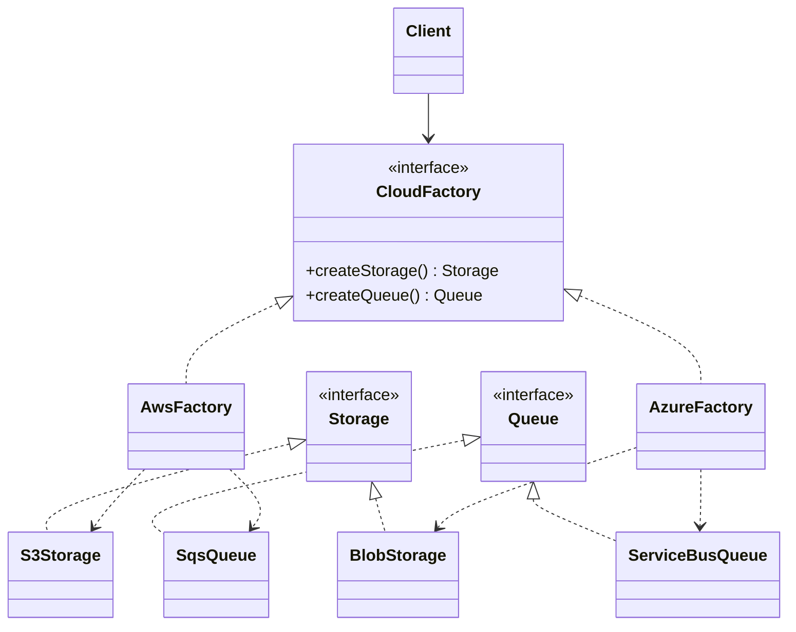

## Intent

**Abstract Factory** groups several factory methods into one object so that a client can create a whole **family** of related products that are guaranteed to work together — without knowing which family it is using.

Think UI toolkits (a *dark* button must go with a *dark* checkbox), cloud providers (an AWS queue with an AWS blob store), or database dialects.

## Structure



## Example

<Playground title="AbstractFactory.java">

```java
interface Storage { void upload(String file); }
interface Queue { void publish(String message); }

// The abstract factory: one method per product in the family
interface CloudFactory {
    Storage createStorage();
    Queue createQueue();
}

// --- AWS family ---
class S3Storage implements Storage {
    public void upload(String file) { System.out.println("S3   ⬆ " + file); }
}
class SqsQueue implements Queue {
    public void publish(String msg) { System.out.println("SQS  ✉ " + msg); }
}
class AwsFactory implements CloudFactory {
    public Storage createStorage() { return new S3Storage(); }
    public Queue createQueue() { return new SqsQueue(); }
}

// --- Azure family ---
class BlobStorage implements Storage {
    public void upload(String file) { System.out.println("Blob ⬆ " + file); }
}
class ServiceBusQueue implements Queue {
    public void publish(String msg) { System.out.println("Bus  ✉ " + msg); }
}
class AzureFactory implements CloudFactory {
    public Storage createStorage() { return new BlobStorage(); }
    public Queue createQueue() { return new ServiceBusQueue(); }
}

// Client code only knows the abstractions
class ReportService {
    private final Storage storage;
    private final Queue queue;

    ReportService(CloudFactory cloud) {
        this.storage = cloud.createStorage();
        this.queue = cloud.createQueue();
    }

    void publishReport(String name) {
        storage.upload(name + ".pdf");
        queue.publish("report-ready:" + name);
    }
}

class Main {
    public static void main(String[] args) {
        String provider = args.length > 0 ? args[0] : "aws";
        CloudFactory factory = switch (provider) {
            case "azure" -> new AzureFactory();
            default -> new AwsFactory();
        };
        new ReportService(factory).publishReport("q3-revenue");
        new ReportService(new AzureFactory()).publishReport("q3-revenue");
    }
}
```

</Playground>

The choice of family is made **once**, at the composition root. Everything downstream is provider-agnostic, and it is impossible to accidentally mix an S3 store with an Azure queue.

## Where you'll see it

- `javax.xml.parsers.DocumentBuilderFactory`, `TransformerFactory` — pluggable XML implementations
- JDBC: a `Connection` acts as a factory for matching `Statement`, `PreparedStatement` and `Blob` objects from the same driver
- Spring profiles: `@Profile("aws")` and `@Profile("azure")` configuration classes that each define a consistent set of beans are Abstract Factory, wired by the container

## Trade-offs

| Pros | Cons |
| --- | --- |
| Guarantees products from one family are used together | Adding a new *product type* changes every factory |
| Swapping families is a one-line change | Many interfaces and classes |
| Isolates concrete classes from clients | Overkill when there is only one family |

<Callout type="warn">
Abstract Factory makes adding a new **family** easy (write a new factory) but adding a new **product** hard (every factory must implement the new method). Choose it when the set of product types is stable.
</Callout>

<Callout type="interview">
Interviewers often ask you to contrast it with **Factory Method**. Short version: Factory Method = *one* product, decided by a subclass or parameter. Abstract Factory = an *object* that produces a *family* of products, chosen by composition. Abstract Factories are frequently implemented *using* factory methods.
</Callout>
