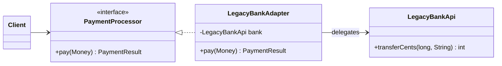

## Intent

**Adapter** (also called *Wrapper*) lets two classes with incompatible interfaces collaborate. The adapter implements the interface your code expects (the **target**) and translates each call into the interface of an existing class (the **adaptee**) — typically a third-party library or legacy system you can't change.

## Structure



This is the **object adapter** (composition). A **class adapter** extends the adaptee instead — possible in Java only when the target is an interface, and generally discouraged because it couples you to the adaptee's implementation.

## Example

Your checkout code works with a clean `PaymentProcessor` interface. You must integrate a legacy bank SDK that speaks in cents, uses status codes and throws its own exceptions.

<Playground title="AdapterDemo.java">

```java
import java.math.BigDecimal;

// --- Target: the interface our application wants ---
record Money(BigDecimal amount, String currency) {}
sealed interface PaymentResult permits Approved, Declined {}
record Approved(String reference) implements PaymentResult {}
record Declined(String reason) implements PaymentResult {}

interface PaymentProcessor {
    PaymentResult pay(Money money);
}

// --- Adaptee: a legacy SDK we cannot modify ---
class LegacyBankApi {
    /** @return 0 = OK, 51 = insufficient funds, 99 = currency not supported */
    int transferCents(long cents, String iso) {
        if (!iso.equals("GBP")) return 99;
        return cents > 50_000 ? 51 : 0;
    }
    String lastTxnId() { return "TXN-" + System.nanoTime() % 100000; }
}

// --- Adapter: translates between the two worlds ---
class LegacyBankAdapter implements PaymentProcessor {
    private final LegacyBankApi bank;

    LegacyBankAdapter(LegacyBankApi bank) { this.bank = bank; }

    @Override
    public PaymentResult pay(Money money) {
        long cents = money.amount().movePointRight(2).longValueExact();
        int code = bank.transferCents(cents, money.currency());
        return switch (code) {
            case 0 -> new Approved(bank.lastTxnId());
            case 51 -> new Declined("Insufficient funds");
            case 99 -> new Declined("Currency " + money.currency() + " not supported");
            default -> new Declined("Unknown bank error " + code);
        };
    }
}

class Main {
    public static void main(String[] args) {
        PaymentProcessor processor = new LegacyBankAdapter(new LegacyBankApi());
        System.out.println(processor.pay(new Money(new BigDecimal("42.50"), "GBP")));
        System.out.println(processor.pay(new Money(new BigDecimal("999.00"), "GBP")));
        System.out.println(processor.pay(new Money(new BigDecimal("10.00"), "USD")));
    }
}
```

</Playground>

Checkout code never sees cents or status codes, and replacing the bank later means writing one new adapter.

## Where you'll see it

- `Arrays.asList(T[])` — adapts an array to the `List` interface
- `InputStreamReader` — adapts a byte `InputStream` to a character `Reader`
- `Collections.enumeration(collection)` / `Collections.list(enumeration)` — adapt between old and new iteration APIs
- Spring MVC's `HandlerAdapter` — lets the `DispatcherServlet` invoke `@Controller` methods, `HttpRequestHandler`s and functional endpoints through one interface
- Spring Security's `UserDetails` — you adapt your own `User` entity to what the framework expects

<Callout type="tip" title="Adapters at the edges">
In **hexagonal architecture** (ports and adapters), every integration with the outside world — databases, message brokers, HTTP APIs — is an adapter behind a port interface owned by the domain. The Adapter pattern at architectural scale.
</Callout>

## Adapter vs similar patterns

| Pattern | Changes the interface? | Purpose |
| --- | --- | --- |
| **Adapter** | Yes — converts to a different one | Make incompatible things work together |
| **Decorator** | No — same interface | Add behaviour |
| **Proxy** | No — same interface | Control access |
| **Facade** | Defines a new, simpler one | Simplify a whole subsystem |

<Callout type="interview">
“Adapter vs Facade?” — an Adapter wraps **one** class to match an **existing** interface the client already expects. A Facade wraps **many** classes behind a **new**, simpler interface. Adapter is about compatibility; Facade is about simplicity.
</Callout>
