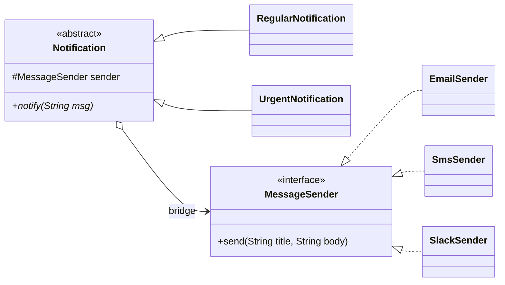

## Intent

**Bridge** splits a large class — or a set of closely related classes — into two separate hierarchies, **abstraction** and **implementation**, connected by composition. Each side can then be extended without touching the other.

## The class explosion problem

Suppose you have notifications of different *urgency* (regular, urgent) delivered over different *channels* (email, SMS, Slack). With inheritance alone you need a class per combination:

```text
RegularEmailNotification   UrgentEmailNotification
RegularSmsNotification     UrgentSmsNotification
RegularSlackNotification   UrgentSlackNotification
```

Add a channel and you write two classes; add an urgency and you write three. The hierarchy grows as **M × N**. Bridge makes it **M + N**.

## Structure



## Example

<Playground title="BridgeDemo.java">

```java
// ---- Implementation hierarchy: HOW a message is delivered ----
interface MessageSender {
    void send(String title, String body);
}

class EmailSender implements MessageSender {
    public void send(String title, String body) {
        System.out.println("[email] Subject: " + title + " | " + body);
    }
}

class SmsSender implements MessageSender {
    public void send(String title, String body) {
        System.out.println("[sms]   " + (title + ": " + body).substring(0, Math.min(40, title.length() + body.length() + 2)));
    }
}

class SlackSender implements MessageSender {
    public void send(String title, String body) {
        System.out.println("[slack] *" + title + "* " + body);
    }
}

// ---- Abstraction hierarchy: WHAT kind of notification it is ----
abstract class Notification {
    protected final MessageSender sender;   // the bridge
    Notification(MessageSender sender) { this.sender = sender; }
    abstract void notify(String message);
}

class RegularNotification extends Notification {
    RegularNotification(MessageSender s) { super(s); }
    void notify(String message) { sender.send("Update", message); }
}

class UrgentNotification extends Notification {
    UrgentNotification(MessageSender s) { super(s); }
    void notify(String message) {
        // urgent notifications retry and shout — independent of the channel
        for (int attempt = 1; attempt <= 2; attempt++) {
            sender.send("URGENT (attempt " + attempt + ")", message.toUpperCase());
        }
    }
}

class Main {
    public static void main(String[] args) {
        new RegularNotification(new EmailSender()).notify("Your invoice is ready");
        new UrgentNotification(new SlackSender()).notify("Production database is down");
        new UrgentNotification(new SmsSender()).notify("Card used abroad");
    }
}
```

</Playground>

Three channels × two urgencies = **five** classes instead of six — and the gap widens quickly: 5 channels × 4 urgencies is 9 classes instead of 20.

## Where you'll see it

- **JDBC** is the textbook Bridge: your code uses the `java.sql` abstraction (`Connection`, `Statement`); each vendor's driver is an independent implementation hierarchy, selected at runtime by `DriverManager`.
- **SLF4J** — the logging API is the abstraction; Logback, Log4j 2 and `java.util.logging` bindings are implementations.
- AWT's peer architecture: `java.awt.Button` delegates to a platform-specific `ButtonPeer`.

## Bridge vs Strategy vs Adapter

| | Bridge | Strategy | Adapter |
| --- | --- | --- | --- |
| Designed | Up-front | Up-front | After the fact |
| Goal | Let two hierarchies vary independently | Swap an algorithm | Make incompatible interfaces fit |
| Structure | Abstraction *hierarchy* holds an implementor | Context holds one strategy | Wrapper translates calls |

<Callout type="interview">
Bridge and Strategy look identical in UML (an object holding an interface). The difference is intent: Strategy swaps **one algorithm** inside a context; Bridge separates **two dimensions of variation**, each with its own subclass hierarchy. If only one side has subclasses, you probably have Strategy.
</Callout>

<Callout type="tip">
Rule of thumb: when you notice class names that are **combinations of two words** (`UrgentSmsNotification`, `WindowsDarkButton`), the two words are your two hierarchies — a Bridge is waiting to happen.
</Callout>
