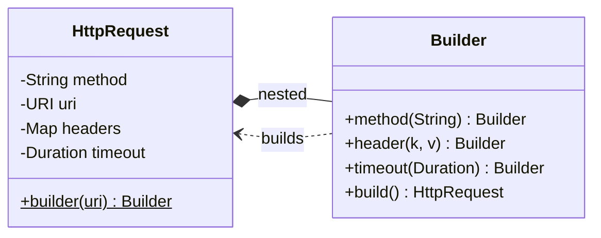

## Intent

**Builder** separates the construction of a complex object from its representation. You configure a mutable builder step by step, then call `build()` to get a finished — usually **immutable** — object, with validation in a single place.

## The problem: telescoping constructors

```java
new Pizza("large", true, false, true, false, null, 2);
// Which boolean is cheese? Which is olives? What is 2?
```

Constructors with many parameters — especially several of the same type — are unreadable and error-prone. JavaBeans-style setters fix readability but leave the object mutable and possibly half-initialised.

## Structure



## Example: a fluent, validated builder

<Playground title="BuilderDemo.java">

```java
import java.time.Duration;
import java.util.*;

final class HttpRequest {
    private final String method;
    private final String url;
    private final Map<String, String> headers;
    private final Duration timeout;
    private final String body;

    private HttpRequest(Builder b) {
        this.method = b.method;
        this.url = b.url;
        this.headers = Collections.unmodifiableMap(new LinkedHashMap<>(b.headers)); // defensive copy
        this.timeout = b.timeout;
        this.body = b.body;
    }

    static Builder builder(String url) { return new Builder(url); }

    @Override public String toString() {
        return method + " " + url + " " + headers + " timeout=" + timeout.toSeconds() + "s"
            + (body == null ? "" : " body=" + body);
    }

    static final class Builder {
        private final String url;                       // required
        private String method = "GET";                  // optional, with defaults
        private final Map<String, String> headers = new LinkedHashMap<>();
        private Duration timeout = Duration.ofSeconds(30);
        private String body;

        private Builder(String url) { this.url = Objects.requireNonNull(url); }

        Builder method(String method) { this.method = method; return this; }
        Builder header(String k, String v) { headers.put(k, v); return this; }
        Builder timeout(Duration t) { this.timeout = t; return this; }
        Builder body(String body) { this.body = body; return this; }

        HttpRequest build() {
            // All cross-field validation lives in one place
            if (body != null && method.equals("GET"))
                throw new IllegalStateException("GET requests cannot have a body");
            if (timeout.isNegative() || timeout.isZero())
                throw new IllegalStateException("timeout must be positive");
            return new HttpRequest(this);
        }
    }
}

class Main {
    public static void main(String[] args) {
        HttpRequest req = HttpRequest.builder("https://api.example.com/orders")
            .method("POST")
            .header("Content-Type", "application/json")
            .header("Authorization", "Bearer •••")
            .timeout(Duration.ofSeconds(5))
            .body("{\"sku\":\"A-42\",\"qty\":2}")
            .build();
        System.out.println(req);

        try {
            HttpRequest.builder("https://api.example.com").body("oops").build();
        } catch (IllegalStateException e) {
            System.out.println("Rejected: " + e.getMessage());
        }
    }
}
```

</Playground>

## Builders and records

For small value objects, a `record` with a compact constructor is usually enough. When a record has many optional components, pair it with a builder:

```java
public record User(String name, String email, int age, List<String> roles) {
    public User {                      // compact constructor validates
        Objects.requireNonNull(name);
        roles = List.copyOf(roles);
    }
    public static Builder builder() { return new Builder(); }

    public static final class Builder {
        private String name, email;
        private int age;
        private List<String> roles = List.of();
        public Builder name(String n)  { this.name = n; return this; }
        public Builder email(String e) { this.email = e; return this; }
        public Builder age(int a)      { this.age = a; return this; }
        public Builder roles(String... r) { this.roles = List.of(r); return this; }
        public User build() { return new User(name, email, age, roles); }
    }
}
```

<Callout type="tip">
Lombok's `@Builder` generates exactly this boilerplate. It's widely used with JPA entities and DTOs — but know how to write one by hand for interviews.
</Callout>

## Where you'll see it

- `StringBuilder`, `Stream.builder()`, `Locale.Builder`
- `java.net.http.HttpClient.newBuilder()` and `HttpRequest.newBuilder()`
- Spring: `UriComponentsBuilder`, `ResponseEntity.ok().header(...).body(...)`, `WebClient.builder()`, `RestClient.builder()`
- Spring Security's `HttpSecurity` DSL and `MockMvcRequestBuilders` in tests

## Trade-offs

| Pros | Cons |
| --- | --- |
| Readable, self-documenting construction | Duplicates every field in the builder |
| Produces immutable, fully-validated objects | More code than a constructor for small types |
| Optional parameters with sensible defaults | A builder is mutable and not thread-safe |

<Callout type="interview">
**Builder vs Factory:** a factory decides *which* class to create in one call; a builder decides *how* to assemble one complex object over several calls. GoF's original Builder also has a **Director** that runs a fixed sequence of builder steps — rarely used in modern Java, but worth mentioning.
</Callout>
