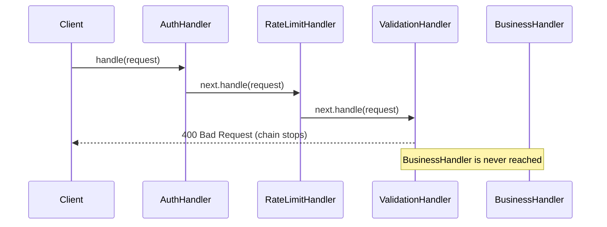

## Intent

**Chain of Responsibility** decouples the sender of a request from its receivers by giving several objects a chance to handle it. Handlers are linked in a chain; each one either handles the request, passes it to the next handler, or both.

There are two common flavours:

- **Classic GoF** — exactly one handler processes the request (e.g. an approval escalates until someone has enough authority).
- **Pipeline / filter chain** — every handler does some work and decides whether to continue (e.g. servlet filters: auth → logging → rate limiting → controller).

## Structure



## Example 1: expense approval (classic)

```java
abstract class Approver {
    private Approver next;
    Approver then(Approver next) { this.next = next; return next; }

    void approve(Expense e) {
        if (canApprove(e)) System.out.println(getClass().getSimpleName() + " approved " + e);
        else if (next != null) next.approve(e);
        else System.out.println("Nobody can approve " + e);
    }
    abstract boolean canApprove(Expense e);
}

class TeamLead extends Approver { boolean canApprove(Expense e) { return e.amount() <= 500; } }
class Manager  extends Approver { boolean canApprove(Expense e) { return e.amount() <= 5_000; } }
class Director extends Approver { boolean canApprove(Expense e) { return e.amount() <= 50_000; } }
```

## Example 2: an HTTP filter pipeline

<Playground title="FilterChainDemo.java">

```java
import java.util.*;

record Request(String path, Map<String, String> headers, String body) {}
record Response(int status, String body) {}

// Each filter receives the request and the rest of the chain
interface Filter {
    Response doFilter(Request req, Chain chain);
}

// The chain walks the list of filters and finally calls the endpoint
final class Chain {
    private final List<Filter> filters;
    private final java.util.function.Function<Request, Response> endpoint;
    private int index = 0;

    Chain(List<Filter> filters, java.util.function.Function<Request, Response> endpoint) {
        this.filters = filters;
        this.endpoint = endpoint;
    }

    Response proceed(Request req) {
        if (index < filters.size()) return filters.get(index++).doFilter(req, this);
        return endpoint.apply(req);
    }
}

class LoggingFilter implements Filter {
    public Response doFilter(Request req, Chain chain) {
        long start = System.nanoTime();
        Response res = chain.proceed(req);                       // continue…
        System.out.printf("  %s -> %d (%d µs)%n", req.path(), res.status(), (System.nanoTime() - start) / 1000);
        return res;                                              // …and post-process
    }
}

class AuthFilter implements Filter {
    public Response doFilter(Request req, Chain chain) {
        String token = req.headers().get("Authorization");
        if (token == null || !token.equals("Bearer secret")) return new Response(401, "Unauthorized"); // stop
        return chain.proceed(req);
    }
}

class ValidationFilter implements Filter {
    public Response doFilter(Request req, Chain chain) {
        if (req.body() == null || req.body().isBlank()) return new Response(400, "Body required");
        return chain.proceed(req);
    }
}

class Main {
    static Response handle(Request req) {
        var filters = List.<Filter>of(new LoggingFilter(), new AuthFilter(), new ValidationFilter());
        return new Chain(filters, r -> new Response(201, "Created order from " + r.body())).proceed(req);
    }

    public static void main(String[] args) {
        System.out.println(handle(new Request("/orders", Map.of("Authorization", "Bearer secret"), "{sku:42}")));
        System.out.println(handle(new Request("/orders", Map.of(), "{sku:42}")));
        System.out.println(handle(new Request("/orders", Map.of("Authorization", "Bearer secret"), "")));
    }
}
```

</Playground>

Notice that `LoggingFilter` wraps the *rest* of the chain, so it can measure the total time and see the final status — even when a later filter short-circuits.

## Where you'll see it

- **Servlet filters**: `jakarta.servlet.Filter.doFilter(request, response, chain)` — the model for the example above
- **Spring Security**: the `SecurityFilterChain` is a chain of ~15 filters (CORS, CSRF, authentication, authorization, exception translation)
- Spring MVC `HandlerInterceptor`s and Spring Cloud Gateway `GatewayFilter`s
- `java.util.logging.Logger` passing records to parent loggers
- Exception handling: `try/catch` blocks up the call stack are a built-in chain of responsibility

## Trade-offs

| Pros | Cons |
| --- | --- |
| Add, remove or reorder handlers without touching the sender | No guarantee a request is handled at all |
| Each handler has a single responsibility | Long chains are hard to debug — which filter rejected it? |
| Handlers can be reused across chains | Ordering bugs (e.g. logging after auth hides failed logins) |

<Callout type="interview">
In Spring Security interviews you may be asked how a request flows: `DelegatingFilterProxy` → `FilterChainProxy` → the matching `SecurityFilterChain` → filters such as `UsernamePasswordAuthenticationFilter` / `BearerTokenAuthenticationFilter` → `AuthorizationFilter` → your controller. That is Chain of Responsibility end to end.
</Callout>
