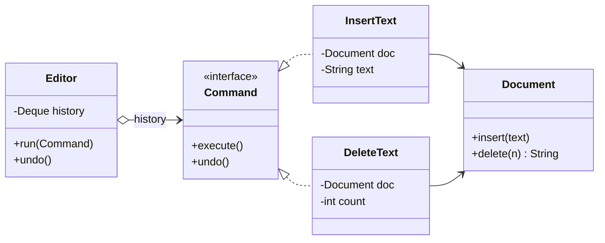

## Intent

**Command** encapsulates a request — *what* to do and *with which data* — as an object. Once an action is an object you can pass it around, store it in a queue, log it, execute it later, retry it, or **undo** it.

The roles:

- **Command** — interface with `execute()` (and optionally `undo()`)
- **Concrete command** — binds a receiver to an action and its parameters
- **Receiver** — the object that does the real work
- **Invoker** — triggers commands without knowing what they do (a button, a scheduler, a job queue)

## Structure



## Example: an editor with undo and redo

<Playground title="CommandDemo.java">

```java
import java.util.*;

class Document {                                 // receiver
    private final StringBuilder text = new StringBuilder();
    void insert(String s) { text.append(s); }
    String delete(int n) {
        int from = Math.max(0, text.length() - n);
        String removed = text.substring(from);
        text.setLength(from);
        return removed;
    }
    public String toString() { return "\"" + text + "\""; }
}

interface Command {                              // command
    void execute();
    void undo();
}

record Insert(Document doc, String text) implements Command {
    public void execute() { doc.insert(text); }
    public void undo() { doc.delete(text.length()); }
}

final class Delete implements Command {
    private final Document doc;
    private final int count;
    private String removed = "";                 // state captured for undo
    Delete(Document doc, int count) { this.doc = doc; this.count = count; }
    public void execute() { removed = doc.delete(count); }
    public void undo() { doc.insert(removed); }
}

class Editor {                                   // invoker
    private final Deque<Command> undo = new ArrayDeque<>();
    private final Deque<Command> redo = new ArrayDeque<>();

    void run(Command c) { c.execute(); undo.push(c); redo.clear(); }
    void undo() { if (!undo.isEmpty()) { Command c = undo.pop(); c.undo(); redo.push(c); } }
    void redo() { if (!redo.isEmpty()) { Command c = redo.pop(); c.execute(); undo.push(c); } }
}

class Main {
    public static void main(String[] args) {
        var doc = new Document();
        var editor = new Editor();

        editor.run(new Insert(doc, "Hello"));
        editor.run(new Insert(doc, ", world"));
        editor.run(new Delete(doc, 5));
        System.out.println("after edits: " + doc);
        editor.undo();
        System.out.println("undo:        " + doc);
        editor.undo();
        System.out.println("undo:        " + doc);
        editor.redo();
        System.out.println("redo:        " + doc);
        editor.run(new Insert(doc, "!"));
        System.out.println("new edit:    " + doc + " (redo history cleared)");
    }
}
```

</Playground>

## Commands as lambdas

If you don't need undo, a command is just “some code to run later” — which is exactly what `Runnable`, `Callable` and `Supplier` are:

```java
ExecutorService pool = Executors.newVirtualThreadPerTaskExecutor();
Runnable sendEmail = () -> mailer.send(to, subject, body);   // a command object
pool.submit(sendEmail);                                       // the executor is the invoker
```

## Where you'll see it

- `Runnable` / `Callable` submitted to an `ExecutorService` — the executor is the invoker
- `javax.swing.Action` — the same command bound to a menu item, toolbar button and keyboard shortcut
- **CQRS**: write operations are modelled as command objects (`PlaceOrderCommand`) handled by command handlers
- Job queues (Spring Batch steps, Quartz jobs, messages on Kafka/RabbitMQ) — a serialised command executed by another process
- Database migrations (Flyway/Liquibase) — ordered, logged commands, some with undo scripts
- Spring's `JdbcTemplate.execute(ConnectionCallback)` — callbacks are commands

<Callout type="tip">
To support undo, a command must capture enough state **at execution time** to reverse itself — note how `Delete` remembers the removed text. For complex objects, combine Command with **Memento**: snapshot before executing, restore on undo.
</Callout>

<Callout type="interview">
**Command vs Strategy:** both wrap behaviour in an object. A *strategy* is a different way of doing the **same** job, chosen by the context (e.g. a sorting algorithm). A *command* is a **specific request** with its parameters bound, often stored and executed later by someone else.
</Callout>
