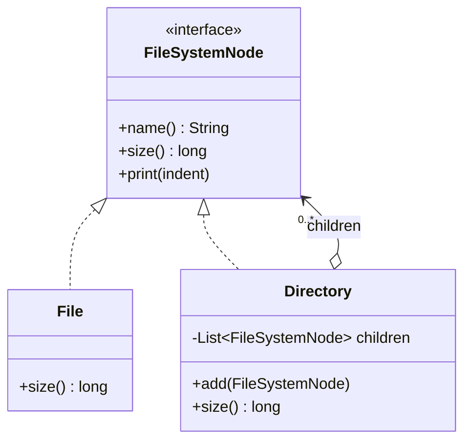

## Intent

**Composite** lets you build **part–whole hierarchies** — trees — where a single element (*leaf*) and a group of elements (*composite*) share the same interface. Client code can then call `size()`, `render()` or `price()` on anything in the tree without caring whether it is one item or a thousand.

## Structure



The key is the recursive aggregation: a `Directory` holds `FileSystemNode`s, which may themselves be directories.

## Example

<Playground title="CompositeDemo.java">

```java
import java.util.*;

sealed interface Node permits File, Directory {
    String name();
    long size();
    void print(String indent);
}

record File(String name, long size) implements Node {
    public void print(String indent) {
        System.out.printf("%s📄 %s (%,d B)%n", indent, name, size);
    }
}

final class Directory implements Node {
    private final String name;
    private final List<Node> children = new ArrayList<>();

    Directory(String name, Node... nodes) {
        this.name = name;
        children.addAll(List.of(nodes));
    }

    public String name() { return name; }

    // The composite delegates to its children — recursion does the work
    public long size() {
        return children.stream().mapToLong(Node::size).sum();
    }

    public void print(String indent) {
        System.out.printf("%s📁 %s/ (%,d B)%n", indent, name, size());
        children.forEach(c -> c.print(indent + "   "));
    }
}

class Main {
    public static void main(String[] args) {
        Node project = new Directory("app",
            new File("pom.xml", 2_300),
            new Directory("src",
                new Directory("main",
                    new File("Application.java", 1_200),
                    new File("OrderService.java", 4_800)),
                new Directory("test",
                    new File("OrderServiceTest.java", 3_100))),
            new File("README.md", 900));

        project.print("");
        System.out.println("Total: " + project.size() + " bytes");

        // Client code is identical for leaves and composites
        List<Node> selection = List.of(new File("notes.txt", 50), project);
        System.out.println("Selection size: " + selection.stream().mapToLong(Node::size).sum());
    }
}
```

</Playground>

## Design decision: where do child operations live?

| Approach | `add`/`remove` declared on… | Trade-off |
| --- | --- | --- |
| **Safety** (above) | `Directory` only | Clients must know they hold a composite to add children |
| **Transparency** | The common interface | Uniform, but leaves must throw or ignore `add` — an LSP smell |

Modern Java usually favours safety, especially with a **sealed** interface: a `switch` over `Node` tells you exactly when you are dealing with a `Directory`.

## Where you'll see it

- **UI component trees**: Swing's `Container extends Component`; React and Angular component trees
- **DOM / XML**: `org.w3c.dom.Node` — elements contain nodes
- **Expression trees and ASTs** — compilers, rule engines, the Interpreter pattern
- Spring's `CompositeCacheManager`, `CompositePropertySource` and `HandlerMethodArgumentResolverComposite` — a composite that tries each child in turn
- Organisation charts, menus, bills of materials, permission groups

<Callout type="warn">
Watch for **cycles**: if a directory can be added to its own descendant, `size()` recurses forever. Validate on `add`, or keep parent references and check ancestry.
</Callout>

<Callout type="interview">
Composite pairs naturally with **Iterator** (walk the tree), **Visitor** (run operations over the tree without adding methods to every node) and **Decorator** (both rely on recursive composition — but a decorator wraps exactly *one* component to add behaviour, while a composite aggregates *many* to represent a whole).
</Callout>
