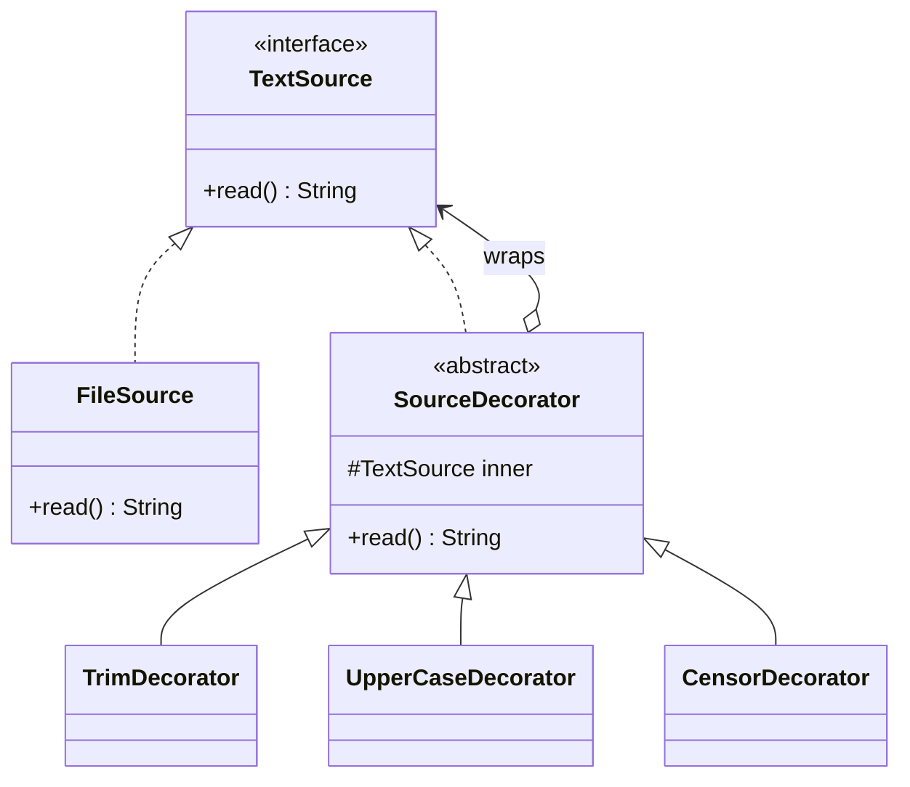

## Intent

**Decorator** wraps an object in another object that has the **same interface**, adding behaviour before or after delegating to it. Because decorators are themselves components, they can be **stacked** in any order at runtime.

## Why not subclassing?

To add logging, caching and retries to a `DataSource` via inheritance you need `LoggingDataSource`, `CachingDataSource`, `LoggingCachingDataSource`, `RetryingLoggingCachingDataSource`… — one class per combination. Decorators let you compose them instead:

```java
DataSource ds = new Retrying(new Caching(new Logging(new HttpDataSource())));
```

## Structure



## Example: a coffee order, the classic way

<Playground title="DecoratorDemo.java">

```java
import java.math.BigDecimal;

interface Beverage {
    String description();
    BigDecimal cost();
}

record Espresso() implements Beverage {
    public String description() { return "Espresso"; }
    public BigDecimal cost() { return new BigDecimal("2.00"); }
}

// Base decorator: delegates everything to the wrapped beverage
abstract class AddOn implements Beverage {
    protected final Beverage inner;
    AddOn(Beverage inner) { this.inner = inner; }
    public String description() { return inner.description(); }
    public BigDecimal cost() { return inner.cost(); }
}

class Milk extends AddOn {
    Milk(Beverage b) { super(b); }
    public String description() { return inner.description() + " + milk"; }
    public BigDecimal cost() { return inner.cost().add(new BigDecimal("0.40")); }
}

class Caramel extends AddOn {
    Caramel(Beverage b) { super(b); }
    public String description() { return inner.description() + " + caramel"; }
    public BigDecimal cost() { return inner.cost().add(new BigDecimal("0.55")); }
}

class Large extends AddOn {
    Large(Beverage b) { super(b); }
    public String description() { return "Large " + inner.description(); }
    public BigDecimal cost() { return inner.cost().multiply(new BigDecimal("1.3")).setScale(2, java.math.RoundingMode.HALF_UP); }
}

class Main {
    public static void main(String[] args) {
        Beverage order = new Large(new Caramel(new Milk(new Milk(new Espresso()))));
        System.out.println(order.description() + " = £" + order.cost());

        // Order matters: size applied before vs after the extras
        Beverage other = new Caramel(new Large(new Espresso()));
        System.out.println(other.description() + " = £" + other.cost());
    }
}
```

</Playground>

## Functional decorators

When the component interface is a single method, decorators can be plain functions. `Function.andThen` and `compose` are decorator stacking in disguise:

```java
UnaryOperator<String> trim = String::strip;
UnaryOperator<String> upper = String::toUpperCase;
Function<String, String> pipeline = trim.andThen(upper).andThen(s -> s.replace("SECRET", "******"));

pipeline.apply("  the secret plan  ");   // "THE ****** PLAN"
```

## Where you'll see it

- **`java.io`** is built on decorators: `new BufferedReader(new InputStreamReader(new GZIPInputStream(new FileInputStream(f))))` — each layer adds buffering, decoding or decompression
- `Collections.unmodifiableList(list)`, `Collections.synchronizedMap(map)`, `Collections.checkedList(...)`
- Spring: `TransactionAwareDataSourceProxy`, `ContentCachingRequestWrapper`, `HttpServletRequestWrapper` used inside servlet filters
- Spring Cloud / Resilience4j: decorating a `Supplier` with a circuit breaker, then a retry, then a rate limiter

<Callout type="tip">
A decorator must honour the wrapped interface's contract (Liskov). It can add behaviour, but callers that worked with the plain object must keep working with the decorated one.
</Callout>

## Trade-offs

| Pros | Cons |
| --- | --- |
| Add or remove behaviour at runtime | Lots of small wrapper objects; debugging stack traces gets deep |
| Combine features freely — no class explosion | Order of wrapping matters and can surprise |
| Each decorator has a single responsibility | Identity checks (`==`) on the wrapped object break |

<Callout type="interview">
**Decorator vs Proxy:** both wrap an object with the same interface. A *decorator* is about **adding behaviour** and is usually composed by the client, often several layers deep. A *proxy* is about **controlling access** (lazy loading, security, remote calls, transactions) and usually manages its subject's lifecycle itself. Spring AOP proxies blur the line — `@Transactional` is technically a proxy that decorates your method with transaction handling.
</Callout>
