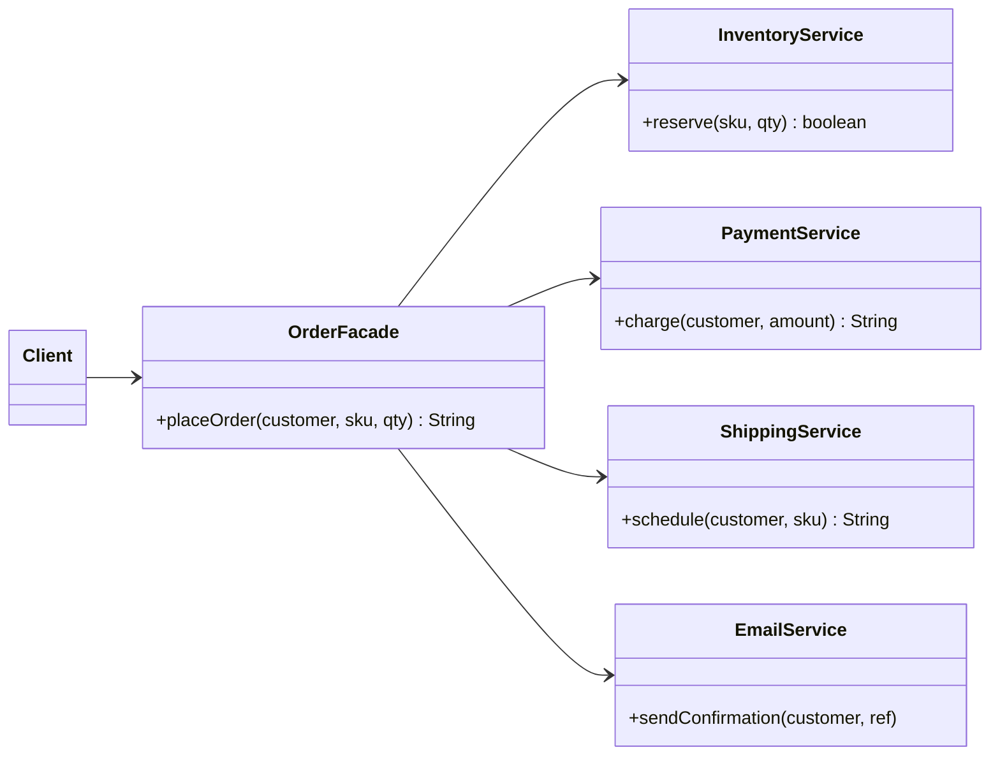

## Intent

**Facade** offers one high-level entry point to a set of lower-level classes. Clients call `placeOrder(...)` instead of orchestrating inventory, payment, shipping and notification services themselves. The subsystem classes remain available for clients that need fine-grained control — the facade just makes the common case easy.

## Structure



## Example

<Playground title="FacadeDemo.java">

```java
import java.util.*;

// ---- A subsystem with several moving parts ----
class InventoryService {
    private final Map<String, Integer> stock = new HashMap<>(Map.of("BOOK-1", 10, "MUG-7", 0));
    boolean reserve(String sku, int qty) {
        int available = stock.getOrDefault(sku, 0);
        if (available < qty) return false;
        stock.put(sku, available - qty);
        return true;
    }
    void release(String sku, int qty) { stock.merge(sku, qty, Integer::sum); }
}

class PricingService {
    double priceOf(String sku) { return sku.startsWith("BOOK") ? 24.99 : 9.99; }
}

class PaymentService {
    String charge(String customer, double amount) {
        if (amount > 100) throw new IllegalStateException("Card limit exceeded");
        return "PAY-" + Math.abs((customer + amount).hashCode() % 10000);
    }
}

class ShippingService {
    String schedule(String customer, String sku) { return "SHIP-" + sku.hashCode() % 1000; }
}

class EmailService {
    void send(String to, String text) { System.out.println("  ✉ to " + to + ": " + text); }
}

// ---- The facade: one method that orchestrates the workflow ----
class OrderFacade {
    private final InventoryService inventory = new InventoryService();
    private final PricingService pricing = new PricingService();
    private final PaymentService payments = new PaymentService();
    private final ShippingService shipping = new ShippingService();
    private final EmailService email = new EmailService();

    String placeOrder(String customer, String sku, int qty) {
        if (!inventory.reserve(sku, qty)) return "FAILED: " + sku + " out of stock";
        try {
            String payment = payments.charge(customer, pricing.priceOf(sku) * qty);
            String shipment = shipping.schedule(customer, sku);
            email.send(customer, "Order confirmed (" + payment + ", " + shipment + ")");
            return "OK: " + payment;
        } catch (RuntimeException e) {
            inventory.release(sku, qty);   // compensate on failure
            return "FAILED: " + e.getMessage();
        }
    }
}

class Main {
    public static void main(String[] args) {
        var shop = new OrderFacade();
        System.out.println(shop.placeOrder("ada@example.com", "BOOK-1", 2));
        System.out.println(shop.placeOrder("bob@example.com", "MUG-7", 1));
        System.out.println(shop.placeOrder("cy@example.com", "BOOK-1", 5));
    }
}
```

</Playground>

## Facade in Spring applications

In a typical Spring Boot service, an **application service** is a facade: a `@Service` method annotated with `@Transactional` that coordinates repositories, domain objects and external clients for one use case. Controllers call the facade; they never orchestrate repositories directly.

```java
@Service
@RequiredArgsConstructor
public class CheckoutService {              // facade over the ordering subsystem
    private final InventoryClient inventory;
    private final PaymentClient payments;
    private final OrderRepository orders;
    private final ApplicationEventPublisher events;

    @Transactional
    public OrderId checkout(CheckoutCommand cmd) { /* orchestrate */ }
}
```

## Where you'll see it

- `javax.faces.context.FacesContext`, `java.net.URL.openStream()` (hides `URLConnection`, protocol handlers and streams)
- Spring's `JdbcTemplate` — a facade over `DataSource`, `Connection`, `PreparedStatement`, `ResultSet` and exception translation
- SLF4J's `LoggerFactory` (also a Bridge)
- The **API Gateway / Backend-for-Frontend** pattern in microservices is a facade at architectural scale

<Callout type="warn" title="Don't build a god object">
A facade should *delegate*, not *implement* business logic. If your facade grows to dozens of methods and starts containing rules, split it by use case or move the logic into the domain objects behind it.
</Callout>

<Callout type="interview">
Facade promotes the **Principle of Least Knowledge** (Law of Demeter): clients talk to one friend instead of reaching through a chain of collaborators. Contrast with **Mediator**: a facade is a one-way simplification for clients; a mediator coordinates *two-way* communication between peers that would otherwise reference each other.
</Callout>
