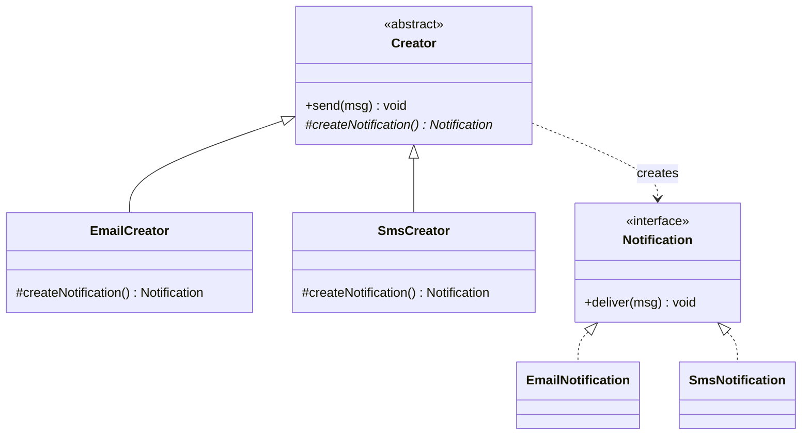

## Intent

**Factory Method** moves the `new` keyword behind a method so that callers depend on an abstraction rather than a concrete class. The creator declares a method that returns a product interface; subclasses (or a lookup table) decide which concrete product to build.

## Problem

```java
Notification n;
if (channel.equals("EMAIL")) n = new EmailNotification();
else if (channel.equals("SMS")) n = new SmsNotification();
else if (channel.equals("PUSH")) n = new PushNotification();
```

This `if` chain gets copied into every place that needs a notification. Adding a channel means hunting down every copy.

## Structure



## Classic GoF version

The base class contains the workflow and calls an abstract **factory method**; subclasses override it.

```java
abstract class NotificationSender {
    // the template that uses the product
    public void send(String message) {
        Notification n = createNotification();   // factory method
        n.deliver(message);
    }

    protected abstract Notification createNotification();
}

class EmailSender extends NotificationSender {
    @Override protected Notification createNotification() { return new EmailNotification(); }
}
```

## Modern Java version

Most Java code today uses a **static factory** or a **registry of suppliers** instead of subclassing. Here is a runnable version combining a sealed interface, records and a `switch` expression:

<Playground title="FactoryMethod.java">

```java
import java.util.*;
import java.util.function.Supplier;

sealed interface Notification permits Email, Sms, Push {
    void deliver(String to, String message);
}

record Email() implements Notification {
    public void deliver(String to, String msg) { System.out.println("📧 EMAIL to " + to + ": " + msg); }
}
record Sms() implements Notification {
    public void deliver(String to, String msg) { System.out.println("📱 SMS to " + to + ": " + msg); }
}
record Push() implements Notification {
    public void deliver(String to, String msg) { System.out.println("🔔 PUSH to " + to + ": " + msg); }
}

enum Channel { EMAIL, SMS, PUSH }

final class Notifications {
    private Notifications() {}

    // Static factory method — callers never see the concrete classes
    static Notification of(Channel channel) {
        return switch (channel) {
            case EMAIL -> new Email();
            case SMS -> new Sms();
            case PUSH -> new Push();
        };
    }

    // Registry variant: new channels can be registered at runtime (e.g. plugins)
    private static final Map<String, Supplier<Notification>> REGISTRY = new HashMap<>(Map.of(
        "email", Email::new,
        "sms", Sms::new));

    static Notification byName(String name) {
        var supplier = REGISTRY.get(name.toLowerCase());
        if (supplier == null) throw new IllegalArgumentException("Unknown channel: " + name);
        return supplier.get();
    }
}

class Main {
    public static void main(String[] args) {
        for (Channel c : Channel.values()) {
            Notifications.of(c).deliver("ada@example.com", "Your build passed");
        }
        Notifications.byName("SMS").deliver("+44 7700 900000", "Code: 123456");
    }
}
```

</Playground>

<Callout type="tip">
The exhaustive `switch` over an enum (or a sealed interface) is checked by the compiler: add a new `Channel` constant and every factory `switch` that misses it stops compiling. That's the Open/Closed Principle with a safety net.
</Callout>

## Where you'll see it

- `List.of()`, `Optional.of()`, `Path.of()`, `LocalDate.of()` — static factory methods
- `Calendar.getInstance()`, `NumberFormat.getInstance(locale)` — return a subclass chosen at runtime
- `Executors.newFixedThreadPool(n)` — hides `ThreadPoolExecutor`'s constructor
- Spring's `FactoryBean<T>` and `@Bean` methods — factory methods managed by the container

## Pros and cons

| Pros | Cons |
| --- | --- |
| Callers depend on an interface, not concrete classes | Classic form needs a creator subclass per product |
| Creation logic lives in one place | Extra indirection for simple cases |
| Can return cached instances or subtypes | Static factories can't be overridden in tests |

<Callout type="interview">
**Factory Method vs Abstract Factory:** Factory Method creates *one* product through a single method (often via inheritance). Abstract Factory creates *families* of related products through an object with several factory methods (via composition). Also note **static factory method** (Effective Java item 1) is not the GoF pattern, though interviewers often accept it as the modern idiom.
</Callout>
