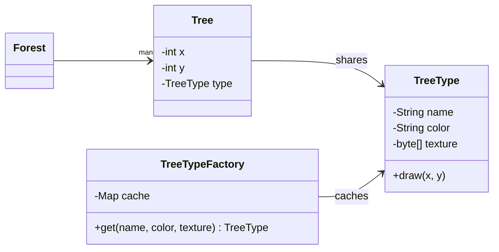

## Intent

**Flyweight** lets you fit far more objects into memory by **sharing** the parts of their state that are identical. Each object's state is split in two:

- **Intrinsic state** — immutable and shared (a tree species' texture, a glyph's font outline)
- **Extrinsic state** — unique per use and passed in or stored separately (a tree's x/y position, a glyph's position on the page)

A **factory** caches flyweights so that identical intrinsic state is stored only once.

## Structure



## Example: a forest of a million trees

<Playground title="FlyweightDemo.java">

```java
import java.util.*;
import java.util.concurrent.ConcurrentHashMap;

// Intrinsic, shared, immutable state — the flyweight
record TreeType(String species, String color, byte[] texture) {
    void draw(int x, int y) { /* render texture at (x, y) */ }
}

// Factory guarantees one TreeType per distinct key
final class TreeTypes {
    private static final Map<String, TreeType> CACHE = new ConcurrentHashMap<>();
    static TreeType of(String species, String color) {
        return CACHE.computeIfAbsent(species + "|" + color,
            k -> new TreeType(species, color, new byte[50_000])); // pretend 50 KB texture
    }
    static int count() { return CACHE.size(); }
}

// Extrinsic state — small and unique per tree
record Tree(int x, int y, TreeType type) {}

class Main {
    public static void main(String[] args) {
        String[][] kinds = { {"Oak", "green"}, {"Pine", "dark-green"}, {"Birch", "white"}, {"Maple", "red"} };
        var rnd = new Random(42);
        List<Tree> forest = new ArrayList<>();
        for (int i = 0; i < 1_000_000; i++) {
            String[] k = kinds[rnd.nextInt(kinds.length)];
            forest.add(new Tree(rnd.nextInt(10_000), rnd.nextInt(10_000), TreeTypes.of(k[0], k[1])));
        }

        long sharedBytes = TreeTypes.count() * 50_000L;
        long naiveBytes = forest.size() * 50_000L;
        System.out.printf("Trees: %,d  distinct TreeTypes: %d%n", forest.size(), TreeTypes.count());
        System.out.printf("Texture memory with flyweights: %,d KB%n", sharedBytes / 1024);
        System.out.printf("Texture memory without:         %,d MB%n", naiveBytes / 1024 / 1024);
        System.out.println("Same instance shared? " + (forest.get(0).type() == TreeTypes.of(forest.get(0).type().species(), forest.get(0).type().color())));
    }
}
```

</Playground>

Without flyweights, a million trees with their own 50 KB textures would need ~47 GB. With four shared `TreeType`s, the textures take 195 KB.

## Flyweights in the JDK

You use flyweights every day:

```java
Integer a = 127, b = 127;
System.out.println(a == b);   // true  — cached by Integer.valueOf (range -128..127)
Integer c = 128, d = 128;
System.out.println(c == d);   // false — outside the cache, two objects

String s1 = "hello", s2 = "hello";
System.out.println(s1 == s2); // true  — string literals are interned in the string pool
```

- `Integer.valueOf`, `Long.valueOf`, `Short.valueOf`, `Byte.valueOf`, `Character.valueOf` and `Boolean.valueOf` caches
- The **String pool** and `String.intern()`
- `Enum` constants and `BigDecimal.ZERO`/`ONE`/`TEN`
- `Collections.emptyList()` / `List.of()` returning shared empty instances

<Callout type="danger">
Never compare boxed numbers with `==`. It *appears* to work for small values because of the flyweight cache, then fails in production for value 128. Always use `equals`, or unbox first.
</Callout>

## Trade-offs

| Pros | Cons |
| --- | --- |
| Huge memory savings for many similar objects | Code is more complex: state is split in two |
| Fewer allocations, less GC pressure | Flyweights **must** be immutable |
| Factory cache gives identity-based equality for free | Extrinsic state must be computed or passed on every call |

<Callout type="interview">
Typical follow-up: *“Why must flyweights be immutable?”* Because they are shared by many clients — if one client mutates a shared `TreeType`, every tree using it changes. It is also why the `Integer` cache is safe: `Integer` is immutable. Mention **Project Valhalla** value classes as the future of memory-dense Java objects.
</Callout>
