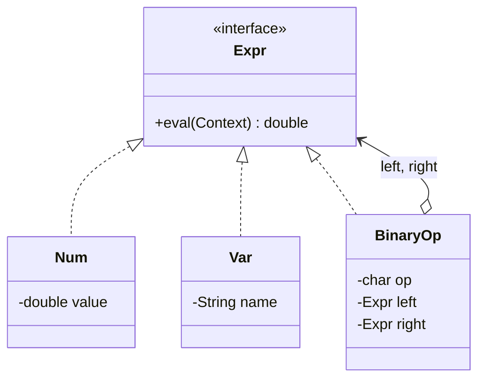

## Intent

**Interpreter** defines a class for each rule in a simple grammar. A sentence in the language is parsed into an **abstract syntax tree (AST)** of those classes, and evaluating the sentence means calling `interpret()` on the root, which recursively interprets its children.

Use it for **small, stable languages**: feature-flag rules, pricing formulas, search filters, permission expressions. For anything larger, use a parser generator (ANTLR) or an existing expression language.

## Structure



Terminal expressions (`Num`, `Var`) are leaves; non-terminal expressions (`BinaryOp`) contain other expressions — Interpreter is a **Composite** with evaluation semantics.

## Example: an arithmetic formula language

Grammar:

```text
expr   := term (('+' | '-') term)*
term   := factor (('*' | '/') factor)*
factor := NUMBER | IDENT | '(' expr ')'
```

<Playground title="InterpreterDemo.java">

```java
import java.util.*;

// ---- AST: one type per grammar rule ----
sealed interface Expr permits Num, Var, Bin {}
record Num(double value) implements Expr {}
record Var(String name) implements Expr {}
record Bin(char op, Expr left, Expr right) implements Expr {}

// ---- Interpreter: evaluate by recursive pattern matching ----
final class Eval {
    static double eval(Expr e, Map<String, Double> ctx) {
        return switch (e) {
            case Num n -> n.value();
            case Var v -> Optional.ofNullable(ctx.get(v.name()))
                                  .orElseThrow(() -> new IllegalArgumentException("Unknown variable " + v.name()));
            case Bin(char op, Expr l, Expr r) -> switch (op) {
                case '+' -> eval(l, ctx) + eval(r, ctx);
                case '-' -> eval(l, ctx) - eval(r, ctx);
                case '*' -> eval(l, ctx) * eval(r, ctx);
                case '/' -> eval(l, ctx) / eval(r, ctx);
                default -> throw new IllegalStateException("op " + op);
            };
        };
    }

    static String show(Expr e) {
        return switch (e) {
            case Num n -> n.value() % 1 == 0 ? String.valueOf((long) n.value()) : String.valueOf(n.value());
            case Var v -> v.name();
            case Bin b -> "(" + show(b.left()) + " " + b.op() + " " + show(b.right()) + ")";
        };
    }
}

// ---- Recursive-descent parser: text -> AST ----
final class Parser {
    private final String s;
    private int pos;
    Parser(String s) { this.s = s.replace(" ", ""); }

    static Expr parse(String text) {
        Parser p = new Parser(text);
        Expr e = p.expr();
        if (p.pos != p.s.length()) throw new IllegalArgumentException("Unexpected '" + p.s.charAt(p.pos) + "'");
        return e;
    }

    private Expr expr() {
        Expr e = term();
        while (peek('+') || peek('-')) { char op = s.charAt(pos++); e = new Bin(op, e, term()); }
        return e;
    }
    private Expr term() {
        Expr e = factor();
        while (peek('*') || peek('/')) { char op = s.charAt(pos++); e = new Bin(op, e, factor()); }
        return e;
    }
    private Expr factor() {
        if (peek('(')) { pos++; Expr e = expr(); pos++; return e; }
        int start = pos;
        if (Character.isLetter(s.charAt(pos))) {
            while (pos < s.length() && Character.isLetterOrDigit(s.charAt(pos))) pos++;
            return new Var(s.substring(start, pos));
        }
        while (pos < s.length() && (Character.isDigit(s.charAt(pos)) || s.charAt(pos) == '.')) pos++;
        return new Num(Double.parseDouble(s.substring(start, pos)));
    }
    private boolean peek(char c) { return pos < s.length() && s.charAt(pos) == c; }
}

class Main {
    public static void main(String[] args) {
        String formula = "price * qty * (1 - discount) + shipping";
        Expr ast = Parser.parse(formula);
        System.out.println("AST:    " + Eval.show(ast));

        Map<String, Double> order = Map.of("price", 19.99, "qty", 3.0, "discount", 0.1, "shipping", 4.5);
        System.out.printf("Result: %.2f%n", Eval.eval(ast, order));

        System.out.println(Eval.eval(Parser.parse("2 + 3 * 4"), Map.of()));
        System.out.println(Eval.eval(Parser.parse("(2 + 3) * 4"), Map.of()));
    }
}
```

</Playground>

<Callout type="tip">
Java 21's **record patterns** (`case Bin(char op, Expr l, Expr r)`) and sealed interfaces make interpreters dramatically shorter than the classic GoF version, where every node class had its own `interpret()` method. This is the functional-programming way: data types plus a function that pattern-matches over them.
</Callout>

## Where you'll see it

- `java.util.regex.Pattern` — compiles a regex into a tree of node objects that are then interpreted against input
- **Spring Expression Language (SpEL)** — `@Value("#{systemProperties['user.region']}")`, `@PreAuthorize("hasRole('ADMIN') and #id == principal.id")`
- Spring Data derived queries — `findByLastNameAndAgeGreaterThan` is parsed into a `PartTree` and interpreted into SQL
- `java.text.Format` subclasses (`MessageFormat`, `SimpleDateFormat`) — interpret pattern strings
- Rule engines (Drools), JSONPath, SQL `WHERE` clause builders, the Criteria API

## Trade-offs

| Pros | Cons |
| --- | --- |
| Grammar rules map 1:1 to classes — easy to extend | One class per rule — explodes for real languages |
| Easy to add new ways to evaluate (pretty-print, optimise) | Slow for complex grammars compared to compiled approaches |
| Great fit for user-configurable business rules | You must write (or generate) a parser |

<Callout type="interview">
Interpreter is the least frequently used GoF pattern in day-to-day work, so interviewers mostly check you know **what it is** and **where it exists** (regex, SpEL, SQL parsers). Mentioning that it is structurally a Composite, and that Visitor is often used to add operations over the AST, shows depth.
</Callout>
