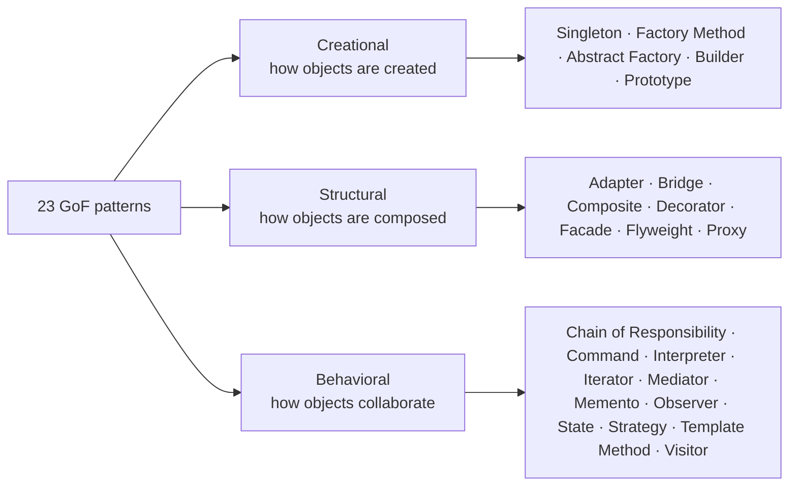

## Patterns are named solutions

A **design pattern** is a reusable, named solution to a problem that keeps recurring in object-oriented design. The term was popularised by the 1994 book *Design Patterns: Elements of Reusable Object-Oriented Software* by Gamma, Helm, Johnson and Vlissides — the **Gang of Four (GoF)**.

A pattern is not a library you import. It is a *shape* for your classes and their collaborations, plus the vocabulary to discuss it. Saying “wrap it in a **Decorator**” in a code review communicates a whole design in three words.

Every pattern in this track is described with the same structure:

- **Intent** — the problem in one or two sentences
- **Structure** — a UML class or sequence diagram
- **Runnable example** — modern Java 21 you can edit and run in the browser
- **Real-world usage** — where the JDK and Spring already use it
- **Trade-offs and interview notes**

## The three families

| Family | Question it answers | Patterns |
| --- | --- | --- |
| **Creational** | How do I create objects without hard-wiring concrete classes? | 5 |
| **Structural** | How do I assemble classes and objects into larger structures? | 7 |
| **Behavioral** | How do objects divide responsibilities and talk to each other? | 11 |

## Patterns you already use

Java and Spring are full of patterns. Recognising them makes framework code far less magical:

| You write… | Pattern behind it |
| --- | --- |
| `List.of(...)`, `LocalDate.of(...)` | Static factory method |
| `StringBuilder`, `HttpRequest.newBuilder()` | Builder |
| `new BufferedReader(new FileReader(f))` | Decorator |
| `Arrays.asList(array)` | Adapter |
| `@Transactional` on a bean | Proxy |
| `Comparator.comparing(...)` | Strategy |
| `JdbcTemplate`, `RestTemplate` | Template Method (via callbacks) |
| `ApplicationEventPublisher` | Observer |
| Servlet `Filter` chain, Spring Security | Chain of Responsibility |

## Modern Java changes the picture

Several classic patterns get dramatically lighter in Java 21:

- **Strategy**, **Command** and **Observer** often collapse into a lambda or method reference.
- **Visitor** can be replaced by **sealed interfaces + pattern matching** in `switch`.
- **Singleton** is best written as an `enum` — or not written at all because your DI container manages lifecycles.
- **Value objects** that used to need builders and hand-written `equals` are now `record`s.

<Callout type="tip" title="How to study this track">
Don't memorise UML. For each pattern, be able to answer three questions: *What problem does it solve? What does the code look like? What does it cost?* If you can explain the trade-off, you understand the pattern.
</Callout>

<Callout type="interview">
A strong answer to “Which design patterns have you used?” names a pattern, the concrete problem it solved in your project, and the alternative you rejected. “We used Strategy for pricing rules so new promotions didn't touch the checkout service” beats a list of pattern names.
</Callout>

## Anti-pattern warning

Patterns add indirection. Indirection has a cost: more types, more files, harder navigation. Apply a pattern when you feel the pain it removes — duplicated `switch` statements, classes that change for unrelated reasons, untestable dependencies — not pre-emptively. **YAGNI** (you aren't gonna need it) applies to patterns too.
