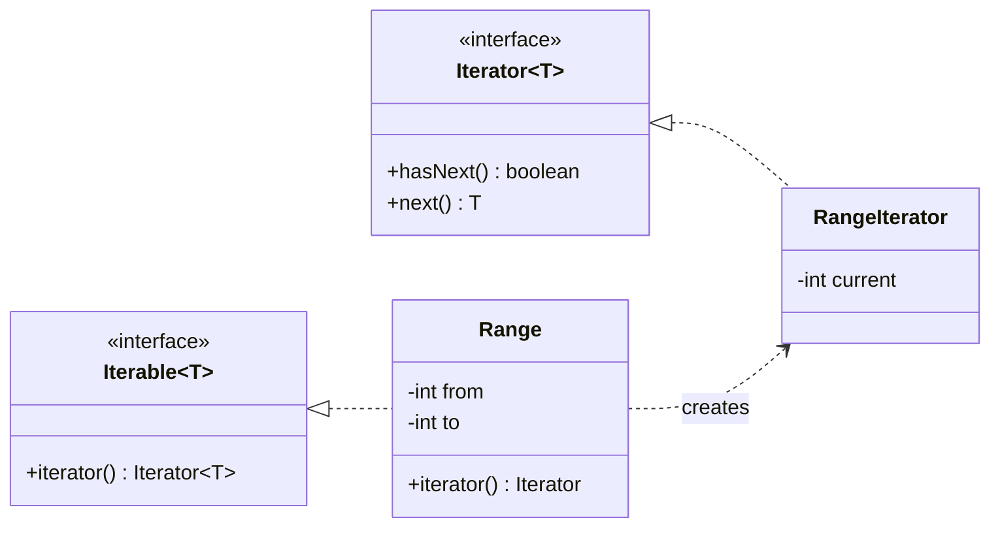

## Intent

**Iterator** extracts traversal logic out of a collection into a separate object. Clients loop over a list, a tree, a paginated API or an infinite sequence using the same `hasNext()` / `next()` protocol — without knowing how the elements are stored.

Java builds this pattern into the language: any class that implements `Iterable<T>` works in an enhanced `for` loop.

## Structure



## Example: custom iterables

<Playground title="IteratorDemo.java">

```java
import java.util.*;
import java.util.function.*;
import java.util.stream.*;

// 1) A numeric range with a step — works in for-each loops
record Range(int from, int to, int step) implements Iterable<Integer> {
    public Iterator<Integer> iterator() {
        return new Iterator<>() {
            private int current = from;
            public boolean hasNext() { return current < to; }
            public Integer next() {
                if (!hasNext()) throw new NoSuchElementException();
                int value = current;
                current += step;
                return value;
            }
        };
    }
}

// 2) A binary tree with an in-order iterator (uses an explicit stack, no recursion)
record TreeNode(int value, TreeNode left, TreeNode right) {}

class InOrder implements Iterator<Integer> {
    private final Deque<TreeNode> stack = new ArrayDeque<>();
    InOrder(TreeNode root) { pushLeft(root); }
    private void pushLeft(TreeNode n) { for (; n != null; n = n.left()) stack.push(n); }
    public boolean hasNext() { return !stack.isEmpty(); }
    public Integer next() {
        TreeNode n = stack.pop();
        pushLeft(n.right());
        return n.value();
    }
}

// 3) A lazily paginated "API" — the client never sees page boundaries
class PagedIterator implements Iterator<String> {
    private final IntFunction<List<String>> fetchPage;
    private Iterator<String> page = Collections.emptyIterator();
    private int nextPage = 0;
    private boolean exhausted;
    PagedIterator(IntFunction<List<String>> fetchPage) { this.fetchPage = fetchPage; }

    public boolean hasNext() {
        while (!page.hasNext() && !exhausted) {
            List<String> items = fetchPage.apply(nextPage++);
            System.out.println("  (fetched page " + (nextPage - 1) + ": " + items.size() + " items)");
            exhausted = items.isEmpty();
            page = items.iterator();
        }
        return page.hasNext();
    }
    public String next() { if (!hasNext()) throw new NoSuchElementException(); return page.next(); }
}

class Main {
    public static void main(String[] args) {
        for (int i : new Range(0, 20, 5)) System.out.print(i + " ");
        System.out.println();

        TreeNode tree = new TreeNode(8, new TreeNode(3, new TreeNode(1, null, null), new TreeNode(6, null, null)),
                                        new TreeNode(10, null, new TreeNode(14, null, null)));
        Iterator<Integer> it = new InOrder(tree);
        while (it.hasNext()) System.out.print(it.next() + " ");
        System.out.println();

        List<String> users = List.of("ada", "bob", "cy", "dee", "eve");
        Iterator<String> paged = new PagedIterator(p -> users.subList(Math.min(p * 2, users.size()), Math.min(p * 2 + 2, users.size())));
        // Adapt any Iterator to a Stream
        Stream<String> stream = StreamSupport.stream(Spliterators.spliteratorUnknownSize(paged, Spliterator.ORDERED), false);
        System.out.println(stream.map(String::toUpperCase).limit(3).toList());
    }
}
```

</Playground>

Notice that the paginated iterator fetched only the pages needed for `limit(3)` — iterators are naturally **lazy**.

## Fail-fast vs fail-safe

| | Fail-fast | Weakly consistent / fail-safe |
| --- | --- | --- |
| Collections | `ArrayList`, `HashMap`, `HashSet` | `ConcurrentHashMap`, `CopyOnWriteArrayList` |
| Concurrent modification | Throws `ConcurrentModificationException` | No exception — may or may not reflect changes |
| How | Checks a `modCount` on every `next()` | Iterates over a snapshot or tolerates changes |

```java
List<String> list = new ArrayList<>(List.of("a", "b", "c"));
for (String s : list) {
    if (s.equals("b")) list.remove(s);   // ConcurrentModificationException
}
list.removeIf(s -> s.equals("b"));       // correct — or use iterator.remove()
```

## Where you'll see it

- `java.util.Iterator`, `ListIterator` (bidirectional), `Spliterator` (splittable, for parallel streams)
- `Scanner`, `BufferedReader.lines()`, `DirectoryStream`, `ResultSet` (a cursor)
- Spring Data's `Slice`/`Page` and `Stream<T>` repository methods; Spring Batch's `ItemReader`
- Java Streams are “internal iterators” — you pass the operation in, the library drives the loop

<Callout type="interview">
**External vs internal iteration:** with an *external* iterator the client controls the loop (`while (it.hasNext())`). With *internal* iteration the collection controls the loop and you supply the behaviour (`list.forEach(...)`, streams). Internal iteration enables laziness, short-circuiting and parallelism without changing client code.
</Callout>
