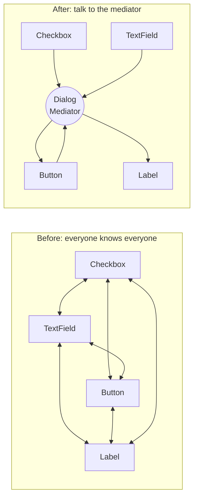
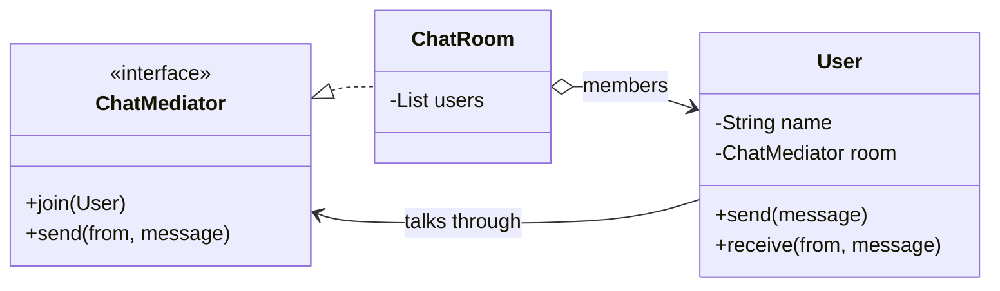

## Intent

**Mediator** stops a set of objects (*colleagues*) from referring to each other directly. Instead they send messages to a **mediator**, which knows how to route them. Many-to-many dependencies collapse into many-to-one.



## Structure



## Example: a chat room with moderation

<Playground title="MediatorDemo.java">

```java
import java.util.*;

interface ChatMediator {
    void join(User user);
    void send(User from, String message);
}

class User {
    final String name;
    private final ChatMediator room;
    User(String name, ChatMediator room) { this.name = name; this.room = room; room.join(this); }

    void send(String message) { room.send(this, message); }       // no reference to other users
    void receive(String from, String message) {
        System.out.printf("  [%s's screen] %s: %s%n", name, from, message);
    }
}

class ChatRoom implements ChatMediator {
    private final List<User> users = new ArrayList<>();
    private final Set<String> banned = Set.of("spam", "scam");
    private final Map<String, Integer> strikes = new HashMap<>();

    public void join(User user) {
        users.forEach(u -> u.receive("system", user.name + " joined"));
        users.add(user);
    }

    public void send(User from, String message) {
        // Coordination rules live HERE, not in every User
        if (banned.stream().anyMatch(message.toLowerCase()::contains)) {
            int n = strikes.merge(from.name, 1, Integer::sum);
            from.receive("system", "Message blocked (strike " + n + ")");
            if (n >= 2) { users.remove(from); users.forEach(u -> u.receive("system", from.name + " was removed")); }
            return;
        }
        if (message.startsWith("@")) {                               // direct message routing
            String target = message.substring(1, message.indexOf(' '));
            users.stream().filter(u -> u.name.equals(target))
                 .forEach(u -> u.receive(from.name + " (DM)", message.substring(message.indexOf(' ') + 1)));
            return;
        }
        users.stream().filter(u -> u != from).forEach(u -> u.receive(from.name, message));
    }
}

class Main {
    public static void main(String[] args) {
        ChatMediator room = new ChatRoom();
        User ada = new User("ada", room);
        User bob = new User("bob", room);
        User eve = new User("eve", room);

        ada.send("Morning all!");
        bob.send("@ada can you review my PR?");
        eve.send("Cheap SPAM here");
        eve.send("Totally not a scam");
        ada.send("Back to work then");
    }
}
```

</Playground>

## Where you'll see it

- **UI dialogs**: a form controller decides that ticking “Ship to a different address” enables the address fields — widgets don't know about each other
- **Spring's `ApplicationEventPublisher`** — publishers and `@EventListener`s never reference each other; the application context mediates
- **Message brokers** (Kafka, RabbitMQ) are mediators at architectural scale
- `java.util.concurrent.Executor` and `Timer` mediate between task submitters and worker threads
- Spring MVC's `DispatcherServlet` coordinating handler mappings, adapters, view resolvers and exception resolvers
- The **MediatR**-style command bus used in CQRS architectures

## Mediator vs Observer vs Facade

| | Mediator | Observer | Facade |
| --- | --- | --- | --- |
| Direction | Colleagues ↔ mediator (two-way) | Subject → observers (one-way) | Client → subsystem (one-way) |
| Do participants know the hub? | Yes | Observers register with the subject | Subsystem doesn't know the facade |
| Contains coordination logic? | Yes — that's its job | No | Only orchestration of calls |

<Callout type="warn" title="The god-mediator">
All coordination logic flows into the mediator, which can grow into an unmaintainable god object. Keep mediators focused on **one** interaction (one dialog, one workflow), and push real business rules back into domain objects.
</Callout>

<Callout type="interview">
A good real-world answer: “Our order, inventory and email modules communicate via Spring application events. `OrderService` publishes `OrderPlaced`; inventory and notifications listen. The event infrastructure is the mediator — the modules don't depend on each other, which made extracting notifications into its own service trivial.”
</Callout>
