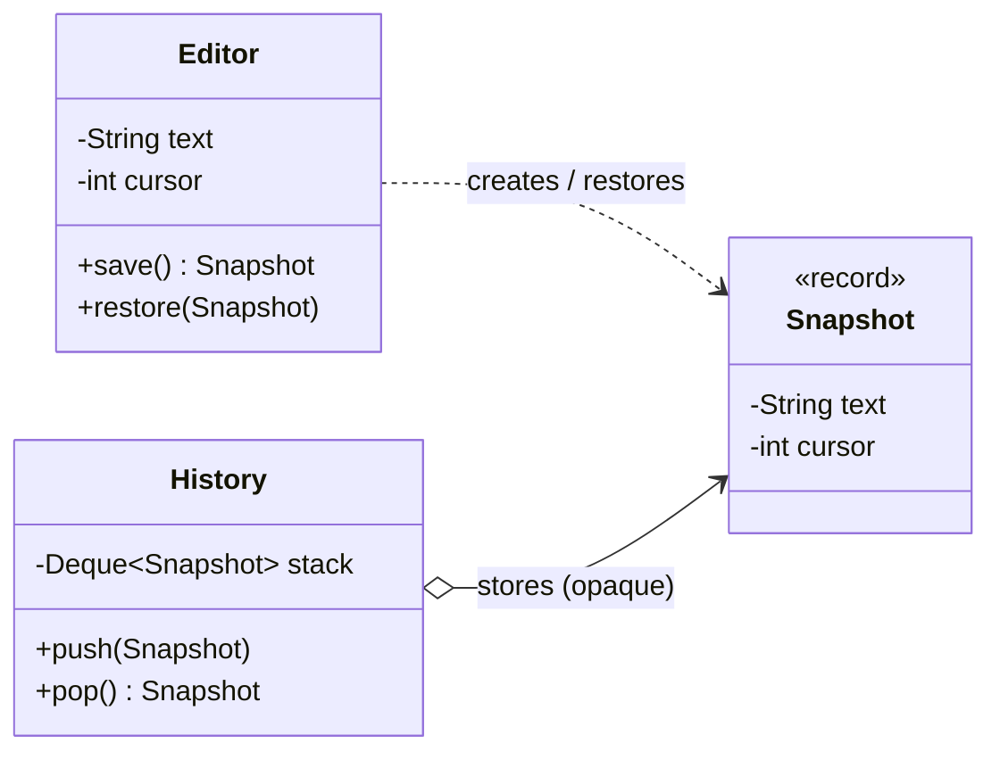

## Intent

**Memento** lets an object (the **originator**) produce a snapshot of its own state — the **memento** — that some other object (the **caretaker**) can store and later hand back to restore that state. Crucially, the caretaker *can't* read or modify the snapshot's contents, so the originator's encapsulation is preserved.

## Structure



## Example: undo history and checkpoints

<Playground title="MementoDemo.java">

```java
import java.util.*;

class Editor {                                         // originator
    private String text = "";
    private int cursor = 0;
    private String font = "Inter";

    // The memento: an immutable record nested in the originator.
    // Its accessors are private to Editor's nesting scope in spirit —
    // the caretaker treats it as an opaque token.
    record Snapshot(String text, int cursor, String font, long takenAt) {}

    void type(String s) { text = text.substring(0, cursor) + s + text.substring(cursor); cursor += s.length(); }
    void moveCursor(int pos) { cursor = Math.max(0, Math.min(pos, text.length())); }
    void setFont(String f) { font = f; }

    Snapshot save() { return new Snapshot(text, cursor, font, System.nanoTime()); }
    void restore(Snapshot s) { text = s.text(); cursor = s.cursor(); font = s.font(); }

    public String toString() {
        return "[" + font + "] " + text.substring(0, cursor) + "|" + text.substring(cursor);
    }
}

class History {                                         // caretaker
    private final Deque<Editor.Snapshot> stack = new ArrayDeque<>();
    private final int limit;
    History(int limit) { this.limit = limit; }

    void push(Editor.Snapshot s) {
        stack.push(s);
        if (stack.size() > limit) stack.removeLast();   // bounded memory
    }
    Optional<Editor.Snapshot> pop() { return Optional.ofNullable(stack.poll()); }
}

class Main {
    public static void main(String[] args) {
        var editor = new Editor();
        var history = new History(10);

        history.push(editor.save()); editor.type("Hello world");
        history.push(editor.save()); editor.moveCursor(5); editor.type(",");
        history.push(editor.save()); editor.setFont("JetBrains Mono"); editor.type(" cruel");
        System.out.println("now:  " + editor);

        history.pop().ifPresent(editor::restore);
        System.out.println("undo: " + editor);
        history.pop().ifPresent(editor::restore);
        System.out.println("undo: " + editor);
        history.pop().ifPresent(editor::restore);
        System.out.println("undo: " + editor);
    }
}
```

</Playground>

<Callout type="tip">
Records are ideal mementos: they are **immutable**, so a snapshot can never be corrupted after it is taken. Remember to *deep-copy* any mutable state (lists, maps) into the memento — a snapshot that shares a mutable list with the originator isn't a snapshot.
</Callout>

## Memento + Command

The two patterns combine naturally for generic undo: before a command executes, take a memento of the receiver; `undo()` restores it. This avoids writing a hand-crafted inverse for every operation, at the cost of memory.

```java
final class SnapshotCommand implements Command {
    private final Editor editor;
    private final Consumer<Editor> action;
    private Editor.Snapshot before;

    public void execute() { before = editor.save(); action.accept(editor); }
    public void undo()    { editor.restore(before); }
}
```

## Where you'll see it

- Undo/redo in editors, drawing tools and IDEs
- `java.io.Serializable` — serialising an object to bytes is an (unencapsulated) memento
- Game save points; database **savepoints** (`Connection.setSavepoint()` / `rollback(savepoint)`)
- Spring Web Flow / Spring State Machine persisting state snapshots
- **Event sourcing** snapshots — periodically storing an aggregate's state so you don't replay every event

## Trade-offs

| Pros | Cons |
| --- | --- |
| Undo without exposing internal state | Memory-hungry if snapshots are large or frequent |
| Originator stays simple — caretaker manages history | Caretaker must manage lifecycle (limits, eviction) |
| Snapshots can be persisted or sent over the wire | In Java, true opacity is hard to enforce |

<Callout type="interview">
Expect: *“How would you implement undo in a text editor?”* Discuss both approaches — **Command with inverse operations** (memory-efficient, more code) and **Memento snapshots** (simple, memory-heavy) — and hybrid strategies like storing diffs or periodic full snapshots.
</Callout>
