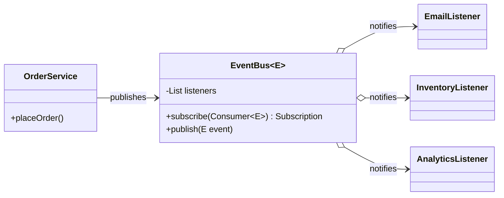
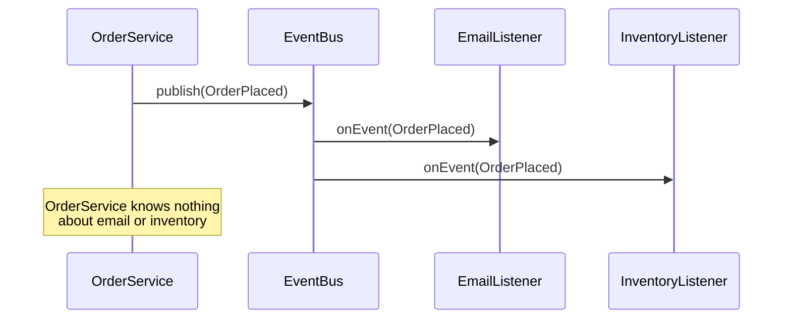

## Intent

**Observer** (also *publish–subscribe* or *listener*) lets a **subject** broadcast events to any number of **observers** that registered interest — without the subject knowing who they are or what they do. Adding a new reaction to an event means adding a new observer, not editing the subject.

## Structure





## Example: a type-safe event bus

<Playground title="ObserverDemo.java">

```java
import java.math.BigDecimal;
import java.util.*;
import java.util.concurrent.CopyOnWriteArrayList;
import java.util.function.Consumer;

sealed interface OrderEvent permits OrderPlaced, OrderCancelled {}
record OrderPlaced(String orderId, String email, BigDecimal total) implements OrderEvent {}
record OrderCancelled(String orderId, String reason) implements OrderEvent {}

// The subject: keeps a list of observers and notifies them
final class EventBus<E> {
    private final List<Consumer<? super E>> listeners = new CopyOnWriteArrayList<>();

    AutoCloseable subscribe(Consumer<? super E> listener) {
        listeners.add(listener);
        return () -> listeners.remove(listener);           // handle to unsubscribe
    }

    void publish(E event) {
        for (var l : listeners) {
            try { l.accept(event); }
            catch (RuntimeException ex) { System.out.println("  ! listener failed: " + ex.getMessage()); }
        }
    }
}

class OrderService {
    private final EventBus<OrderEvent> events;
    OrderService(EventBus<OrderEvent> events) { this.events = events; }

    void place(String id, String email, String total) {
        System.out.println("Order " + id + " saved");
        events.publish(new OrderPlaced(id, email, new BigDecimal(total)));
    }
    void cancel(String id) { events.publish(new OrderCancelled(id, "customer request")); }
}

class Main {
    public static void main(String[] args) throws Exception {
        var bus = new EventBus<OrderEvent>();

        bus.subscribe(e -> { if (e instanceof OrderPlaced p) System.out.println("  ✉ email " + p.email()); });
        bus.subscribe(e -> {
            switch (e) {
                case OrderPlaced p -> System.out.println("  📦 reserve stock for " + p.orderId());
                case OrderCancelled c -> System.out.println("  📦 release stock for " + c.orderId());
            }
        });
        AutoCloseable analytics = bus.subscribe(e -> System.out.println("  📈 track " + e.getClass().getSimpleName()));
        bus.subscribe(e -> { throw new IllegalStateException("flaky webhook"); });

        var orders = new OrderService(bus);
        orders.place("A-100", "ada@example.com", "59.90");
        analytics.close();                                      // unsubscribe
        orders.cancel("A-100");
    }
}
```

</Playground>

<Callout type="warn">
Two classic pitfalls: (1) a **failing listener** must not stop the others — catch per listener, as above; (2) **memory leaks** — a long-lived subject holding references to short-lived observers keeps them alive forever. Always provide (and use) an unsubscribe handle.
</Callout>

## Observer in Spring

Spring's application events are Observer with dependency injection:

```java
public record OrderPlaced(Long orderId, String email) {}

@Service
class OrderService {
    private final ApplicationEventPublisher events;

    @Transactional
    public void place(Order order) {
        repository.save(order);
        events.publishEvent(new OrderPlaced(order.getId(), order.getEmail()));
    }
}

@Component
class ConfirmationEmailListener {
    @TransactionalEventListener(phase = TransactionPhase.AFTER_COMMIT)  // only if the tx commits
    @Async
    public void on(OrderPlaced event) { mailer.sendConfirmation(event.email()); }
}
```

<Callout type="tip">
Use `@TransactionalEventListener(phase = AFTER_COMMIT)` for side effects like emails, so customers aren't emailed about orders that were rolled back. Plain `@EventListener` runs **synchronously inside** the publisher's transaction.
</Callout>

## Where you'll see it

- Swing/AWT listeners (`ActionListener`), JavaFX properties
- `java.beans.PropertyChangeListener` / `PropertyChangeSupport`
- `java.util.concurrent.Flow` (Publisher/Subscriber) and **Reactive Streams** — Project Reactor's `Flux`, RxJava — observer with back-pressure
- Spring `ApplicationEvent`s, `@EventListener`, `@TransactionalEventListener`; Spring Modulith's event publication registry
- Message brokers — Kafka topics are observer across processes

<Callout type="interview">
`java.util.Observable` and `Observer` were **deprecated in Java 9**: `Observable` is a class (not an interface), isn't thread-safe, and its notification order is unspecified. Mention that modern code uses listeners/lambdas, `Flow`, reactive libraries or framework event buses instead.
</Callout>
