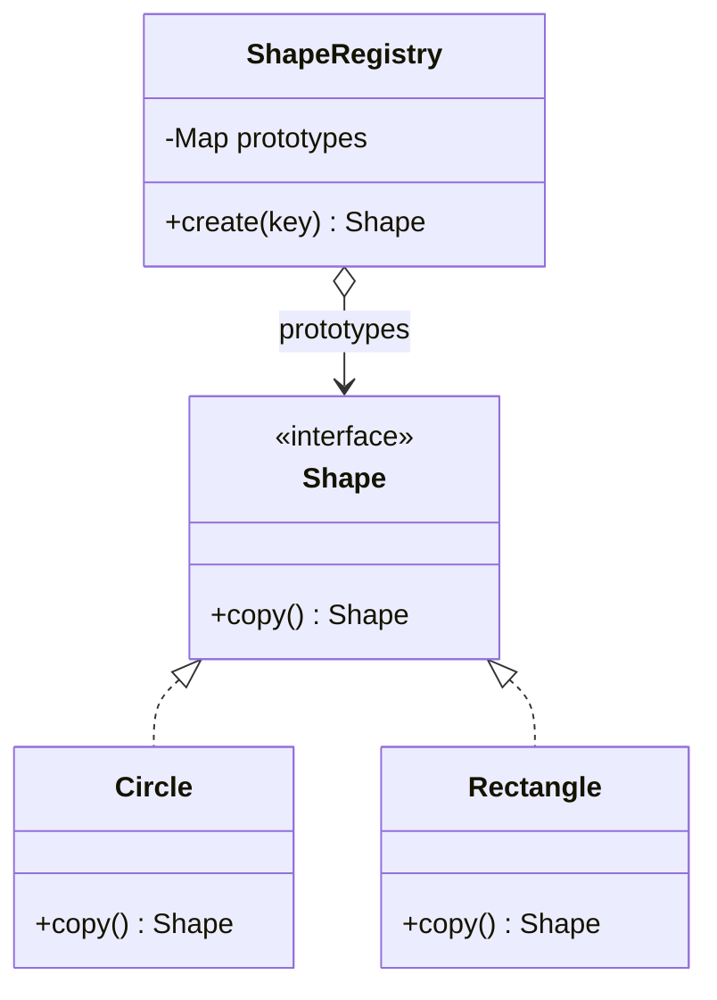

## Intent

**Prototype** creates new objects by **copying an existing instance** — the prototype — rather than calling a constructor and re-applying configuration. It is useful when objects are expensive to initialise, or when the exact class to create is only known at runtime through an existing object.

## Structure



## Shallow vs deep copy

The central question in Prototype is **how deep the copy goes**:

- **Shallow copy** — fields are copied as-is, so the copy and the original *share* referenced objects such as lists.
- **Deep copy** — referenced mutable objects are copied too, so the two are fully independent.

## Example: copy constructors and a registry

Java's `Cloneable`/`Object.clone()` is widely considered broken (see the callout below). Idiomatic Java uses a **copy constructor** or a `copy()` method:

<Playground title="PrototypeDemo.java">

```java
import java.util.*;

abstract class Shape {
    String color;
    final List<String> tags;

    Shape(String color, List<String> tags) {
        this.color = color;
        this.tags = new ArrayList<>(tags);
    }

    // copy constructor — performs a DEEP copy of the mutable list
    Shape(Shape other) {
        this(other.color, other.tags);
    }

    abstract Shape copy();
}

class Circle extends Shape {
    int radius;
    Circle(String color, int radius, List<String> tags) { super(color, tags); this.radius = radius; }
    Circle(Circle other) { super(other); this.radius = other.radius; }
    Circle copy() { return new Circle(this); }
    public String toString() { return "Circle(r=" + radius + ", " + color + ", " + tags + ")"; }
}

class Rectangle extends Shape {
    int w, h;
    Rectangle(String color, int w, int h, List<String> tags) { super(color, tags); this.w = w; this.h = h; }
    Rectangle(Rectangle other) { super(other); this.w = other.w; this.h = other.h; }
    Rectangle copy() { return new Rectangle(this); }
    public String toString() { return "Rect(" + w + "x" + h + ", " + color + ", " + tags + ")"; }
}

// Registry of pre-configured prototypes
class ShapeRegistry {
    private final Map<String, Shape> prototypes = new HashMap<>();
    void register(String key, Shape s) { prototypes.put(key, s); }
    Shape create(String key) { return prototypes.get(key).copy(); }
}

class Main {
    public static void main(String[] args) {
        var registry = new ShapeRegistry();
        registry.register("button", new Rectangle("blue", 120, 40, List.of("ui", "rounded")));
        registry.register("avatar", new Circle("grey", 24, List.of("ui")));

        Shape a = registry.create("button");
        Shape b = registry.create("button");
        b.color = "red";
        b.tags.add("danger");

        System.out.println(a);  // unaffected — deep copy
        System.out.println(b);
        System.out.println(registry.create("avatar"));
        System.out.println("Same object? " + (a == b));
    }
}
```

</Playground>

<Callout type="danger" title="Why not Cloneable?">
`Cloneable` is a marker interface with no `clone()` method; `Object.clone()` is `protected`, returns `Object`, throws a checked `CloneNotSupportedException`, bypasses constructors, does a shallow copy and doesn't play well with `final` fields. *Effective Java* (item 13) recommends copy constructors or copy factories instead.
</Callout>

## Records make copying trivial

Records are immutable, so “copying” means constructing a new record with one component changed — a *wither*:

```java
record Settings(String theme, int fontSize, boolean autosave) {
    Settings withTheme(String t) { return new Settings(t, fontSize, autosave); }
}

Settings defaults = new Settings("dark", 14, true);
Settings mine = defaults.withTheme("light");
```

Immutable objects can safely be *shared* instead of copied — often the best prototype is no copy at all.

## Where you'll see it

- `ArrayList(Collection)`, `HashMap(Map)` and other collection copy constructors
- `Object.clone()` on arrays: `int[] copy = original.clone()` is the one place `clone()` is fine
- Spring's **prototype bean scope**: `@Scope("prototype")` returns a fresh instance on every lookup (the name is borrowed; Spring creates rather than clones)

## Trade-offs

| Pros | Cons |
| --- | --- |
| Avoids repeating expensive initialisation | Deep copying object graphs with cycles is tricky |
| Create objects whose class is only known at runtime | Every class must implement copying correctly |
| Pre-configured templates via a registry | `Cloneable` is a trap in Java |

<Callout type="interview">
A common question: *“What is the difference between a shallow and a deep copy, and how do you implement a deep copy?”* Mention copy constructors, copying each mutable field, serialization-based copying (slow but generic), and that immutable fields don't need copying.
</Callout>
