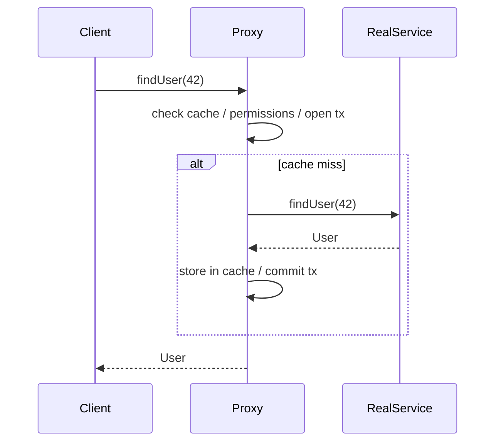

## Intent

**Proxy** places an object with the **same interface** in front of a real subject and intercepts every call. The proxy can decide *whether*, *when* and *how* the real object is invoked.

| Kind of proxy | What it controls | Example |
| --- | --- | --- |
| **Virtual** | Creation — create the expensive object lazily | Hibernate lazy-loaded associations |
| **Protection** | Access — check permissions first | Spring Security `@PreAuthorize` |
| **Remote** | Location — hide a network call | gRPC stubs, RMI, Feign clients |
| **Caching** | Repetition — return stored results | Spring `@Cacheable` |
| **Smart reference** | Bookkeeping — logging, metrics, transactions | Spring `@Transactional` |

## Structure



## Example 1: a hand-written caching proxy

```java
interface UserService { User find(long id); }

class CachingUserService implements UserService {
    private final UserService target;
    private final Map<Long, User> cache = new ConcurrentHashMap<>();

    CachingUserService(UserService target) { this.target = target; }

    public User find(long id) {
        return cache.computeIfAbsent(id, target::find);
    }
}
```

## Example 2: a dynamic proxy — how Spring AOP works

Writing a proxy class per interface doesn't scale. `java.lang.reflect.Proxy` generates one at runtime for **any** interface. This is exactly the mechanism Spring uses for interface-based beans:

<Playground title="DynamicProxyDemo.java">

```java
import java.lang.annotation.*;
import java.lang.reflect.*;
import java.util.*;

@Retention(RetentionPolicy.RUNTIME) @Target(ElementType.METHOD)
@interface Cached {}

@Retention(RetentionPolicy.RUNTIME) @Target(ElementType.METHOD)
@interface Timed {}

interface PriceService {
    @Cached @Timed double priceOf(String sku);
    @Timed void reindex();
}

class SlowPriceService implements PriceService {
    public double priceOf(String sku) {
        sleep(300);                          // pretend this calls a database
        return sku.length() * 3.5;
    }
    public void reindex() { sleep(100); }
    private static void sleep(long ms) { try { Thread.sleep(ms); } catch (InterruptedException e) { } }
}

// A tiny "AOP framework": one InvocationHandler implements cross-cutting concerns
class Interceptor implements InvocationHandler {
    private final Object target;
    private final Map<String, Object> cache = new HashMap<>();

    Interceptor(Object target) { this.target = target; }

    @SuppressWarnings("unchecked")
    static <T> T wrap(T target, Class<T> type) {
        return (T) Proxy.newProxyInstance(type.getClassLoader(), new Class<?>[]{type}, new Interceptor(target));
    }

    public Object invoke(Object proxy, Method m, Object[] args) throws Throwable {
        String key = m.getName() + Arrays.toString(args);
        if (m.isAnnotationPresent(Cached.class) && cache.containsKey(key)) {
            System.out.println("  cache hit  " + key);
            return cache.get(key);
        }
        long start = System.nanoTime();
        Object result = m.invoke(target, args);        // call the real subject
        if (m.isAnnotationPresent(Timed.class))
            System.out.printf("  %-10s took %d ms%n", m.getName(), (System.nanoTime() - start) / 1_000_000);
        if (m.isAnnotationPresent(Cached.class)) cache.put(key, result);
        return result;
    }
}

class Main {
    public static void main(String[] args) {
        PriceService prices = Interceptor.wrap(new SlowPriceService(), PriceService.class);
        System.out.println("Proxy class: " + prices.getClass().getSimpleName());
        System.out.println(prices.priceOf("BOOK-1"));
        System.out.println(prices.priceOf("BOOK-1"));   // served from cache
        prices.reindex();
    }
}
```

</Playground>

## Proxies in Spring

When a bean needs cross-cutting behaviour — `@Transactional`, `@Cacheable`, `@Async`, `@PreAuthorize`, `@Retryable` — Spring registers a **proxy** in the container instead of your object:

- If the bean implements an interface, Spring *can* use a **JDK dynamic proxy** (as above).
- Otherwise — and by default in Spring Boot — it uses **CGLIB** to generate a *subclass* of your class at runtime.

<Callout type="danger" title="The self-invocation trap">
Because the behaviour lives in the proxy, calling an annotated method **from another method in the same class** bypasses it:

```java
@Service
class OrderService {
    public void importAll(List<Order> orders) {
        orders.forEach(this::save);      // `this` is the raw object, not the proxy!
    }
    @Transactional
    public void save(Order o) { /* NO transaction is started here */ }
}
```

Fix it by moving `save` into another bean, injecting the proxy into itself, or using `TransactionTemplate`. CGLIB proxies also can't intercept `final` or `private` methods.
</Callout>

## Where else you'll see it

- Hibernate entity proxies for `@ManyToOne(fetch = LAZY)` — and the infamous `LazyInitializationException` when the session is closed
- Spring Cloud OpenFeign and Spring's HTTP interface clients (`@HttpExchange`) — remote proxies generated from an interface
- Mockito mocks — proxies that record and stub calls
- `Collections.unmodifiableList` (protection proxy / decorator)

<Callout type="interview">
Know the difference between **JDK dynamic proxies** (interface-based, built into the JDK, the proxy implements the interfaces) and **CGLIB/ByteBuddy proxies** (subclass-based, work on concrete classes, cannot proxy `final` classes or methods). Spring Boot 2+ defaults to CGLIB via `spring.aop.proxy-target-class=true`.
</Callout>
