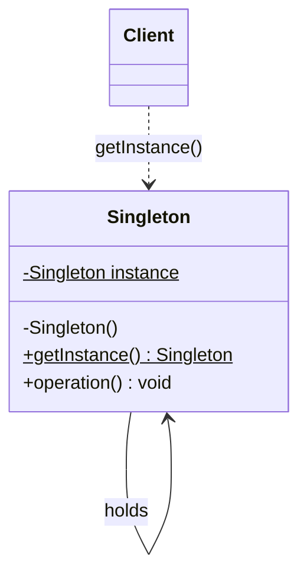

## Intent

**Singleton** guarantees that a class has only one instance and gives the rest of the program a well-known way to reach it. Typical candidates are things that are expensive to build or that must be shared: a configuration registry, a connection pool, a metrics registry.



## Implementations compared

<CodeTabs labels={["Enum (recommended)", "Holder idiom", "Double-checked locking"]}>

```java
public enum AppConfig {
    INSTANCE;

    private final Map<String, String> values = new ConcurrentHashMap<>();

    public String get(String key) { return values.get(key); }
    public void put(String key, String value) { values.put(key, value); }
}
```

```java
public final class AppConfig {
    private AppConfig() {}

    // The JVM initialises Holder lazily and thread-safely on first access
    private static class Holder {
        static final AppConfig INSTANCE = new AppConfig();
    }

    public static AppConfig getInstance() {
        return Holder.INSTANCE;
    }
}
```

```java
public final class AppConfig {
    private static volatile AppConfig instance; // volatile is essential

    private AppConfig() {}

    public static AppConfig getInstance() {
        AppConfig local = instance;
        if (local == null) {
            synchronized (AppConfig.class) {
                local = instance;
                if (local == null) {
                    instance = local = new AppConfig();
                }
            }
        }
        return local;
    }
}
```

</CodeTabs>

## Try it

<Playground title="SingletonDemo.java">

```java
import java.util.*;
import java.util.concurrent.*;

enum Registry {
    INSTANCE;
    private final Map<String, Integer> counters = new ConcurrentHashMap<>();
    int increment(String key) { return counters.merge(key, 1, Integer::sum); }
}

class Main {
    public static void main(String[] args) throws Exception {
        try (ExecutorService pool = Executors.newVirtualThreadPerTaskExecutor()) {
            for (int i = 0; i < 1_000; i++) {
                pool.submit(() -> Registry.INSTANCE.increment("hits"));
            }
        }
        System.out.println("Same instance? " + (Registry.INSTANCE == Registry.valueOf("INSTANCE")));
        System.out.println("hits = " + Registry.INSTANCE.increment("hits"));
    }
}
```

</Playground>

<Callout type="interview">
Expect the follow-up: *“How can a singleton be broken?”* — reflection (calling the private constructor), serialization (deserialising creates a new object unless you add `readResolve`) and cloning. The **enum** form is immune to all three, which is why *Effective Java* recommends it.
</Callout>

## When to use it — and when not

| Use it when | Avoid it when |
| --- | --- |
| Exactly one instance is a true domain rule | You just want a convenient global variable |
| The object is costly and safely shareable | It holds mutable state that makes tests order-dependent |
| You're not inside a DI container | You use Spring — beans are singletons by default |

<Callout type="tip">
In Spring applications, prefer a regular class registered as a bean. The container gives you one instance per context, and you can still swap it for a mock in tests.
</Callout>
