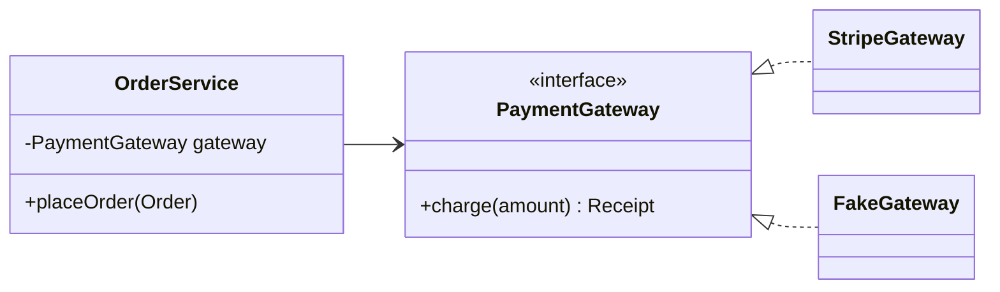

SOLID is an acronym coined by Robert C. Martin for five principles that keep object-oriented code easy to change. Design patterns are, in large part, recipes for applying these principles.

| Letter | Principle | One-line summary |
| --- | --- | --- |
| **S** | Single Responsibility | A class should have one reason to change |
| **O** | Open/Closed | Open for extension, closed for modification |
| **L** | Liskov Substitution | Subtypes must be usable wherever the base type is expected |
| **I** | Interface Segregation | Many small, client-specific interfaces beat one fat one |
| **D** | Dependency Inversion | Depend on abstractions, not concretions |

## S — Single Responsibility Principle

A class should have **one reason to change** — one actor or stakeholder whose requirements drive it.

<CodeTabs labels={["Violates SRP", "Follows SRP"]}>

```java
class Invoice {
    double total() { /* business rules */ return 0; }
    String toPdf() { /* rendering */ return ""; }
    void save()    { /* SQL */ }
}
```

```java
record Invoice(List<LineItem> items) {
    double total() { return items.stream().mapToDouble(LineItem::amount).sum(); }
}
class InvoicePdfRenderer { byte[] render(Invoice i) { /* ... */ return new byte[0]; } }
class InvoiceRepository  { void save(Invoice i) { /* ... */ } }
```

</CodeTabs>

The finance team changing tax rules, the design team changing the PDF layout and the DBA changing the schema no longer edit the same file.

## O — Open/Closed Principle

You should be able to **add behaviour without editing existing, tested code**. The usual tool is polymorphism — often the Strategy pattern.

<Playground title="OpenClosed.java">

```java
import java.util.*;

interface Discount {
    double apply(double amount);
}

record PercentOff(double pct) implements Discount {
    public double apply(double amount) { return amount * (1 - pct / 100); }
}

record FlatOff(double value) implements Discount {
    public double apply(double amount) { return Math.max(0, amount - value); }
}

class Checkout {
    // Adding a new discount type never requires changing this class
    double total(double amount, List<Discount> discounts) {
        double result = amount;
        for (Discount d : discounts) result = d.apply(result);
        return result;
    }
}

class Main {
    public static void main(String[] args) {
        var checkout = new Checkout();
        Discount blackFriday = amount -> amount > 100 ? amount - 25 : amount; // a new rule as a lambda
        System.out.println(checkout.total(200, List.of(new PercentOff(10), new FlatOff(5))));
        System.out.println(checkout.total(200, List.of(blackFriday)));
    }
}
```

</Playground>

## L — Liskov Substitution Principle

If `S` is a subtype of `T`, code written against `T` must keep working when given an `S` — no strengthened preconditions, weakened postconditions or surprise exceptions.

The classic violation is `Square extends Rectangle`:

```java
class Rectangle {
    protected int w, h;
    void setWidth(int w)  { this.w = w; }
    void setHeight(int h) { this.h = h; }
    int area() { return w * h; }
}

class Square extends Rectangle {
    @Override void setWidth(int w)  { this.w = this.h = w; }
    @Override void setHeight(int h) { this.w = this.h = h; }
}

void resize(Rectangle r) {
    r.setWidth(5);
    r.setHeight(4);
    assert r.area() == 20; // fails for Square: area is 16
}
```

<Callout type="warn">
Real-world LSP violations: a read-only `List` that throws `UnsupportedOperationException` from `add` (the JDK's own `List.of` does this!), or a subclass that throws on a method the parent supports. Prefer separate types, or composition, when behaviour genuinely differs.
</Callout>

## I — Interface Segregation Principle

Clients should not be forced to depend on methods they don't use.

<CodeTabs labels={["Fat interface", "Segregated"]}>

```java
interface Worker {
    void work();
    void eat();
    void attendStandup();
}

class Robot implements Worker {
    public void work() { /* ... */ }
    public void eat() { throw new UnsupportedOperationException(); } // forced!
    public void attendStandup() { throw new UnsupportedOperationException(); }
}
```

```java
interface Workable { void work(); }
interface Feedable { void eat(); }

class Human implements Workable, Feedable {
    public void work() { /* ... */ }
    public void eat()  { /* ... */ }
}
class Robot implements Workable {
    public void work() { /* ... */ }
}
```

</CodeTabs>

## D — Dependency Inversion Principle

High-level policy should not depend on low-level details; **both should depend on abstractions**. This is what makes code testable and what Spring's dependency injection is built around.



```java
@Service
class OrderService {
    private final PaymentGateway gateway;           // abstraction

    OrderService(PaymentGateway gateway) {          // injected, not created with `new`
        this.gateway = gateway;
    }
}
```

In tests you pass a `FakeGateway`; in production Spring injects `StripeGateway`. `OrderService` never changes.

<Callout type="interview">
Don't confuse **Dependency Inversion** (a design principle), **Inversion of Control** (the framework calls your code, not the other way round) and **Dependency Injection** (a technique — passing dependencies in through constructors or setters). DI is the most common way to achieve DIP, and IoC containers like Spring automate DI.
</Callout>

## SOLID and patterns

| Principle | Patterns that apply it |
| --- | --- |
| SRP | Facade, Command, Visitor |
| OCP | Strategy, Decorator, Observer, Template Method |
| LSP | Every pattern relying on polymorphism |
| ISP | Adapter, role interfaces |
| DIP | Abstract Factory, Factory Method, Dependency Injection |
