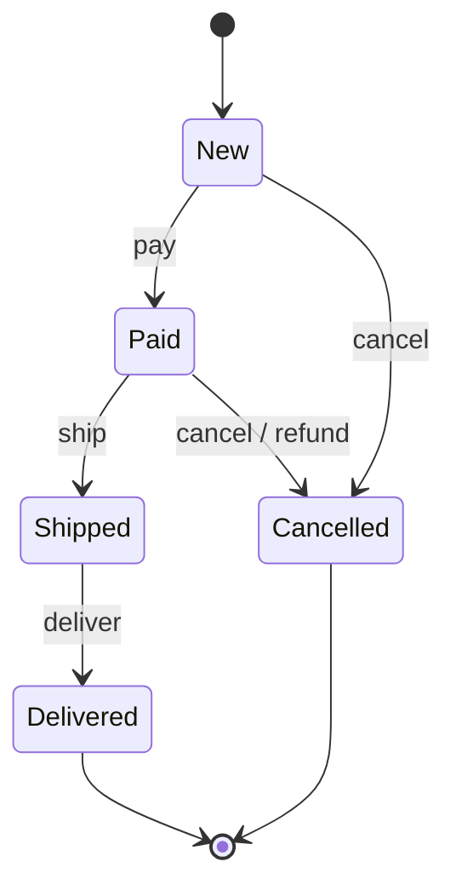

## Intent

**State** models an object as a **finite state machine**. Each state is its own class implementing a common interface; the object (the **context**) delegates behaviour to its current state object and swaps it when a transition occurs. To the outside world, the object appears to change its class.

## The problem

```java
void ship() {
    if (status == NEW) throw new IllegalStateException("Not paid");
    else if (status == PAID) { status = SHIPPED; notifyCourier(); }
    else if (status == SHIPPED) throw new IllegalStateException("Already shipped");
    else if (status == CANCELLED) throw new IllegalStateException("Cancelled");
}
// …and the same if/else ladder in pay(), cancel(), deliver(), refund()…
```

Every operation repeats a ladder of `if (status == ...)`. Adding a state means editing every method.

## The state machine



## Example: an order lifecycle

<Playground title="StateDemo.java">

```java
import java.util.*;

sealed interface OrderState permits New, Paid, Shipped, Delivered, Cancelled {
    default OrderState pay(Order o)     { throw illegal("pay"); }
    default OrderState ship(Order o)    { throw illegal("ship"); }
    default OrderState deliver(Order o) { throw illegal("deliver"); }
    default OrderState cancel(Order o)  { throw illegal("cancel"); }
    private IllegalStateException illegal(String action) {
        return new IllegalStateException("Cannot " + action + " an order that is " + getClass().getSimpleName());
    }
}

record New() implements OrderState {
    public OrderState pay(Order o)    { o.log("payment captured"); return new Paid(); }
    public OrderState cancel(Order o) { o.log("cancelled before payment"); return new Cancelled(); }
}
record Paid() implements OrderState {
    public OrderState ship(Order o)   { o.log("handed to courier"); return new Shipped(); }
    public OrderState cancel(Order o) { o.log("refund issued"); return new Cancelled(); }
}
record Shipped() implements OrderState {
    public OrderState deliver(Order o) { o.log("delivered"); return new Delivered(); }
}
record Delivered() implements OrderState {}
record Cancelled() implements OrderState {}

class Order {                                       // the context
    private final String id;
    private OrderState state = new New();
    Order(String id) { this.id = id; }

    void pay()     { state = state.pay(this); }
    void ship()    { state = state.ship(this); }
    void deliver() { state = state.deliver(this); }
    void cancel()  { state = state.cancel(this); }

    void log(String msg) { System.out.println("  " + id + ": " + msg); }
    String status() { return state.getClass().getSimpleName(); }
}

class Main {
    static void attempt(Order o, Runnable action) {
        try { action.run(); } catch (IllegalStateException e) { System.out.println("  ✗ " + e.getMessage()); }
    }

    public static void main(String[] args) {
        var a = new Order("A-1");
        a.pay(); a.ship(); a.deliver();
        System.out.println("A-1 is " + a.status());

        var b = new Order("B-2");
        attempt(b, b::ship);                        // not paid yet
        b.pay(); b.cancel();
        attempt(b, b::ship);                        // cancelled
        System.out.println("B-2 is " + b.status());
    }
}
```

</Playground>

Each state class contains **only** the transitions valid from that state. Illegal transitions fall through to the default methods. Adding a `Returned` state means one new record and a change to `Delivered` — nothing else.

<Callout type="tip" title="Enums work too">
For simple machines, an `enum` with abstract methods is a compact State implementation: `enum Light { RED { Light next() { return GREEN; } }, GREEN { ... }, ... }`. Use classes/records when states carry data (e.g. `Shipped(String trackingNumber)`).
</Callout>

## Where you'll see it

- **Spring State Machine** — declarative state machines with guards, actions and persistence
- `java.util.Iterator` implementations and parsers often track internal states
- TCP connection handling (`LISTEN`, `ESTABLISHED`, `CLOSE_WAIT`…), the original GoF example
- Workflow engines (Camunda, Temporal), order/payment/booking lifecycles, UI wizards, game AI

## State vs Strategy

They have the same UML — a context holding an interface. The difference:

| | State | Strategy |
| --- | --- | --- |
| Who chooses the object? | The **states themselves** trigger transitions | The **client** picks a strategy |
| Do implementations know each other? | Yes — a state returns the next state | No — strategies are independent |
| Changes over the object's life? | Constantly | Usually fixed once configured |

<Callout type="interview">
In system design interviews about order or payment flows, sketching the **state diagram** first and then saying “I'd model each state as a class, so illegal transitions are impossible to call by mistake” is a strong signal. Mention persisting the state as an enum column and using optimistic locking (`@Version`) to avoid concurrent transitions.
</Callout>
