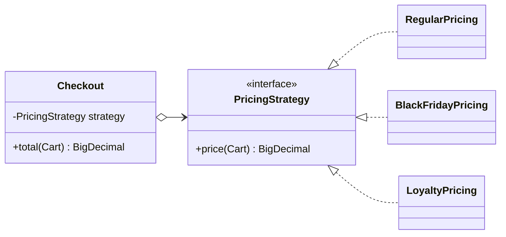

## Intent

**Strategy** extracts a varying algorithm into its own object behind a common interface. The **context** holds a reference to a strategy and delegates to it, so the algorithm can be swapped at runtime and new algorithms can be added without modifying the context — the Open/Closed Principle in its purest form.

## Structure



## Example: strategies as classes, enums and lambdas

<Playground title="StrategyDemo.java">

```java
import java.math.*;
import java.util.*;
import java.util.function.*;

record Item(String name, BigDecimal price, int qty) {
    BigDecimal subtotal() { return price.multiply(BigDecimal.valueOf(qty)); }
}
record Cart(List<Item> items, String customerTier) {
    BigDecimal gross() { return items.stream().map(Item::subtotal).reduce(BigDecimal.ZERO, BigDecimal::add); }
}

@FunctionalInterface
interface PricingStrategy {
    BigDecimal price(Cart cart);

    // Strategies compose: apply this one, then another
    default PricingStrategy then(UnaryOperator<BigDecimal> adjust) {
        return cart -> adjust.apply(price(cart));
    }
}

// 1) A classic class
class RegularPricing implements PricingStrategy {
    public BigDecimal price(Cart c) { return c.gross(); }
}

// 2) An enum of named strategies
enum Seasonal implements PricingStrategy {
    BLACK_FRIDAY { public BigDecimal price(Cart c) { return c.gross().multiply(new BigDecimal("0.70")); } },
    THREE_FOR_TWO {
        public BigDecimal price(Cart c) {
            return c.items().stream()
                .map(i -> i.price().multiply(BigDecimal.valueOf(i.qty() - i.qty() / 3)))
                .reduce(BigDecimal.ZERO, BigDecimal::add);
        }
    }
}

class Checkout {                                         // the context
    private final Map<String, PricingStrategy> byTier;
    Checkout(Map<String, PricingStrategy> byTier) { this.byTier = byTier; }

    BigDecimal total(Cart cart, PricingStrategy override) {
        PricingStrategy s = override != null ? override : byTier.getOrDefault(cart.customerTier(), new RegularPricing());
        return s.price(cart).setScale(2, RoundingMode.HALF_UP);
    }
}

class Main {
    public static void main(String[] args) {
        var cart = new Cart(List.of(
            new Item("Keyboard", new BigDecimal("89.00"), 1),
            new Item("USB-C cable", new BigDecimal("9.50"), 3)), "GOLD");

        // 3) A lambda strategy, composed with a free-shipping adjustment
        PricingStrategy gold = c -> c.gross().multiply(new BigDecimal("0.90"));
        PricingStrategy goldWithShipping = gold.then(total -> total.compareTo(new BigDecimal("100")) > 0 ? total : total.add(new BigDecimal("4.99")));

        var checkout = new Checkout(Map.of("GOLD", goldWithShipping));
        System.out.println("Tier price (GOLD):   " + checkout.total(cart, null));
        System.out.println("Regular price:       " + checkout.total(cart, new RegularPricing()));
        System.out.println("Black Friday:        " + checkout.total(cart, Seasonal.BLACK_FRIDAY));
        System.out.println("3 for 2:             " + checkout.total(cart, Seasonal.THREE_FOR_TWO));
    }
}
```

</Playground>

## Strategy in Spring: inject all implementations

A common production pattern: each strategy is a `@Component`, and Spring injects them all as a `Map` keyed by bean name (or a `List`). The context picks one at runtime — no `switch` anywhere:

```java
public interface PaymentStrategy {
    PaymentMethod method();
    Receipt pay(Order order);
}

@Component class CardPayment   implements PaymentStrategy { /* ... */ }
@Component class PayPalPayment implements PaymentStrategy { /* ... */ }
@Component class CryptoPayment implements PaymentStrategy { /* ... */ }

@Service
class PaymentService {
    private final Map<PaymentMethod, PaymentStrategy> strategies;

    PaymentService(List<PaymentStrategy> all) {        // Spring injects every implementation
        this.strategies = all.stream().collect(Collectors.toMap(PaymentStrategy::method, s -> s));
    }

    Receipt pay(Order order) {
        return strategies.get(order.paymentMethod()).pay(order);
    }
}
```

Adding Apple Pay is now a single new `@Component` class.

## Where you'll see it

- `Comparator` passed to `List.sort`, `TreeMap`, `Collections.max` — the canonical Java strategy
- `java.util.concurrent.RejectedExecutionHandler` (`AbortPolicy`, `CallerRunsPolicy`…)
- `javax.crypto.Cipher.getInstance("AES/GCM/NoPadding")` — algorithm selected by name
- Spring: `PasswordEncoder`, `ResourceLoader`, `TaskExecutor`, `CacheManager`, `HandlerMethodArgumentResolver`, `AuthenticationProvider`
- Resilience4j retry/back-off policies

<Callout type="tip">
In modern Java, **if your strategy interface has a single method, make it a `@FunctionalInterface`** and let callers pass lambdas or method references. Reserve full classes for strategies with state, dependencies or several methods.
</Callout>

<Callout type="interview">
“How would you remove a giant `switch` on `paymentType`?” is a Strategy question in disguise. Mention: interface per behaviour, one implementation per case, registry (`Map`) populated by Spring, and that the `switch` moves to exactly one place — or disappears entirely.
</Callout>
