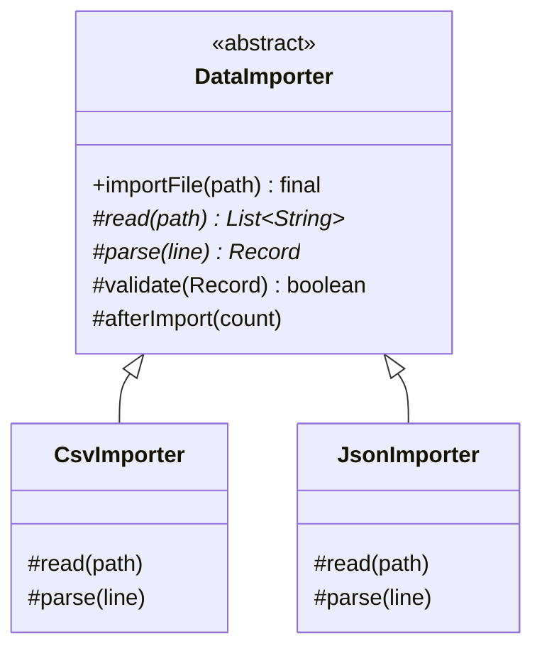

## Intent

**Template Method** puts the **invariant structure** of an algorithm in one `final` method of a base class and defers the **variable steps** to abstract methods (or overridable *hooks*) that subclasses implement. The base class calls the subclass — the “Hollywood Principle”: *don't call us, we'll call you*.

## Structure



- **Abstract steps** (`read`, `parse`) must be implemented
- **Hooks** (`validate`, `afterImport`) have default behaviour and may be overridden
- The **template method** (`importFile`) is `final` so subclasses can't break the algorithm's order

## Example: a data import pipeline

<Playground title="TemplateMethodDemo.java">

```java
import java.util.*;

record Customer(String name, String email) {}

abstract class CustomerImporter {
    // The template method: fixed sequence, cannot be overridden
    public final ImportReport run(String source) {
        List<String> raw = read(source);
        int ok = 0, rejected = 0;
        for (String line : raw) {
            Customer c = parse(line);
            if (validate(c)) { save(c); ok++; }
            else { rejected++; System.out.println("  rejected: " + line); }
        }
        var report = new ImportReport(getClass().getSimpleName(), ok, rejected);
        afterImport(report);
        return report;
    }

    // Abstract steps — subclasses MUST provide these
    protected abstract List<String> read(String source);
    protected abstract Customer parse(String line);

    // Hooks — sensible defaults, optionally overridden
    protected boolean validate(Customer c) { return c.email() != null && c.email().contains("@"); }
    protected void afterImport(ImportReport r) {}

    private void save(Customer c) { System.out.println("  saved " + c); }
}

record ImportReport(String importer, int imported, int rejected) {}

class CsvImporter extends CustomerImporter {
    protected List<String> read(String source) { return source.lines().skip(1).toList(); } // skip header
    protected Customer parse(String line) {
        String[] f = line.split(",");
        return new Customer(f[0].trim(), f.length > 1 ? f[1].trim() : null);
    }
}

class PipeImporter extends CustomerImporter {
    protected List<String> read(String source) { return List.of(source.split(";")); }
    protected Customer parse(String line) {
        String[] f = line.split("\\|");
        return new Customer(f[1], f[0]);
    }
    @Override protected boolean validate(Customer c) {           // stricter hook
        return super.validate(c) && c.email().endsWith(".com");
    }
    @Override protected void afterImport(ImportReport r) {
        System.out.println("  📣 notifying ops: " + r);
    }
}

class Main {
    public static void main(String[] args) {
        String csv = """
            name,email
            Ada Lovelace, ada@example.com
            Bob, not-an-email
            Grace Hopper, grace@navy.mil
            """;
        System.out.println(new CsvImporter().run(csv));
        System.out.println(new PipeImporter().run("alan@turing.com|Alan;linus@kernel.org|Linus"));
    }
}
```

</Playground>

## Template Method in Spring — callback style

Spring's `*Template` classes implement the pattern **without inheritance**: the template method takes the variable step as a *callback* (a lambda). You get the fixed algorithm (acquire connection → run → map rows → translate exceptions → release) and supply only the interesting part:

```java
List<User> users = jdbcTemplate.query(
    "select id, name from users where active = ?",
    (rs, rowNum) -> new User(rs.getLong("id"), rs.getString("name")),   // the variable step
    true);

transactionTemplate.execute(status -> {
    accountRepository.debit(from, amount);
    accountRepository.credit(to, amount);
    return null;
});
```

<Callout type="tip">
Prefer the **callback/lambda** form in new code: it favours composition over inheritance, works with classes that already extend something else, and is easier to test. Use the inheritance form when there are many related steps and hooks.
</Callout>

## Where you'll see it

- `java.util.AbstractList` — implement `get` and `size`; `iterator`, `indexOf`, `equals` etc. are templates built on them. Same for `AbstractMap`, `AbstractSet`
- `java.io.InputStream.read(byte[], int, int)` is built on the abstract `read()`
- `HttpServlet.service()` dispatching to `doGet` / `doPost`
- Spring: `JdbcTemplate`, `RestTemplate`, `TransactionTemplate`, `JmsTemplate`, `KafkaTemplate`, `AbstractApplicationContext.refresh()`, `OncePerRequestFilter.doFilterInternal`
- JUnit lifecycle: `@BeforeEach` → test → `@AfterEach`

<Callout type="interview">
**Template Method vs Strategy:** Template Method varies parts of an algorithm through **inheritance** — the subclass is fixed at compile time. Strategy varies the **whole** algorithm through **composition** — swappable at runtime. Spring's callback-based templates are a hybrid: the skeleton is a template method; each callback is a tiny strategy.
</Callout>
