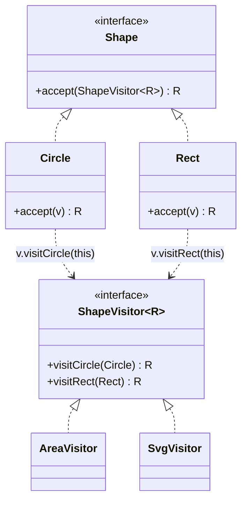

## Intent

**Visitor** separates an **operation** from the **object structure** it runs on. Each operation (export to JSON, compute tax, render, validate) becomes a visitor class with one `visit` method per element type. Elements expose a single `accept(visitor)` method. Adding a new operation means writing a new visitor — no element classes change.

It solves a fundamental limitation of single-dispatch languages like Java: choosing a method based on the **runtime type of the argument**. Visitor achieves *double dispatch* — the call depends on both the visitor's type and the element's type.

## Structure



## Classic vs modern Java

<CodeTabs labels={["Classic GoF visitor", "Java 21: sealed + switch"]}>

```java
interface Shape { <R> R accept(ShapeVisitor<R> v); }

interface ShapeVisitor<R> {
    R visitCircle(Circle c);
    R visitRect(Rect r);
}

record Circle(double r) implements Shape {
    public <R> R accept(ShapeVisitor<R> v) { return v.visitCircle(this); } // dispatch #2
}
record Rect(double w, double h) implements Shape {
    public <R> R accept(ShapeVisitor<R> v) { return v.visitRect(this); }
}

class AreaVisitor implements ShapeVisitor<Double> {
    public Double visitCircle(Circle c) { return Math.PI * c.r() * c.r(); }
    public Double visitRect(Rect r)     { return r.w() * r.h(); }
}

double area = shape.accept(new AreaVisitor());                             // dispatch #1
```

```java
sealed interface Shape permits Circle, Rect {}
record Circle(double r) implements Shape {}
record Rect(double w, double h) implements Shape {}

// Each "visitor" is just a function with an exhaustive switch
static double area(Shape s) {
    return switch (s) {
        case Circle c -> Math.PI * c.r() * c.r();
        case Rect(double w, double h) -> w * h;
    };   // no default: the compiler checks every subtype is handled
}
```

</CodeTabs>

With a **sealed** hierarchy, the compiler knows every possible subtype. A `switch` with type patterns is exhaustive and type-safe — if someone adds `Triangle`, every non-exhaustive `switch` fails to compile, exactly the safety net the classic visitor interface gave you, without the `accept` boilerplate.

## Example: several operations over an invoice

<Playground title="VisitorDemo.java">

```java
import java.math.*;
import java.util.*;

sealed interface LineItem permits Product, Service, Discount {}
record Product(String sku, BigDecimal price, int qty, boolean food) implements LineItem {}
record Service(String description, BigDecimal hourlyRate, double hours) implements LineItem {}
record Discount(String code, BigDecimal amount) implements LineItem {}

// Operation 1: amount
final class Amount {
    static BigDecimal of(LineItem item) {
        return switch (item) {
            case Product p -> p.price().multiply(BigDecimal.valueOf(p.qty()));
            case Service s -> s.hourlyRate().multiply(BigDecimal.valueOf(s.hours()));
            case Discount d -> d.amount().negate();
        };
    }
}

// Operation 2: VAT — different rules per type, with a guarded pattern
final class Vat {
    static BigDecimal of(LineItem item) {
        BigDecimal rate = switch (item) {
            case Product p when p.food() -> BigDecimal.ZERO;   // zero-rated food
            case Product p -> new BigDecimal("0.20");
            case Service s -> new BigDecimal("0.20");
            case Discount d -> new BigDecimal("0.20");
        };
        return Amount.of(item).multiply(rate);
    }
}

// Operation 3: rendering — added later without touching the records
final class Render {
    static String line(LineItem item) {
        return switch (item) {
            case Product(var sku, var price, var qty, var food) -> "%-22s %3d × %7s".formatted(sku + (food ? " (food)" : ""), qty, price);
            case Service(var desc, var rate, var hours) -> "%-22s %5.1fh × %5s".formatted(desc, hours, rate);
            case Discount(var code, var amt) -> "%-22s %15s".formatted("Discount " + code, "-" + amt);
        };
    }
}

class Main {
    public static void main(String[] args) {
        List<LineItem> invoice = List.of(
            new Product("COFFEE-BEANS", new BigDecimal("12.50"), 2, true),
            new Product("GRINDER", new BigDecimal("89.00"), 1, false),
            new Service("Barista training", new BigDecimal("40.00"), 1.5),
            new Discount("WELCOME10", new BigDecimal("10.00")));

        invoice.forEach(i -> System.out.println(Render.line(i)));
        BigDecimal net = invoice.stream().map(Amount::of).reduce(BigDecimal.ZERO, BigDecimal::add);
        BigDecimal vat = invoice.stream().map(Vat::of).reduce(BigDecimal.ZERO, BigDecimal::add).setScale(2, RoundingMode.HALF_UP);
        System.out.println("-".repeat(40));
        System.out.printf("Net %s  VAT %s  Total %s%n", net, vat, net.add(vat));
    }
}
```

</Playground>

## When to use Visitor

The **expression problem**: you can make it easy to add new *types* or easy to add new *operations*, but not both.

| | Add a new element type | Add a new operation |
| --- | --- | --- |
| Polymorphic methods on each class | Easy — one new class | Hard — edit every class |
| Visitor / pattern matching | Hard — update every visitor/switch | Easy — one new visitor/function |

Use Visitor when the **set of types is stable** but **operations keep growing** — ASTs, document models, financial instruments, file formats.

## Where you'll see it

- `java.nio.file.FileVisitor` / `Files.walkFileTree(path, visitor)`
- `javax.lang.model.element.ElementVisitor` and annotation processors; `com.sun.source.tree.TreeVisitor` in javac
- ASM / ByteBuddy `ClassVisitor` and `MethodVisitor` for bytecode manipulation
- Spring's `BeanDefinitionVisitor` (resolves placeholders across bean definitions)
- JSqlParser, Jackson's `JsonNode` tree walkers, compiler front-ends

<Callout type="interview">
Explaining **double dispatch** wins points: `shape.accept(visitor)` dispatches on the shape's runtime type; inside, `visitor.visitCircle(this)` dispatches on the visitor's runtime type. Then say that since Java 21, *sealed interfaces + pattern matching for switch* give the same exhaustiveness with far less ceremony — the language now has a built-in visitor.
</Callout>
