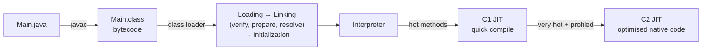

## From source to running code



1. `javac` compiles source into platform-independent **bytecode** (`.class` files).
2. A **class loader** loads the bytecode when a class is first needed (lazily).
3. The JVM **links** it — verifies the bytecode, allocates static fields, resolves symbolic references.
4. **Initialisation** runs static initialisers.
5. Code starts in the **interpreter**; hot code is compiled to native code by the **JIT**.

## The class loader hierarchy

| Loader | Loads | Location |
| --- | --- | --- |
| **Bootstrap** | Core platform: `java.lang`, `java.util`… | Built into the JVM (shows as `null` in Java) |
| **Platform** (Java 9+, formerly *Extension*) | Other JDK modules: `java.sql`, `java.xml`… | JDK modules |
| **Application** (System) | Your classes and dependencies | Class path / module path |
| Custom | Plugins, hot reload, app servers | Anything you like |

### Parent delegation

When asked to load a class, a loader first **delegates to its parent**; only if the parent can't find it does it try itself. This guarantees `java.lang.String` always comes from the bootstrap loader — you can't hijack core classes by putting your own `String` on the class path.

<Playground title="ClassLoading.java">

```java
import java.util.*;

class Lazy {
    static { System.out.println("  Lazy initialised"); }
    static final int CONSTANT = 42;                 // compile-time constant: inlined, no init
    static int counter = 0;
    static void touch() { counter++; }
}

class Main {
    public static void main(String[] args) throws Exception {
        System.out.println("String loaded by:  " + String.class.getClassLoader());          // bootstrap -> null
        System.out.println("java.sql loaded by: " + java.sql.Connection.class.getClassLoader().getName());
        // Single-file source mode uses an in-memory loader; from a jar this would be the "app" loader
        System.out.println("Main loaded by:    " + Main.class.getClassLoader().getClass().getSimpleName());

        // Walk the delegation chain
        ClassLoader cl = Main.class.getClassLoader();
        while (cl != null) { System.out.println("  -> " + cl.getClass().getSimpleName() + (cl.getName() != null ? " '" + cl.getName() + "'" : "")); cl = cl.getParent(); }
        System.out.println("  -> bootstrap");

        // Initialisation is lazy and happens at most once
        System.out.println("Reading a constant: " + Lazy.CONSTANT);    // does NOT trigger init
        System.out.println("Calling a static method:");
        Lazy.touch();                                                  // triggers init
        Lazy.touch();
        System.out.println("counter = " + Lazy.counter);

        // Class.forName loads and initialises by name
        Class<?> c = Class.forName("java.util.concurrent.ConcurrentHashMap");
        System.out.println("Loaded " + c.getSimpleName() + ", interfaces: " + Arrays.toString(c.getInterfaces()));
    }
}
```

</Playground>

<Callout type="tip" title="Why this matters in Spring Boot">
An executable Spring Boot jar nests dependency jars inside `BOOT-INF/lib`. The standard class loader can't read nested jars, so Boot's launcher installs its own class loader. Similarly, `ClassNotFoundException` vs `NoClassDefFoundError` debugging, devtools restarts (two class loaders: one for libraries, one for your code), and `ClassCastException`s between "identical" classes from different loaders all come down to class loading.
</Callout>

### ClassNotFoundException vs NoClassDefFoundError

| | `ClassNotFoundException` | `NoClassDefFoundError` |
| --- | --- | --- |
| Type | Checked exception | `Error` |
| When | Loading **by name** at runtime fails (`Class.forName`, `loadClass`) | A class present at **compile time** is missing at runtime, or its static initialiser previously failed |
| Typical cause | Missing JDBC driver / plugin on the class path | Dependency version conflict, missing jar, `ExceptionInInitializerError` earlier |

## The JIT compiler

The JVM starts by **interpreting** bytecode, gathering **profiles**: which branches are taken, which types appear at call sites, how often methods and loops run. **Tiered compilation** then kicks in:

- **C1** (client compiler) quickly compiles warm methods with light optimisations.
- **C2** (server compiler) recompiles hot methods with aggressive, profile-guided optimisations.

Key optimisations:

- **Inlining** — copying small callee bodies into the caller; the most important optimisation, enabling all the others
- **Escape analysis** — objects that never escape a method can be allocated on the stack or eliminated entirely (*scalar replacement*)
- **Loop unrolling**, **dead-code elimination**, **lock elision** (removing locks on non-escaping objects)
- **Devirtualisation** — if profiling shows only one implementation at a call site, call it directly (with a guard)

If an assumption is invalidated (a new subclass is loaded), the JVM **deoptimises** back to the interpreter and recompiles later.

<Callout type="warn" title="Benchmarking pitfalls">
Because of warm-up, dead-code elimination and on-stack replacement, naive `System.nanoTime()` loops measure the wrong thing. Use **JMH** (the Java Microbenchmark Harness) for any performance claim.
</Callout>

## Startup: CDS, AOT and native images

JIT gives excellent peak performance but slow startup and warm-up — painful for serverless and autoscaling:

- **Class Data Sharing (CDS / AppCDS)** — store pre-parsed class metadata in an archive shared across JVM runs. Spring Boot supports creating a CDS archive with a training run.
- **Project Leyden / AOT cache** (Java 24+, JEP 483 and successors) — cache loaded and linked classes, and later profiles and compiled code, from a training run.
- **GraalVM Native Image** — compiles the whole application ahead of time into a native executable: millisecond startup and low memory, but a closed-world assumption (reflection must be declared) and lower peak throughput. Spring Boot's AOT engine generates the required hints — see [Docker & Native Images](/spring-boot/docker-native-images/).

<Callout type="interview">
Common questions: *“Explain the class loader delegation model and why it exists”* (security and consistency of core classes), *“When is a class initialised?”* (first active use — `new`, static method call, non-constant static field access, `Class.forName`, subclass init), *“`ClassNotFoundException` vs `NoClassDefFoundError`?”*, *“What does the JIT do?”* (profile-guided compilation of hot code; inlining and escape analysis), and *“JIT vs AOT trade-offs?”* (peak performance vs startup time).
</Callout>
