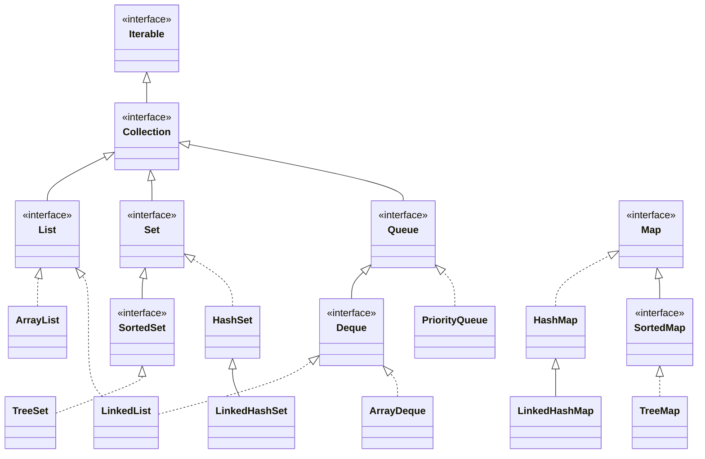

## The hierarchy



`Map` is part of the framework but does **not** extend `Collection`.

## Choosing an implementation

| Need | Use | Why |
| --- | --- | --- |
| Ordered list, index access | `ArrayList` | Contiguous array — fast random access, cache-friendly |
| Unique elements, fast lookup | `HashSet` | O(1) average `contains` |
| Unique + insertion order | `LinkedHashSet` | Hash table + linked list |
| Unique + sorted | `TreeSet` | Red-black tree, O(log n), range queries |
| Key → value lookup | `HashMap` | O(1) average |
| Map with insertion/access order, LRU cache | `LinkedHashMap` | Predictable iteration; `accessOrder=true` |
| Sorted keys, floor/ceiling queries | `TreeMap` | O(log n), `NavigableMap` API |
| Stack or FIFO queue | `ArrayDeque` | Faster than `Stack` and `LinkedList` |
| Priority / top-K | `PriorityQueue` | Binary heap, O(log n) offer/poll |
| Enum keys | `EnumMap` / `EnumSet` | Array/bit-vector backed — extremely fast |
| Thread-safe map | `ConcurrentHashMap` | Fine-grained locking, no global lock |

## Time complexity

| Operation | `ArrayList` | `LinkedList` | `HashSet`/`HashMap` | `TreeSet`/`TreeMap` | `ArrayDeque` | `PriorityQueue` |
| --- | --- | --- | --- | --- | --- | --- |
| add (end) | O(1)* | O(1) | O(1)† | O(log n) | O(1)* | O(log n) |
| get(i) | **O(1)** | O(n) | — | — | — | — |
| contains | O(n) | O(n) | **O(1)†** | O(log n) | O(n) | O(n) |
| remove(head) | O(n) | O(1) | — | O(log n) | **O(1)** | O(log n) |
| insert in middle | O(n) | O(n)‡ | — | — | — | — |

\* amortised — occasional resize copies the array. † average; worst case O(log n) since Java 8 treeified buckets. ‡ O(1) once you have the node, but finding it is O(n).

<Callout type="tip" title="ArrayList beats LinkedList almost always">
Despite its O(1) insertions, `LinkedList` is usually slower in practice: every node is a separate object (≈24+ bytes of overhead), scattered in memory, so iteration thrashes the CPU cache. Use `ArrayList` for lists and `ArrayDeque` for queues/stacks.
</Callout>

## Hands-on

<Playground title="CollectionsTour.java">

```java
import java.util.*;

class Main {
    public static void main(String[] args) {
        // List: ordered, allows duplicates
        List<String> langs = new ArrayList<>(List.of("Java", "Kotlin", "Java", "Scala"));
        langs.removeIf(l -> l.startsWith("S"));
        System.out.println("List            " + langs);

        // Sets: uniqueness with different orderings
        System.out.println("HashSet         " + new HashSet<>(List.of("pear", "apple", "fig", "apple")));
        System.out.println("LinkedHashSet   " + new LinkedHashSet<>(List.of("pear", "apple", "fig", "apple")));
        System.out.println("TreeSet         " + new TreeSet<>(List.of("pear", "apple", "fig", "apple")));

        // NavigableMap: range and nearest-key queries
        TreeMap<Integer, String> grades = new TreeMap<>(Map.of(90, "A", 80, "B", 70, "C", 60, "D", 0, "F"));
        System.out.println("Grade for 84    " + grades.floorEntry(84).getValue());
        System.out.println("Scores >= 75    " + grades.tailMap(75, true).keySet());

        // Deque as a stack and as a queue
        Deque<String> stack = new ArrayDeque<>();
        stack.push("a"); stack.push("b"); stack.push("c");
        System.out.println("Stack pop       " + stack.pop());
        Deque<String> queue = new ArrayDeque<>(List.of("first", "second"));
        queue.offer("third");
        System.out.println("Queue poll      " + queue.poll());

        // PriorityQueue: top 3 largest with a min-heap of size 3
        PriorityQueue<Integer> top = new PriorityQueue<>();
        for (int n : new int[]{5, 1, 9, 3, 7, 8, 2}) {
            top.offer(n);
            if (top.size() > 3) top.poll();
        }
        System.out.println("Top 3           " + top.stream().sorted(Comparator.reverseOrder()).toList());

        // Map idioms
        Map<String, Integer> wordCount = new TreeMap<>();
        for (String w : "the cat and the hat and the bat".split(" ")) wordCount.merge(w, 1, Integer::sum);
        System.out.println("Word counts     " + wordCount);
        Map<String, List<String>> byLetter = new TreeMap<>();
        for (String w : List.of("apple", "avocado", "banana", "blueberry", "cherry"))
            byLetter.computeIfAbsent(w.substring(0, 1), k -> new ArrayList<>()).add(w);
        System.out.println("Grouped         " + byLetter);
    }
}
```

</Playground>

## Map methods worth knowing

```java
map.getOrDefault(key, 0);
map.putIfAbsent(key, value);
map.computeIfAbsent(key, k -> new ArrayList<>()).add(item);   // multimap idiom
map.merge(word, 1, Integer::sum);                              // counting idiom
map.compute(key, (k, v) -> v == null ? 1 : v + 1);
map.entrySet().removeIf(e -> e.getValue() == 0);
map.forEach((k, v) -> System.out.println(k + "=" + v));
```

## Iterating and modifying

Modifying a collection while iterating over it with a for-each loop throws `ConcurrentModificationException` (fail-fast iterators). Use `removeIf`, `Iterator.remove()`, or collect changes and apply them afterwards.

## Legacy classes to avoid

| Legacy | Modern replacement |
| --- | --- |
| `Vector` | `ArrayList` (or `CopyOnWriteArrayList` for concurrency) |
| `Stack` | `ArrayDeque` |
| `Hashtable` | `HashMap` / `ConcurrentHashMap` |
| `Enumeration` | `Iterator` |

<Callout type="interview">
Typical questions: *“`ArrayList` vs `LinkedList`?”* (above), *“`HashMap` vs `TreeMap` vs `LinkedHashMap`?”* (ordering and complexity), *“How do you implement an LRU cache?”* — `LinkedHashMap` with `accessOrder = true` and an overridden `removeEldestEntry` — see [HashMap Internals](/java/hashmap-internals/).
</Callout>
