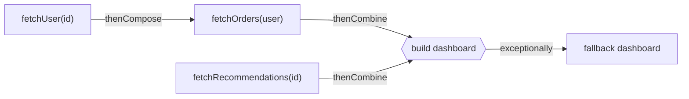

## Beyond Future

A plain `Future<T>` can only be **polled or blocked on** with `get()`. You can't say "when this finishes, do that". `CompletableFuture<T>` (Java 8) is a `Future` you can **compose**: attach callbacks, chain dependent calls, combine independent ones and recover from errors — without blocking a thread.

## Starting async work

```java
CompletableFuture<User> user = CompletableFuture.supplyAsync(() -> userClient.fetch(id), executor);
CompletableFuture<Void> audit = CompletableFuture.runAsync(() -> auditLog.write(event), executor);
CompletableFuture<String> done = CompletableFuture.completedFuture("cached");
```

<Callout type="warn" title="Always pass an executor for I/O">
Without an executor argument, `*Async` methods run on `ForkJoinPool.commonPool()`, which is sized for **CPU** work and shared by the entire JVM (including parallel streams). Blocking I/O there starves everything else. Pass a dedicated executor — on Java 21, `Executors.newVirtualThreadPerTaskExecutor()` is ideal for I/O.
</Callout>

## The composition toolkit

| Method | Input → output | Like |
| --- | --- | --- |
| `thenApply(fn)` | `T → U` | `map` |
| `thenCompose(fn)` | `T → CompletableFuture<U>` | `flatMap` — for dependent async calls |
| `thenAccept(consumer)` / `thenRun(runnable)` | `T → void` | terminal side effect |
| `thenCombine(other, bifn)` | two independent futures → one result | `zip` |
| `allOf(f...)` / `anyOf(f...)` | wait for all / first | |
| `exceptionally(fn)` | `Throwable → T` | `catch` |
| `handle(bifn)` | `(T, Throwable) → U` | `catch` + `map` |
| `whenComplete(biconsumer)` | observe result or error, pass through | `finally` |
| `orTimeout(d, unit)` / `completeOnTimeout(v, d, unit)` | fail / default after a timeout (Java 9) | |



## A realistic aggregation

<Playground title="CompletableFutureDemo.java">

```java
import java.time.*;
import java.util.*;
import java.util.concurrent.*;

record User(long id, String name) {}
record Order(String id, double total) {}
record Dashboard(String user, List<Order> orders, List<String> recommendations) {}

class Services {
    static void latency(long ms) { try { Thread.sleep(ms); } catch (InterruptedException e) { throw new CompletionException(e); } }
    static User fetchUser(long id) { latency(150); return new User(id, "Ada"); }
    static List<Order> fetchOrders(User u) { latency(200); return List.of(new Order("o1", 42.0), new Order("o2", 17.5)); }
    static List<String> fetchRecommendations(long id) {
        latency(180);
        if (id == 13) throw new IllegalStateException("recommendation service down");
        return List.of("Effective Java", "Java Concurrency in Practice");
    }
}

class Main {
    static CompletableFuture<Dashboard> dashboard(long userId, ExecutorService io) {
        CompletableFuture<User> user = CompletableFuture.supplyAsync(() -> Services.fetchUser(userId), io);

        // dependent call: needs the user first -> thenCompose
        CompletableFuture<List<Order>> orders = user.thenCompose(u -> CompletableFuture.supplyAsync(() -> Services.fetchOrders(u), io));

        // independent call: starts immediately, in parallel; degrade gracefully on failure
        CompletableFuture<List<String>> recs = CompletableFuture
            .supplyAsync(() -> Services.fetchRecommendations(userId), io)
            .completeOnTimeout(List.of(), 1, TimeUnit.SECONDS)
            .exceptionally(ex -> {
                System.out.println("  ⚠ recommendations failed: " + ex.getCause().getMessage());
                return List.of();
            });

        return user.thenCombine(orders, (u, o) -> new Object[]{u, o})
                   .thenCombine(recs, (uo, r) -> new Dashboard(((User) uo[0]).name(), (List<Order>) uo[1], r));
    }

    public static void main(String[] args) {
        try (ExecutorService io = Executors.newVirtualThreadPerTaskExecutor()) {
            for (long id : new long[]{1, 13}) {
                Instant start = Instant.now();
                Dashboard d = dashboard(id, io).join();
                System.out.printf("user %d -> %s in %d ms%n", id, d, Duration.between(start, Instant.now()).toMillis());
            }

            // allOf: fan out to many calls and gather the results
            List<CompletableFuture<User>> calls = List.of(1L, 2L, 3L, 4L).stream()
                .map(id -> CompletableFuture.supplyAsync(() -> Services.fetchUser(id), io)).toList();
            Instant start = Instant.now();
            List<Long> ids = CompletableFuture.allOf(calls.toArray(CompletableFuture[]::new))
                .thenApply(v -> calls.stream().map(CompletableFuture::join).map(User::id).toList())
                .join();
            System.out.println("fetched " + ids + " in " + Duration.between(start, Instant.now()).toMillis() + " ms (parallel)");

            // handle(): convert success or failure into a single result type
            String status = CompletableFuture.supplyAsync(() -> Services.fetchRecommendations(13), io)
                .handle((ok, err) -> err == null ? "ok: " + ok.size() : "failed: " + err.getCause().getClass().getSimpleName())
                .join();
            System.out.println(status);
        }
    }
}
```

</Playground>

The whole dashboard takes roughly `max(150 + 200, 180)` ms rather than the sum of all calls, because the independent recommendation call runs in parallel with the user → orders chain.

## thenApply vs thenCompose

```java
// thenApply with an async function nests futures:
CompletableFuture<CompletableFuture<List<Order>>> nested = user.thenApply(u -> fetchOrdersAsync(u));

// thenCompose flattens:
CompletableFuture<List<Order>> flat = user.thenCompose(u -> fetchOrdersAsync(u));
```

Rule: **if your function returns a `CompletableFuture`, use `thenCompose`**.

## Error semantics

- An exception in any stage completes the future **exceptionally**; dependent stages are skipped until a handler (`exceptionally`, `handle`, `whenComplete`) runs.
- Exceptions reaching a handler are usually wrapped in `CompletionException` — unwrap with `getCause()`.
- `join()` throws unchecked `CompletionException`; `get()` throws checked `ExecutionException`.

<Callout type="tip" title="Do you still need it?">
With **virtual threads**, many async chains can be rewritten as straightforward blocking code running in parallel virtual threads — easier to read, debug and profile. `CompletableFuture` remains useful for composing independent results, timeouts, and APIs that are already asynchronous (e.g. `HttpClient.sendAsync`, Spring's `@Async` methods returning `CompletableFuture`).
</Callout>

<Callout type="interview">
Typical questions: *“`thenApply` vs `thenCompose`?”* (map vs flatMap), *“`thenCombine` vs `allOf`?”*, *“How do you handle exceptions?”* (`exceptionally` / `handle` / `whenComplete`), *“Which thread runs a non-async callback?”* (whichever thread completes the previous stage — or the caller's, if it's already complete), and *“Why pass a custom executor?”* (common pool starvation).
</Callout>
