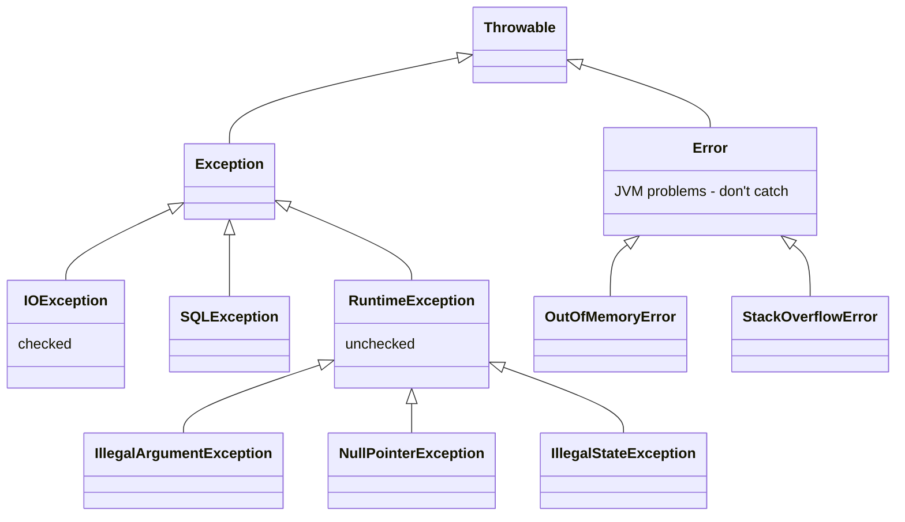

## The exception hierarchy



| Type | Checked at compile time? | Meaning | Examples |
| --- | --- | --- | --- |
| **Checked** (`Exception` but not `RuntimeException`) | Yes — must catch or declare `throws` | Recoverable conditions outside the program's control | `IOException`, `SQLException` |
| **Unchecked** (`RuntimeException`) | No | Programming errors or violated preconditions | `NullPointerException`, `IllegalArgumentException` |
| **Error** | No | Serious JVM problems you shouldn't handle | `OutOfMemoryError`, `StackOverflowError` |

## try / catch / finally

```java
try {
    process(order);
} catch (ValidationException | PricingException e) {    // multi-catch (Java 7)
    log.warn("Rejected order {}: {}", order.id(), e.getMessage());
} catch (RuntimeException e) {                           // more general types last
    log.error("Unexpected failure", e);
    throw e;
} finally {
    metrics.increment("orders.processed");               // always runs*
}
```

\* `finally` runs whether the `try` completes normally, throws, or `return`s — except if the JVM exits or the thread is killed.

<Callout type="danger">
Never `return` from a `finally` block: it silently swallows any exception thrown in `try` or `catch`, and overrides the earlier return value.
</Callout>

## try-with-resources

Any `AutoCloseable` declared in the `try (...)` header is closed automatically, in reverse order, even if an exception is thrown. Exceptions thrown by `close()` are attached as **suppressed** exceptions rather than hiding the original.

<Playground title="TryWithResources.java">

```java
class Resource implements AutoCloseable {
    private final String name;
    private final boolean failOnClose;
    Resource(String name, boolean failOnClose) {
        this.name = name; this.failOnClose = failOnClose;
        System.out.println("open  " + name);
    }
    void use() { System.out.println("use   " + name); throw new IllegalStateException("boom while using " + name); }
    @Override public void close() {
        System.out.println("close " + name);
        if (failOnClose) throw new IllegalArgumentException("close failed for " + name);
    }
}

class Main {
    public static void main(String[] args) {
        try (var db = new Resource("db", false);
             var file = new Resource("file", true)) {
            file.use();
        } catch (IllegalStateException e) {
            System.out.println("caught: " + e.getMessage());
            for (Throwable s : e.getSuppressed()) System.out.println("  suppressed: " + s.getMessage());
        }
    }
}
```

</Playground>

Resources are closed **before** the `catch` block runs, `file` before `db`, and the failure in `close()` is preserved as a suppressed exception instead of replacing the real error.

## Custom exceptions

Create domain-specific exceptions when callers need to react to a specific failure. Extend `RuntimeException` for most business errors in modern code (Spring translates and handles them centrally).

```java
public class InsufficientFundsException extends RuntimeException {
    private final String accountId;
    private final BigDecimal shortfall;

    public InsufficientFundsException(String accountId, BigDecimal shortfall) {
        super("Account %s is short by %s".formatted(accountId, shortfall));
        this.accountId = accountId;
        this.shortfall = shortfall;
    }

    public BigDecimal shortfall() { return shortfall; }
}
```

## Exception chaining

When translating a low-level exception into a higher-level one, **always pass the cause** so the original stack trace isn't lost:

```java
try {
    return objectMapper.readValue(json, Order.class);
} catch (JsonProcessingException e) {
    throw new InvalidOrderException("Malformed order payload", e);   // ← cause preserved
}
```

## Best practices

1. **Don't swallow exceptions.** An empty `catch {}` hides bugs. At minimum log, rethrow or convert.
2. **Catch the most specific type** you can actually handle. Avoid `catch (Exception e)` except at boundaries (a top-level handler, a scheduled job loop).
3. **Fail fast** — validate arguments early with `Objects.requireNonNull` and `IllegalArgumentException`.
4. **Don't use exceptions for control flow** — they're slow (stack trace capture) and obscure intent. Return `Optional` or a result type for expected outcomes like "not found".
5. **Log or rethrow, not both** — double logging produces confusing duplicate stack traces.
6. **Never catch `Throwable` or `Error`** unless you are writing framework code.
7. **Restore the interrupt flag** if you catch `InterruptedException` and can't rethrow it: `Thread.currentThread().interrupt()`.

<Callout type="interview">
*“Checked or unchecked — which should you use?”* A balanced answer: checked exceptions force callers to handle recoverable conditions, but they don't compose with lambdas/streams and leak implementation details through `throws` clauses. That's why Spring wraps checked exceptions in unchecked ones (e.g. `DataAccessException`) and why most modern Java APIs prefer unchecked exceptions for errors, plus `Optional`/result types for expected absence.
</Callout>

## Helpful NullPointerExceptions

Since Java 14, NPE messages name exactly what was null:

```text
Cannot invoke "String.length()" because the return value of "User.email()" is null
```
