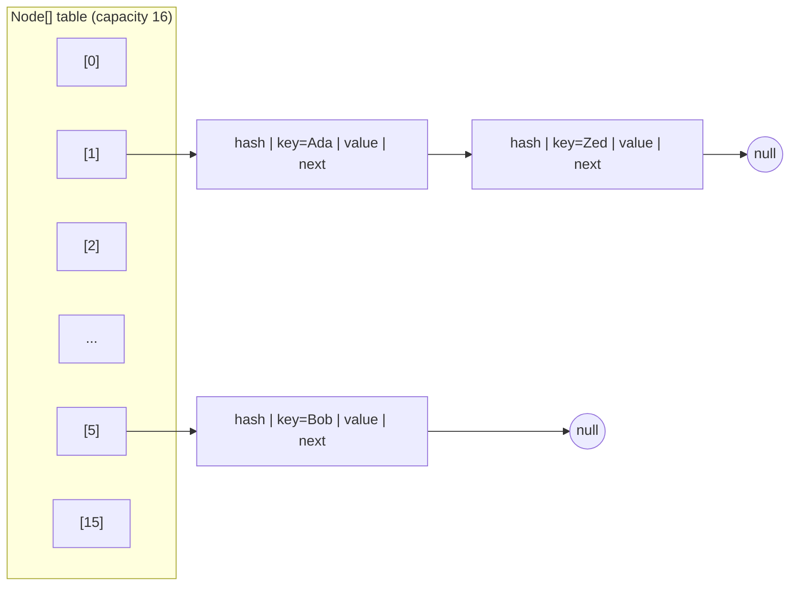

## The data structure

A `HashMap` is an **array of buckets**. Each bucket holds a linked list of nodes — or, since Java 8, a red-black tree when the list gets long.



Each node stores `hash`, `key`, `value` and `next`.

## put(key, value), step by step

1. **Hash the key**: `h = key.hashCode()`, then spread the high bits: `h ^ (h >>> 16)`. This mixes high-order bits into the low bits used for indexing, reducing collisions for poor hash codes.
2. **Find the bucket**: `index = hash & (capacity - 1)`. Because capacity is always a power of two, this bitmask equals `hash % capacity` but is much faster.
3. **Empty bucket?** Store a new node.
4. **Otherwise walk the bucket**: if a node has the same hash *and* `equals` the key, **replace its value**. Otherwise append a new node.
5. **Treeify**: if a bucket's list reaches **8** nodes (`TREEIFY_THRESHOLD`) and the table has at least **64** buckets, convert it to a red-black tree — worst-case lookups go from O(n) to O(log n). (With fewer than 64 buckets, it resizes instead.)
6. **Resize**: if `size > capacity × loadFactor` (default 16 × 0.75 = 12), double the capacity and redistribute nodes.

`get(key)` follows steps 1, 2 and 4: hash, index, then compare `hash` and `equals` along the bucket.

<Callout type="tip" title="Why equals AND hashCode">
`hashCode` picks the bucket; `equals` finds the exact key within it. That's why the [equals/hashCode contract](/java/equals-hashcode-comparable/) matters: equal keys must produce the same hash, or `get` looks in the wrong bucket.
</Callout>

## Watch it happen

<Playground title="HashMapInternals.java">

```java
import java.util.*;

// A key with a deliberately terrible hashCode — every instance collides
record BadKey(String id) implements Comparable<BadKey> {
    @Override public int hashCode() { return 42; }
    public int compareTo(BadKey o) { return id.compareTo(o.id); }   // lets treeified bins search in O(log n)
}

class Main {
    static int spread(int h) { return h ^ (h >>> 16); }

    public static void main(String[] args) {
        int capacity = 16;
        for (String key : List.of("Ada", "Bob", "Cy", "Polygenelubricants", "Aa", "BB")) {
            int h = key.hashCode();
            System.out.printf("%-20s hashCode=%11d  bucket=%2d%n", key, h, spread(h) & (capacity - 1));
        }
        System.out.println("\"Aa\" and \"BB\" have the same hashCode -> same bucket (a collision)");

        // Collisions degrade performance, but correctness is preserved by equals()
        Map<BadKey, Integer> map = new HashMap<>();
        for (int i = 0; i < 10_000; i++) map.put(new BadKey("k" + i), i);
        long start = System.nanoTime();
        int found = map.get(new BadKey("k9999"));
        System.out.printf("Found %d among 10k colliding keys in %d µs (treeified bucket)%n",
            found, (System.nanoTime() - start) / 1000);

        // null key is allowed (one), always in bucket 0
        Map<String, String> m = new HashMap<>();
        m.put(null, "null-key");
        System.out.println(m.get(null));

        // Iteration order is NOT insertion order
        Map<String, Integer> hm = new HashMap<>();
        Map<String, Integer> lhm = new LinkedHashMap<>();
        for (String s : List.of("zebra", "apple", "mango", "kiwi")) { hm.put(s, 1); lhm.put(s, 1); }
        System.out.println("HashMap       " + hm.keySet());
        System.out.println("LinkedHashMap " + lhm.keySet());
    }
}
```

</Playground>

## Load factor and capacity

- **Default capacity**: 16 buckets. **Default load factor**: 0.75 — a balance between memory and collision probability.
- Resizing is O(n) — every entry is moved. If you know the size, **presize**: `HashMap.newHashMap(1_000)` (Java 19+) computes the right capacity for 1,000 entries without resizing. (`new HashMap<>(1000)` sets *capacity*, which would still resize at 750.)
- During resize, each node either stays at index `i` or moves to `i + oldCapacity` — determined by a single bit of the hash — so no rehashing is needed.

## Key facts

| Property | `HashMap` |
| --- | --- |
| Null keys / values | One `null` key, many `null` values |
| Ordering | None (use `LinkedHashMap` / `TreeMap`) |
| Thread-safe | **No** — concurrent writes can lose data; use `ConcurrentHashMap` |
| Average get/put | O(1) |
| Worst case get | O(log n) with treeified buckets (O(n) before Java 8) |

## Building an LRU cache with LinkedHashMap

```java
class LruCache<K, V> extends LinkedHashMap<K, V> {
    private final int maxSize;

    LruCache(int maxSize) {
        super(16, 0.75f, true);          // accessOrder = true: get() moves entry to the end
        this.maxSize = maxSize;
    }

    @Override
    protected boolean removeEldestEntry(Map.Entry<K, V> eldest) {
        return size() > maxSize;         // evict least-recently-used after each put
    }
}
```

## ConcurrentHashMap in one paragraph

`ConcurrentHashMap` (Java 8+) uses **CAS** to insert into empty buckets and **synchronises on the first node** of a bucket for other updates — so threads writing to different buckets never block each other. Reads are lock-free. It forbids `null` keys and values (so `get` returning `null` unambiguously means "absent"), and offers atomic compound operations like `computeIfAbsent`, `merge` and `compute`.

<Callout type="interview">
The full answer to *“How does HashMap work?”* covers: array of buckets, `hashCode` + spreading, index via `hash & (n-1)`, collision handling with linked lists, **treeification at 8** (with ≥64 buckets), **load factor 0.75** and doubling on resize, and the role of `equals`. Bonus points: why capacity is a power of two, why `String` keys are ideal (immutable, cached hash), and why tree bins work best when keys are `Comparable`.
</Callout>
