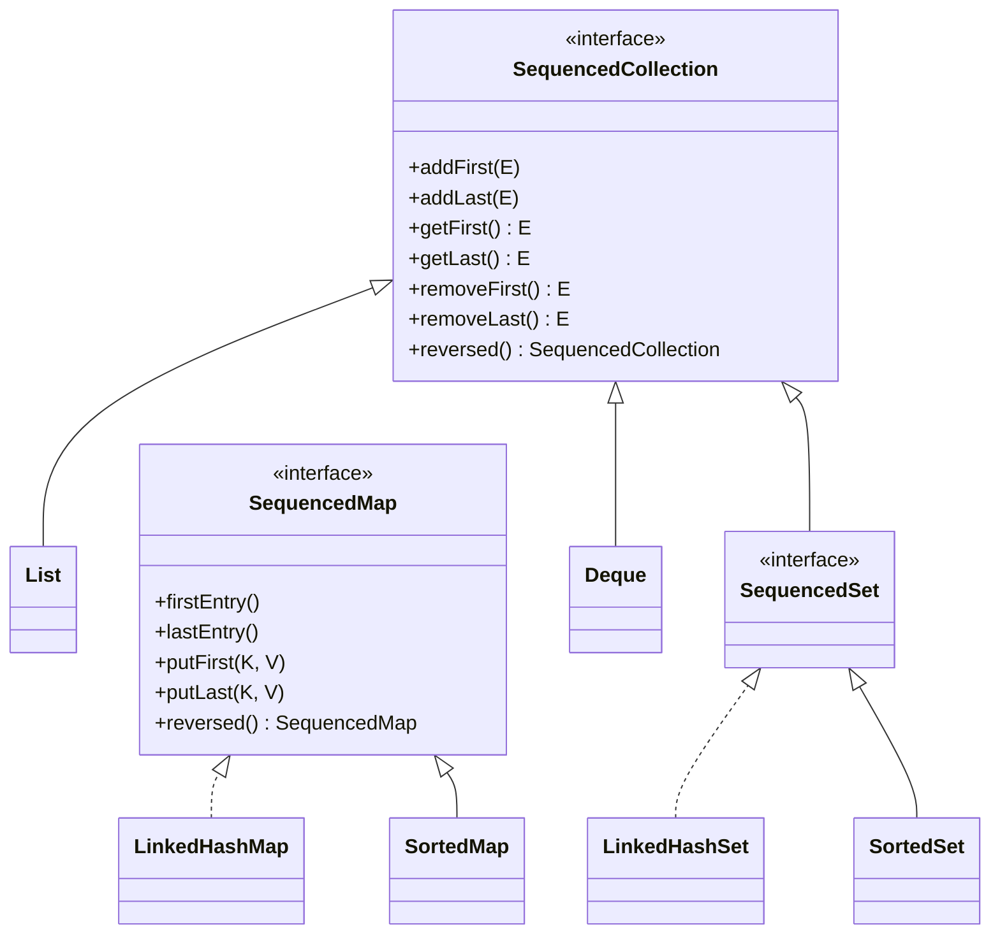

## Three kinds of "read-only"

Java has several ways to get a collection you can't modify — with very different guarantees:

| Factory | Mutate the result? | Backing collection changes visible? | Nulls? |
| --- | --- | --- | --- |
| `List.of(...)`, `Set.of`, `Map.of` (Java 9) | ✗ throws | n/a — truly immutable | ✗ throws NPE |
| `List.copyOf(c)` (Java 10) | ✗ throws | No — independent copy | ✗ |
| `Collections.unmodifiableList(list)` | ✗ throws | **Yes** — it's a read-only *view* | ✓ |
| `Arrays.asList(array)` | `set` ✓, `add`/`remove` ✗ | **Yes** — writes through to the array | ✓ |
| `stream.toList()` (Java 16) | ✗ throws | n/a | ✓ |
| `Collectors.toList()` | ✓ (currently an `ArrayList`) | n/a | ✓ |

<Playground title="ReadOnlyCollections.java">

```java
import java.util.*;
import java.util.stream.*;

class Main {
    static void attempt(String label, Runnable r) {
        try { r.run(); System.out.println(label + " -> ok"); }
        catch (RuntimeException e) { System.out.println(label + " -> " + e.getClass().getSimpleName()); }
    }

    public static void main(String[] args) {
        List<String> source = new ArrayList<>(List.of("a", "b"));

        List<String> view = Collections.unmodifiableList(source);
        List<String> copy = List.copyOf(source);
        source.add("c");                                     // mutate the original
        System.out.println("view sees change: " + view);
        System.out.println("copy is frozen:   " + copy);

        attempt("view.add", () -> view.add("x"));
        attempt("List.of.add", () -> List.of(1, 2).add(3));
        attempt("List.of(null)", () -> List.of("a", null));
        attempt("Map.of dup keys", () -> Map.of("k", 1, "k", 2));

        String[] array = {"x", "y", "z"};
        List<String> asList = Arrays.asList(array);
        asList.set(0, "X");                                  // writes through to the array
        System.out.println("array[0] = " + array[0]);
        attempt("asList.add", () -> asList.add("w"));

        List<Integer> streamed = Stream.of(1, 2, 3).toList();
        attempt("stream.toList().add", () -> streamed.add(4));
        List<Integer> collected = Stream.of(1, 2, 3).collect(Collectors.toList());
        attempt("collect(toList()).add", () -> collected.add(4));
    }
}
```

</Playground>

<Callout type="warn">
`List.of(...).contains(null)` throws `NullPointerException` rather than returning `false`. And `Set.of`/`Map.of` iteration order is deliberately randomised between JVM runs — never rely on it.
</Callout>

## Defensive copies

When a class stores a collection passed in by a caller, or returns one of its own, copy it — otherwise the caller can mutate your internal state:

```java
public final class Order {
    private final List<LineItem> items;

    public Order(List<LineItem> items) {
        this.items = List.copyOf(items);     // caller's list can't affect us
    }

    public List<LineItem> items() {
        return items;                        // already unmodifiable — safe to share
    }
}
```

`List.copyOf` is smart: if the argument is already an immutable `List.of` list, it returns it without copying.

## Sequenced collections (Java 21)

Before Java 21, getting the last element was inconsistent: `list.get(list.size() - 1)`, `deque.getLast()`, `sortedSet.last()`, and for `LinkedHashSet` — iterate the whole thing. Java 21 adds three interfaces that unify ordered collections:



<Playground title="SequencedCollections.java">

```java
import java.util.*;

class Main {
    public static void main(String[] args) {
        List<String> list = new ArrayList<>(List.of("b", "c"));
        list.addFirst("a");
        list.addLast("d");
        System.out.println(list.getFirst() + " … " + list.getLast() + "   reversed view: " + list.reversed());

        LinkedHashSet<Integer> set = new LinkedHashSet<>(List.of(3, 1, 4, 1, 5));
        System.out.println("first=" + set.getFirst() + " last=" + set.getLast());

        LinkedHashMap<String, Integer> scores = new LinkedHashMap<>();
        scores.put("ada", 90); scores.put("bob", 72); scores.put("cy", 85);
        scores.putFirst("zed", 60);                       // insert at the front
        System.out.println(scores + "  last entry: " + scores.lastEntry());
        System.out.println("reversed: " + scores.reversed());

        // reversed() is a live view, not a copy
        List<String> rev = list.reversed();
        list.add("e");
        System.out.println("view updated: " + rev);
    }
}
```

</Playground>

<Callout type="interview">
*“What's the difference between `Collections.unmodifiableList` and `List.copyOf`?”* — the first is a **view**: unmodifiable through that reference, but changes to the underlying list show through. The second is an **independent, immutable copy**. Also know that `Arrays.asList` is fixed-size but writable, and that `stream.toList()` is unmodifiable while `collect(Collectors.toList())` makes no such guarantee.
</Callout>
