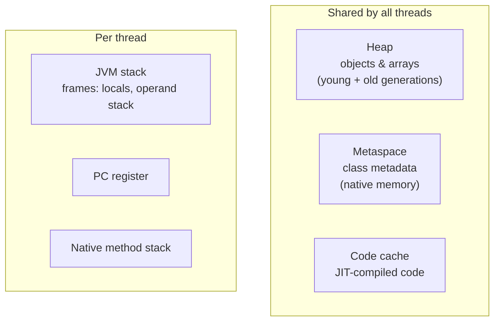
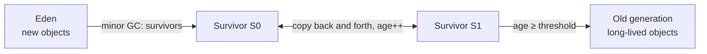

## Runtime data areas



| Area | Contents | Error when exhausted |
| --- | --- | --- |
| **Heap** | All objects and arrays; string pool | `OutOfMemoryError: Java heap space` |
| **Stack** (per thread) | One frame per method call: local primitives, object **references**, return address | `StackOverflowError` (deep recursion) |
| **Metaspace** | Class definitions, method bytecode, constant pools (replaced PermGen in Java 8) | `OutOfMemoryError: Metaspace` |
| **Code cache** | Native code produced by the JIT | JIT stops compiling — performance drops |
| **Direct memory** | `ByteBuffer.allocateDirect`, NIO, Netty | `OutOfMemoryError: Direct buffer memory` |

```java
void handle() {
    int count = 5;                  // primitive on the stack
    User u = new User("Ada");       // reference `u` on the stack, User object on the heap
}                                   // frame popped; the User becomes unreachable → eligible for GC
```

## How garbage collection works

The GC frees objects that are **unreachable** from **GC roots**: local variables on thread stacks, static fields, JNI references and active threads. Reference cycles are not a problem — if a cycle isn't reachable from a root, it's collected.

### The generational hypothesis

Most objects **die young** (request DTOs, iterators, temporary strings). So the heap is split:



- **Minor GC** — collects the young generation. Frequent and fast because it only copies the few survivors.
- **Major / full GC** — collects the old generation. Less frequent, more expensive.

### Phases

Most collectors **mark** reachable objects, then **sweep** the rest and/or **compact** survivors to avoid fragmentation. Pauses during which application threads are halted are called **stop-the-world (STW)** pauses; modern collectors do most of the work **concurrently** with the application.

## Choosing a collector

| Collector | Flag | Pause times | Best for |
| --- | --- | --- | --- |
| **G1** (default since 9) | `-XX:+UseG1GC` | ~10–200 ms, target via `MaxGCPauseMillis` | General-purpose server apps |
| **ZGC** (generational since 21) | `-XX:+UseZGC` | **< 1 ms**, independent of heap size | Low-latency services, very large heaps |
| **Shenandoah** | `-XX:+UseShenandoahGC` | Sub-10 ms, concurrent compaction | Low latency (OpenJDK builds) |
| **Parallel** | `-XX:+UseParallelGC` | Longer pauses, highest throughput | Batch jobs |
| **Serial** | `-XX:+UseSerialGC` | Single-threaded | Tiny heaps, small containers |

G1 divides the heap into equal **regions** and collects the regions with the most garbage first ("garbage first"). ZGC uses coloured pointers and load barriers to relocate objects while the application runs. In Java 21, enable generational ZGC with `-XX:+UseZGC -XX:+ZGenerational` (generational became the default for ZGC in Java 23).

## Essential flags

```bash
java -Xms2g -Xmx2g \                       # initial = max heap avoids resize pauses
     -XX:+UseG1GC -XX:MaxGCPauseMillis=100 \
     -XX:+HeapDumpOnOutOfMemoryError -XX:HeapDumpPath=/var/dumps \
     -Xlog:gc*:file=gc.log:time,uptime \      # unified GC logging (Java 9+)
     -jar app.jar
```

<Callout type="tip" title="Containers">
The JVM is container-aware: it reads cgroup limits. Rather than a fixed `-Xmx`, use `-XX:MaxRAMPercentage=75` so the heap scales with the container's memory limit, leaving room for metaspace, thread stacks, direct buffers and the code cache.
</Callout>

## Memory leaks in Java

GC can't free objects that are still **reachable**. Classic leaks:

- **Unbounded caches and static collections** — a `static Map` that only grows
- **Listeners and callbacks** never unregistered
- **`ThreadLocal`** values in pooled threads that are never `remove()`d
- **Unclosed resources** — streams, connections, `ResultSet`s
- **Inner class instances** holding a hidden reference to a large outer object
- **Wrong `equals`/`hashCode`** — "duplicate" keys accumulate in a `HashMap`

<Playground title="ReferencesDemo.java">

```java
import java.lang.ref.*;
import java.util.*;

class Main {
    public static void main(String[] args) throws Exception {
        Runtime rt = Runtime.getRuntime();
        System.out.printf("max heap: %d MB, processors: %d%n", rt.maxMemory() / 1024 / 1024, rt.availableProcessors());

        // A WeakReference doesn't keep its referent alive
        Object big = new byte[10_000_000];
        WeakReference<Object> weak = new WeakReference<>(big);
        System.out.println("before: weak.get() != null -> " + (weak.get() != null));
        big = null;                                    // drop the only strong reference
        System.gc();                                   // a hint, not a command
        Thread.sleep(100);
        System.out.println("after GC: weak.get() == null -> " + (weak.get() == null));

        // WeakHashMap: entries vanish when keys become unreachable
        Map<Object, String> metadata = new WeakHashMap<>();
        Object key = new Object();
        metadata.put(key, "session data");
        System.out.println("WeakHashMap size with live key: " + metadata.size());
        key = null;
        System.gc();
        Thread.sleep(100);
        System.out.println("WeakHashMap size after key unreachable: " + metadata.size());

        // A leak: a static-like list that only grows
        List<byte[]> leak = new ArrayList<>();
        long before = rt.totalMemory() - rt.freeMemory();
        for (int i = 0; i < 50; i++) leak.add(new byte[1_000_000]);
        long after = rt.totalMemory() - rt.freeMemory();
        System.out.printf("retained by the 'cache': ~%d MB (reachable, so GC can't free it)%n", (after - before) / 1024 / 1024);
    }
}
```

</Playground>

| Reference type | Collected when… | Typical use |
| --- | --- | --- |
| Strong | Never while reachable | Normal references |
| `SoftReference` | Memory is low | Memory-sensitive caches |
| `WeakReference` | Next GC once only weakly reachable | Canonicalising maps, metadata (`WeakHashMap`) |
| `PhantomReference` | After finalisation, for cleanup | Resource cleanup (`Cleaner`) |

## Diagnosing problems

- **`jcmd <pid> GC.heap_info`**, `jstat -gcutil <pid> 1s` — live GC stats
- **`jcmd <pid> GC.heap_dump file.hprof`** → analyse in **Eclipse MAT** or VisualVM ("dominator tree" finds what retains memory)
- **Java Flight Recorder**: `jcmd <pid> JFR.start duration=60s filename=app.jfr` → JDK Mission Control
- Spring Boot Actuator `/actuator/metrics/jvm.memory.used` and `/actuator/heapdump`

<Callout type="interview">
Expect: *“Stack vs heap?”*, *“How does GC decide what to collect?”* (reachability from GC roots, not reference counting), *“Explain young/old generations”*, *“G1 vs ZGC?”*, *“Can Java have memory leaks?”* (yes — reachable-but-unused objects), and *“How would you investigate an `OutOfMemoryError` in production?”* (heap dump on OOM → MAT dominator tree → find the retaining path).
</Callout>
