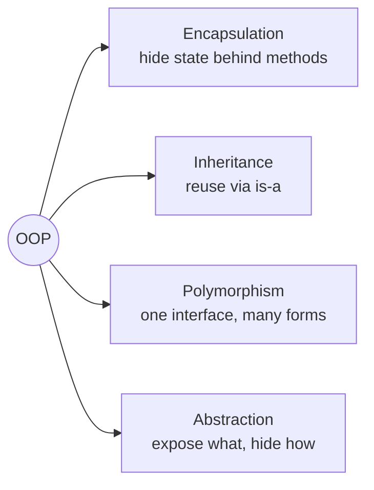

Java is an object-oriented language: programs are built from **objects** that bundle state (fields) with behaviour (methods). Four principles shape how those objects are designed.



## Encapsulation

Encapsulation means **an object controls access to its own state**. Fields are `private`; the outside world interacts through methods that enforce invariants.

```java
public class BankAccount {
    private final String id;
    private long balanceInCents;          // never directly writable from outside

    public BankAccount(String id) { this.id = id; }

    public void deposit(long cents) {
        if (cents <= 0) throw new IllegalArgumentException("Deposit must be positive");
        balanceInCents += cents;
    }

    public void withdraw(long cents) {
        if (cents > balanceInCents) throw new IllegalStateException("Insufficient funds");
        balanceInCents -= cents;
    }

    public long balance() { return balanceInCents; }
}
```

Nobody can set a negative balance, because the only way to change it goes through validated methods.

<Callout type="warn">
Getters and setters for every field are **not** encapsulation — they just make private fields public with extra steps. Expose *behaviour* (`withdraw`), not raw state (`setBalance`).
</Callout>

### Access modifiers

| Modifier | Class | Package | Subclass | Everywhere |
| --- | --- | --- | --- | --- |
| `private` | ✓ | | | |
| *(package-private, no keyword)* | ✓ | ✓ | | |
| `protected` | ✓ | ✓ | ✓ | |
| `public` | ✓ | ✓ | ✓ | ✓ |

## Inheritance

Inheritance creates an **is-a** relationship: a subclass inherits the fields and methods of its superclass and can add or override behaviour. Java supports **single inheritance of classes** but **multiple inheritance of interfaces**.

```java
class Vehicle {
    protected final String plate;
    Vehicle(String plate) { this.plate = plate; }
    int wheels() { return 4; }
}

class Motorbike extends Vehicle {
    Motorbike(String plate) { super(plate); }     // must call a super constructor first
    @Override int wheels() { return 2; }
}
```

<Callout type="tip" title="Favour composition over inheritance">
Inheritance couples a subclass tightly to its parent's implementation (the *fragile base class* problem). If the relationship is really **has-a** or **uses-a**, hold a reference instead: a `Car` *has an* `Engine`; it isn't one.
</Callout>

## Polymorphism

Polymorphism lets one reference type refer to objects of many concrete types, with the right method chosen **at runtime**.

- **Runtime polymorphism (overriding)** — a subclass replaces a superclass method; the JVM picks the implementation based on the object's actual class (*dynamic dispatch*).
- **Compile-time polymorphism (overloading)** — several methods share a name but have different parameter lists; the compiler picks one based on the static argument types.

<Playground title="Polymorphism.java">

```java
import java.util.*;

abstract class Employee {
    private final String name;
    Employee(String name) { this.name = name; }
    String name() { return name; }
    abstract double monthlyPay();                  // abstraction: what, not how

    @Override public String toString() {
        return "%-10s %-5s £%,9.2f".formatted(getClass().getSimpleName(), name, monthlyPay());
    }
}

class Salaried extends Employee {
    private final double annual;
    Salaried(String name, double annual) { super(name); this.annual = annual; }
    double monthlyPay() { return annual / 12; }
}

class Hourly extends Employee {
    private final double rate, hours;
    Hourly(String name, double rate, double hours) { super(name); this.rate = rate; this.hours = hours; }
    double monthlyPay() {
        double overtime = Math.max(0, hours - 160);
        return rate * (hours - overtime) + rate * 1.5 * overtime;
    }
}

class Contractor extends Employee {
    private final double dayRate; private final int days;
    Contractor(String name, double dayRate, int days) { super(name); this.dayRate = dayRate; this.days = days; }
    double monthlyPay() { return dayRate * days; }
}

class Printer {
    // Overloading: the compiler chooses by the *static* type of the argument
    static void print(Employee e) { System.out.println("Employee:   " + e.name()); }
    static void print(Salaried s) { System.out.println("Salaried:   " + s.name()); }
}

class Main {
    public static void main(String[] args) {
        List<Employee> staff = List.of(
            new Salaried("Ada", 84_000),
            new Hourly("Bob", 22.5, 172),
            new Contractor("Cy", 550, 18));

        // Overriding: the JVM picks monthlyPay() by the *runtime* type
        staff.forEach(System.out::println);
        System.out.printf("Payroll: £%,.2f%n", staff.stream().mapToDouble(Employee::monthlyPay).sum());

        Employee e = new Salaried("Dee", 60_000);
        Printer.print(e);                  // prints "Employee:" — overload chosen at compile time!
        Printer.print((Salaried) e);       // prints "Salaried:"
    }
}
```

</Playground>

<Callout type="interview">
The last two lines are a favourite trick question: **overload resolution uses the declared (static) type**, while **override dispatch uses the runtime type**. `Printer.print(e)` calls the `Employee` overload even though `e` holds a `Salaried`.
</Callout>

### Overriding rules

- Same name and parameter types; return type may be a **covariant** subtype
- Access can be widened (`protected` → `public`) but not narrowed
- Cannot throw broader **checked** exceptions
- `static`, `private` and `final` methods are **not** overridden (static methods are *hidden*)
- Always use `@Override` — the compiler then catches typos like `equals(MyType o)`

## Abstraction

Abstraction exposes **what** an object does and hides **how**. Java offers two tools:

- **Abstract classes** — can hold state, constructors and partially implemented behaviour
- **Interfaces** — define a contract; since Java 8 they can contain `default` and `static` methods

The `Employee.monthlyPay()` method above is abstraction: payroll code calls it without knowing how each employee type computes pay. See [Interfaces vs Abstract Classes](/java/interfaces-abstract-classes/) for when to use which.

## Summary

| Principle | Java mechanism | Benefit |
| --- | --- | --- |
| Encapsulation | `private` fields, methods that guard invariants | Objects can't be put in invalid states |
| Inheritance | `extends`, `super`, `@Override` | Reuse and specialisation |
| Polymorphism | Overriding (runtime), overloading (compile time) | Code against abstractions; extend without editing |
| Abstraction | `abstract` classes, `interface` | Hide complexity, decouple modules |
