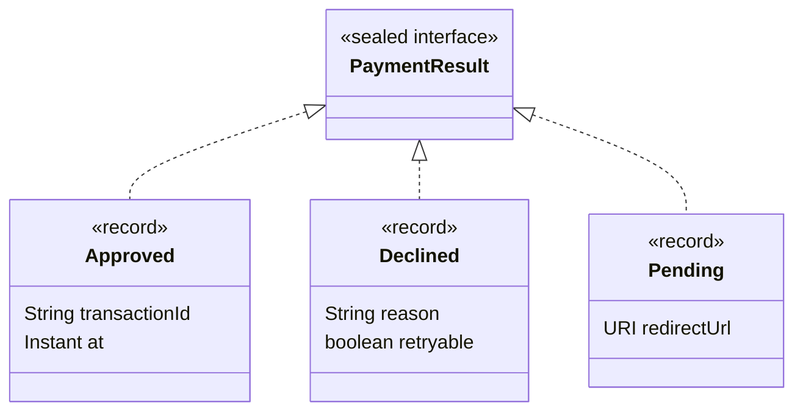

## Sealed types (Java 17)

A **sealed** class or interface declares exactly which classes may extend or implement it. The hierarchy becomes **closed**: the compiler knows every possible subtype.

```java
public sealed interface Shape permits Circle, Rectangle, Triangle {}

public record Circle(double radius) implements Shape {}
public record Rectangle(double width, double height) implements Shape {}
public final class Triangle implements Shape { /* ... */ }
```

Every permitted subclass must say how it continues the hierarchy:

| Modifier | Meaning |
| --- | --- |
| `final` | No further subclasses (records are implicitly final) |
| `sealed … permits …` | Its own closed set of subclasses |
| `non-sealed` | Re-opens the hierarchy — anyone may extend it |

If all permitted types are in the same file, `permits` can be omitted.

## Why closed hierarchies matter

Inheritance is usually about *extensibility* — anyone can add a subtype. Sealing is about *modelling*: some domains have a fixed set of cases. A payment **is** a card payment, a bank transfer or a wallet payment — nothing else. Sealing lets the compiler enforce that, which unlocks **exhaustive** pattern matching.



## Pattern matching for switch (Java 21)

`switch` can now match on **types**, deconstruct **records**, and add **guards** with `when`:

<Playground title="PatternMatching.java">

```java
import java.net.URI;
import java.time.Instant;
import java.util.*;

sealed interface PaymentResult permits Approved, Declined, Pending {}
record Approved(String transactionId, Instant at) implements PaymentResult {}
record Declined(String reason, boolean retryable) implements PaymentResult {}
record Pending(URI redirectUrl) implements PaymentResult {}

sealed interface Shape permits Circle, Rect, Group {}
record Circle(double r) implements Shape {}
record Rect(double w, double h) implements Shape {}
record Group(List<Shape> children) implements Shape {}

class Main {
    static String handle(PaymentResult result) {
        // Exhaustive: no default needed. Add a 4th result type and this stops compiling.
        return switch (result) {
            case Approved a -> "✓ paid, txn " + a.transactionId();
            case Declined(String reason, boolean retry) when retry -> "↻ retry later: " + reason;
            case Declined(String reason, var ignored) -> "✗ declined: " + reason;
            case Pending(URI url) -> "… redirect customer to " + url.getHost();
        };
    }

    // Recursive data + recursive pattern matching
    static double area(Shape s) {
        return switch (s) {
            case Circle(double r) -> Math.PI * r * r;
            case Rect(double w, double h) when w == h -> w * w;          // squares
            case Rect(double w, double h) -> w * h;
            case Group(List<Shape> kids) -> kids.stream().mapToDouble(Main::area).sum();
        };
    }

    // Pattern matching on arbitrary objects, including null
    static String describe(Object o) {
        return switch (o) {
            case null -> "null!";
            case Integer i when i > 1000 -> "big int " + i;
            case Integer i -> "int " + i;
            case String s when s.isBlank() -> "blank string";
            case String s -> "string of length " + s.length();
            case int[] arr -> "int array of " + arr.length;
            case Collection<?> c -> c.size() + " element collection";
            default -> "some " + o.getClass().getSimpleName();
        };
    }

    public static void main(String[] args) {
        List<PaymentResult> results = List.of(
            new Approved("TX-981", Instant.now()),
            new Declined("insufficient funds", false),
            new Declined("issuer unavailable", true),
            new Pending(URI.create("https://3ds.bank.example/challenge")));
        results.forEach(r -> System.out.println(handle(r)));

        Shape drawing = new Group(List.of(new Circle(1), new Rect(2, 2), new Group(List.of(new Rect(1, 3)))));
        System.out.printf("total area = %.3f%n", area(drawing));

        for (Object o : new Object[]{42, 5000, "", "hello", new int[3], Set.of(1, 2), 3.14, null})
            System.out.println(describe(o));
    }
}
```

</Playground>

## The rules

- **Exhaustiveness** — a `switch` *expression* (and any pattern `switch`) must cover every possible input. For sealed types, listing every permitted subtype suffices; otherwise add `default`.
- **Dominance** — a more general pattern can't come before a more specific one: `case CharSequence cs` before `case String s` is a compile error. Guarded cases must come before the unguarded case for the same type.
- **null** — a pattern `switch` throws `NullPointerException` on `null` unless you add `case null` (optionally `case null, default ->`).
- **Unnamed patterns** — `_` for components you don't need is final in **Java 22** (`case Declined(String reason, _)`). In Java 21, use `var ignored` as above.

## Data-oriented programming

Sealed interfaces + records + pattern matching enable a style where **data and behaviour are separated**: model the domain as immutable data types, and write operations as functions that switch over them. It complements OOP rather than replacing it:

| Use classic OOP polymorphism when… | Use sealed types + switch when… |
| --- | --- |
| New *types* are added often (plugins) | The set of types is fixed by the domain |
| Behaviour belongs with the data | Many independent operations over the same data |
| Implementations live in different modules | You want the compiler to find every unhandled case |

It's the modern replacement for the [Visitor pattern](/design-patterns/visitor/).

<Callout type="tip" title="Modelling results and errors">
A sealed `Result` type (`Success` / `Failure` records) is a clean alternative to exceptions for *expected* failures, such as validation or a declined payment. Callers can't forget a case — the compiler won't let them.
</Callout>

<Callout type="interview">
*“What problem do sealed classes solve?”* — they let you model a closed set of alternatives (sum types), preserve encapsulation of the hierarchy, and give the compiler enough information for exhaustive `switch` without a `default` branch that silently swallows new cases. Be ready to explain `final` vs `sealed` vs `non-sealed`, and what `when` guards do.
</Callout>
