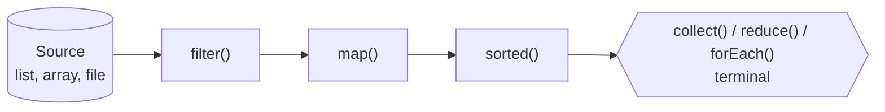

## What is a stream?

A **stream** is a sequence of elements supporting declarative, pipeline-style operations. It is **not** a data structure: it doesn't store elements, it computes them from a source (a collection, array, file, generator) on demand.



A pipeline has three parts:

1. **Source** — `list.stream()`, `Arrays.stream(arr)`, `Stream.of(...)`, `Files.lines(path)`, `IntStream.range(0, n)`
2. **Intermediate operations** (lazy, return a new stream) — `filter`, `map`, `flatMap`, `distinct`, `sorted`, `peek`, `limit`, `skip`, `takeWhile`, `dropWhile`, `mapMulti`
3. **Terminal operation** (triggers execution) — `collect`, `toList`, `reduce`, `forEach`, `count`, `min`/`max`, `anyMatch`/`allMatch`/`noneMatch`, `findFirst`/`findAny`

## A realistic pipeline

<Playground title="Streams.java">

```java
import java.util.*;
import java.util.stream.*;

record Order(String id, String customer, String status, List<Line> lines) {
    double total() { return lines.stream().mapToDouble(l -> l.price() * l.qty()).sum(); }
}
record Line(String sku, double price, int qty) {}

class Main {
    public static void main(String[] args) {
        List<Order> orders = List.of(
            new Order("o1", "ada", "PAID", List.of(new Line("BOOK", 20, 2), new Line("PEN", 2, 5))),
            new Order("o2", "bob", "CANCELLED", List.of(new Line("LAMP", 45, 1))),
            new Order("o3", "ada", "PAID", List.of(new Line("MUG", 8, 3), new Line("BOOK", 20, 1))),
            new Order("o4", "cy", "PAID", List.of(new Line("DESK", 250, 1))));

        // filter -> map -> sorted -> limit -> toList
        List<String> bigPaid = orders.stream()
            .filter(o -> o.status().equals("PAID"))
            .sorted(Comparator.comparingDouble(Order::total).reversed())
            .limit(2)
            .map(o -> o.id() + "=" + o.total())
            .toList();
        System.out.println("Top paid orders: " + bigPaid);

        // flatMap: one order -> many lines
        Set<String> skus = orders.stream()
            .flatMap(o -> o.lines().stream())
            .map(Line::sku)
            .collect(Collectors.toCollection(TreeSet::new));
        System.out.println("Distinct SKUs:   " + skus);

        // reduce and primitive streams
        double revenue = orders.stream().filter(o -> !o.status().equals("CANCELLED")).mapToDouble(Order::total).sum();
        IntSummaryStatistics qty = orders.stream().flatMap(o -> o.lines().stream()).mapToInt(Line::qty).summaryStatistics();
        System.out.println("Revenue: " + revenue + "  qty stats: " + qty);

        // short-circuiting terminals
        System.out.println("Any desk? " + orders.stream().flatMap(o -> o.lines().stream()).anyMatch(l -> l.sku().equals("DESK")));
        System.out.println("First by ada: " + orders.stream().filter(o -> o.customer().equals("ada")).findFirst().map(Order::id).orElse("-"));

        // Laziness: watch how few elements are actually processed
        Stream.iterate(1, n -> n + 1)                 // infinite source!
            .peek(n -> System.out.print("[" + n + "]"))
            .filter(n -> n % 3 == 0)
            .limit(2)
            .forEach(n -> System.out.print(" -> " + n + " "));
        System.out.println();
    }
}
```

</Playground>

The last pipeline works on an **infinite** stream because operations are lazy and `limit` short-circuits: elements flow through the pipeline **one at a time** (vertical processing), and processing stops as soon as two multiples of 3 are found.

## map vs flatMap

- `map(f)`: one element in → one element out. `Stream<Order>` → `Stream<List<Line>>`
- `flatMap(f)`: one element in → a *stream* out, flattened. `Stream<Order>` → `Stream<Line>`

```java
List<List<Integer>> nested = List.of(List.of(1, 2), List.of(3), List.of());
nested.stream().flatMap(List::stream).toList();     // [1, 2, 3]
```

## Primitive streams

`IntStream`, `LongStream` and `DoubleStream` avoid boxing and add `sum`, `average`, `range`, `summaryStatistics`:

```java
IntStream.rangeClosed(1, 5).map(i -> i * i).sum();          // 55
list.stream().mapToInt(String::length).max().orElse(0);
IntStream.range(0, 3).boxed().toList();                     // back to Stream<Integer>
```

## Rules for well-behaved streams

1. **Streams are single-use.** Calling a second terminal operation throws `IllegalStateException`.
2. **No side effects in intermediate ops.** Don't mutate external state in `map` or `filter`; `peek` is for debugging only.
3. **Non-interference.** Never modify the source collection during the pipeline.
4. **Stateless lambdas.** Behaviour shouldn't depend on state that changes as the pipeline runs.
5. **Close I/O streams.** `Files.lines(...)` holds a file handle — use try-with-resources.

```java
try (Stream<String> lines = Files.lines(Path.of("access.log"))) {
    long errors = lines.filter(l -> l.contains(" 500 ")).count();
}
```

## Parallel streams

`.parallel()` splits work across the common `ForkJoinPool`. It can help for **large, CPU-bound, easily splittable** workloads (arrays, `ArrayList`, `IntStream.range`) — and hurt everywhere else.

<Callout type="warn" title="When parallel streams hurt">
- Small collections — splitting overhead dominates
- `LinkedList` or `Stream.iterate` sources — they split poorly
- **Blocking I/O** in the pipeline — it starves the shared common pool used by the whole JVM
- Order-sensitive operations (`findFirst`, `limit`, `sorted`) on ordered streams
- Shared mutable state — data races. Use `collect`, never `forEach` into an `ArrayList`

Measure with JMH before parallelising. For I/O-bound fan-out, use virtual threads instead.
</Callout>

## Java 16+ conveniences

```java
stream.toList();                                     // unmodifiable list (Java 16)
Stream.of(1, 2, 3).mapMulti((n, sink) -> {           // 0..n outputs per element (Java 16)
    if (n % 2 == 1) { sink.accept(n); sink.accept(n * 10); }
});
stream.takeWhile(x -> x < 10);                       // Java 9 — stop at first failure
Stream.ofNullable(maybeNull);                        // empty stream for null (Java 9)
```

<Callout type="interview">
Classic questions: *“What's the difference between intermediate and terminal operations?”*, *“Are streams lazy? Prove it”* (the infinite-stream demo), *“map vs flatMap”*, *“When would you avoid parallel streams?”*, and *“Collection vs Stream”* — a collection is an in-memory data structure you can iterate many times; a stream is a one-shot, lazily computed view that can even be infinite.
</Callout>
