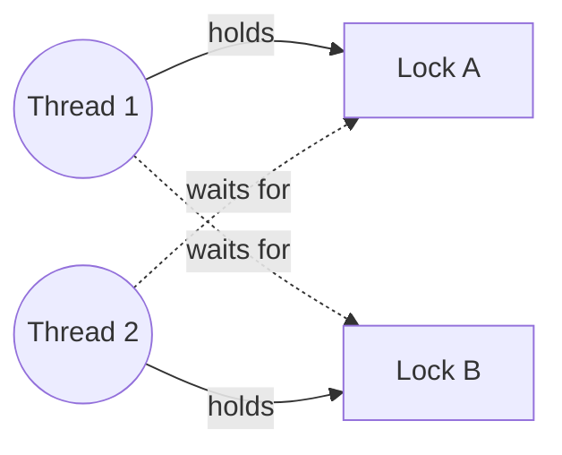

## Two problems: atomicity and visibility

Thread-safety bugs come in two flavours:

- **Atomicity (race conditions)** — `count++` is actually *read, add, write*. Two threads can read the same value and both write `n + 1`, losing an update.
- **Visibility** — without synchronisation, one thread's writes may never become visible to another. CPUs cache values in registers and cores' caches, and both the JIT and the CPU **reorder** instructions.

<Playground title="RaceCondition.java">

```java
import java.util.concurrent.*;
import java.util.concurrent.atomic.*;

class Counters {
    int unsafe = 0;
    int synced = 0;
    final AtomicInteger atomic = new AtomicInteger();

    void incUnsafe() { unsafe++; }                 // read-modify-write: not atomic
    synchronized void incSynced() { synced++; }    // intrinsic lock on `this`
    void incAtomic() { atomic.incrementAndGet(); } // lock-free CAS
}

class Main {
    public static void main(String[] args) throws Exception {
        var c = new Counters();
        int threads = 8, perThread = 100_000;
        try (var pool = Executors.newFixedThreadPool(threads)) {
            for (int t = 0; t < threads; t++) {
                pool.submit(() -> {
                    for (int i = 0; i < perThread; i++) { c.incUnsafe(); c.incSynced(); c.incAtomic(); }
                });
            }
        }
        int expected = threads * perThread;
        System.out.println("expected     " + expected);
        System.out.println("unsafe       " + c.unsafe + (c.unsafe == expected ? "" : "   ← lost updates!"));
        System.out.println("synchronized " + c.synced);
        System.out.println("atomic       " + c.atomic.get());
    }
}
```

</Playground>

## synchronized

Every object has an **intrinsic lock** (monitor). `synchronized` acquires it, guaranteeing **mutual exclusion** *and* **visibility**: everything a thread did before releasing the lock is visible to the next thread that acquires it.

```java
public synchronized void deposit(long amount) { ... }        // locks `this`
public static synchronized void reset() { ... }               // locks Account.class

private final Object lock = new Object();
public void transfer(...) {
    synchronized (lock) { ... }                               // private lock object — preferred
}
```

Intrinsic locks are **reentrant**: a thread holding a lock can enter another `synchronized` block on the same lock without deadlocking itself.

<Callout type="tip">
Lock on a **private final** object rather than `this` or a class literal — external code can't then interfere by synchronising on your object. Never synchronise on boxed values or string literals: they may be shared across the whole JVM.
</Callout>

## volatile

`volatile` guarantees **visibility and ordering** for a single variable — reads always see the latest write — but **not atomicity** of compound actions.

```java
class Worker implements Runnable {
    private volatile boolean running = true;     // without volatile the loop may never stop
    public void stop() { running = false; }
    public void run() { while (running) { doWork(); } }
}
```

Use `volatile` for **flags and published references** written by one thread and read by others. For counters or check-then-act logic use locks or atomics. `volatile long` and `volatile double` are also guaranteed to be written atomically (plain 64-bit writes may tear on some platforms).

## Happens-before

The **Java Memory Model** defines when a write is guaranteed visible to a read via the *happens-before* relation. The most important edges:

| Action A | happens-before action B |
| --- | --- |
| Unlock of a monitor | Every later lock of the same monitor |
| Write to a `volatile` field | Every later read of that field |
| `thread.start()` | Every action in the started thread |
| Every action in a thread | Another thread's successful `join()` on it |
| Completion of a constructor's `final` field writes | Any thread that sees the object reference (safe publication) |
| Putting into a concurrent collection / completing a `Future` | Retrieving it |

If there's no happens-before path between a write and a read, the program has a **data race**, and the read may see a stale value.

## Double-checked locking — why volatile matters

```java
class Config {
    private static volatile Config instance;     // remove volatile and this is broken
    static Config get() {
        Config c = instance;
        if (c == null) {
            synchronized (Config.class) {
                c = instance;
                if (c == null) instance = c = new Config();
            }
        }
        return c;
    }
}
```

Without `volatile`, the write of the reference may be reordered before the constructor's writes, so another thread can see a non-null but **half-constructed** object.

## wait / notify

`wait()`, `notify()` and `notifyAll()` coordinate threads on a monitor. They must be called while holding the lock, and `wait()` must be called **in a loop** that rechecks the condition (spurious wake-ups happen):

```java
synchronized (queue) {
    while (queue.isEmpty()) queue.wait();     // releases the lock while waiting
    item = queue.remove();
}
```

In modern code prefer `BlockingQueue`, `CountDownLatch`, `Semaphore` or `Condition` — they're easier to get right.

## Deadlock

A **deadlock** occurs when threads wait for each other's locks in a cycle. The four Coffman conditions — mutual exclusion, hold-and-wait, no pre-emption, circular wait — must all hold.



Prevention strategies:

- **Lock ordering** — always acquire locks in a global order (e.g. by account id)
- **Timeouts** — `ReentrantLock.tryLock(timeout)` and back off
- **Hold fewer locks** — keep critical sections small; don't call alien methods while holding a lock
- Detect with thread dumps (`jstack <pid>`, `jcmd <pid> Thread.print`) — the JVM reports found deadlocks

<Callout type="interview">
Expect: *“Difference between `synchronized` and `volatile`?”* (mutual exclusion + visibility vs visibility only), *“Is `count++` on a volatile int thread-safe?”* (no), *“What is happens-before?”*, *“Why does double-checked locking need volatile?”*, and *“How do you prevent deadlocks?”* (lock ordering, tryLock with timeout).
</Callout>
