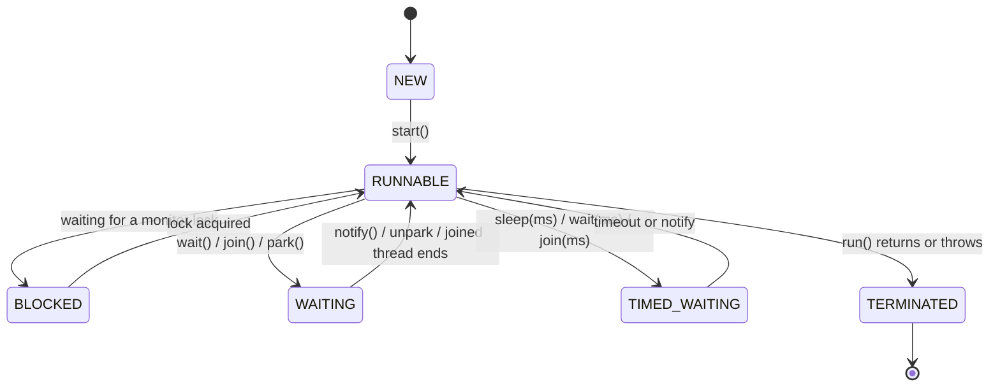

## Threads and their lifecycle

A **thread** is an independent path of execution inside a process; threads of the same JVM share the heap. Each Java thread moves through these states (`Thread.State`):



`RUNNABLE` covers both "running on a CPU" and "ready to run" — the JVM doesn't distinguish them.

## Creating threads

```java
Thread t1 = new Thread(() -> System.out.println("hi from " + Thread.currentThread().getName()));
t1.start();        // start() creates a new thread; calling run() directly would NOT
t1.join();         // wait for it to finish

Thread t2 = Thread.ofPlatform().name("worker-1").daemon(true).start(task);   // Java 21 builder
```

Prefer implementing `Runnable` (or using lambdas) over extending `Thread`: it separates the *task* from the *mechanism* that runs it. In application code, prefer an **executor** over creating threads by hand.

## Runnable vs Callable

| | `Runnable` | `Callable<V>` |
| --- | --- | --- |
| Method | `void run()` | `V call() throws Exception` |
| Returns a value | No | Yes |
| Throws checked exceptions | No | Yes |
| Submit to executor | `execute()` or `submit()` | `submit()` → `Future<V>` |

## ExecutorService

An `ExecutorService` decouples task submission from thread management: threads are reused, the number of concurrent tasks is bounded, and results come back as `Future`s.

<Playground title="Executors.java">

```java
import java.util.*;
import java.util.concurrent.*;

class Main {
    static int slowSquare(int n) throws InterruptedException {
        Thread.sleep(100);
        if (n == 7) throw new IllegalArgumentException("unlucky 7");
        return n * n;
    }

    public static void main(String[] args) throws Exception {
        ExecutorService pool = Executors.newFixedThreadPool(4);
        try {
            // submit Callables and collect Futures
            List<Future<Integer>> futures = new ArrayList<>();
            for (int i = 1; i <= 8; i++) {
                int n = i;
                futures.add(pool.submit(() -> slowSquare(n)));
            }
            for (int i = 0; i < futures.size(); i++) {
                try {
                    System.out.println((i + 1) + "² = " + futures.get(i).get(1, TimeUnit.SECONDS));
                } catch (ExecutionException e) {                       // task threw
                    System.out.println((i + 1) + "² failed: " + e.getCause().getMessage());
                }
            }

            // invokeAll: run a batch and wait for all
            List<Callable<String>> batch = List.of(
                () -> "A on " + Thread.currentThread().getName(),
                () -> "B on " + Thread.currentThread().getName(),
                () -> "C on " + Thread.currentThread().getName());
            for (Future<String> f : pool.invokeAll(batch)) System.out.println(f.get());

            // invokeAny: first successful result wins (others are cancelled)
            String fastest = pool.invokeAny(List.of(
                () -> { Thread.sleep(300); return "slow mirror"; },
                () -> { Thread.sleep(50); return "fast mirror"; }));
            System.out.println("invokeAny -> " + fastest);
        } finally {
            pool.shutdown();                                         // stop accepting, finish queued work
            if (!pool.awaitTermination(5, TimeUnit.SECONDS)) {
                pool.shutdownNow();                                  // interrupt running tasks
            }
        }
        System.out.println("terminated: " + pool.isTerminated());

        // Scheduled executor: periodic tasks
        ScheduledExecutorService scheduler = Executors.newSingleThreadScheduledExecutor();
        ScheduledFuture<?> tick = scheduler.scheduleAtFixedRate(() -> System.out.println("tick"), 0, 100, TimeUnit.MILLISECONDS);
        Thread.sleep(350);
        tick.cancel(false);
        scheduler.shutdown();
    }
}
```

</Playground>

<Callout type="tip">
Since Java 19, `ExecutorService` is `AutoCloseable`: `try (var pool = Executors.newFixedThreadPool(4)) { ... }` calls `close()`, which shuts down and waits for tasks to finish.
</Callout>

## Choosing an executor

| Factory | Behaviour | Use for |
| --- | --- | --- |
| `newFixedThreadPool(n)` | n threads, **unbounded** queue | CPU-bound work (n ≈ cores) |
| `newCachedThreadPool()` | Creates threads on demand, reuses idle ones, **unbounded** threads | Short-lived bursts — risky under load |
| `newSingleThreadExecutor()` | One thread, tasks run sequentially | Ordered background work |
| `newScheduledThreadPool(n)` | Delayed and periodic tasks | Timers, heartbeats |
| `newWorkStealingPool()` | `ForkJoinPool` sized to cores | Recursive divide-and-conquer |
| `newVirtualThreadPerTaskExecutor()` | One virtual thread per task | **I/O-bound** work (Java 21) |

<Callout type="warn" title="Unbounded queues in production">
`newFixedThreadPool` uses an unbounded `LinkedBlockingQueue`; under sustained overload the queue grows until `OutOfMemoryError`. In servers, construct a `ThreadPoolExecutor` directly with a **bounded queue** and an explicit **rejection policy** (`CallerRunsPolicy` gives natural back-pressure).

```java
new ThreadPoolExecutor(
    8, 16,                              // core and max pool size
    60, TimeUnit.SECONDS,               // idle timeout for extra threads
    new ArrayBlockingQueue<>(1_000),    // bounded queue
    new ThreadPoolExecutor.CallerRunsPolicy());
```

Threads beyond the core size are only created when the **queue is full** — a common surprise.
</Callout>

## Sizing a pool

- **CPU-bound**: `threads ≈ number of cores` (`Runtime.getRuntime().availableProcessors()`), maybe +1.
- **I/O-bound** (platform threads): `threads ≈ cores × (1 + wait time / compute time)` — e.g. 8 cores, 90 ms waiting per 10 ms computing → ~80 threads. Or, on Java 21, simply use virtual threads.

## Interruption

Java has no safe way to *kill* a thread. Instead, `thread.interrupt()` sets a flag; blocking methods like `sleep`, `wait` and `BlockingQueue.take` throw `InterruptedException`, and loops should check `Thread.currentThread().isInterrupted()`. If you catch `InterruptedException` and can't propagate it, **restore the flag** with `Thread.currentThread().interrupt()`.

<Callout type="interview">
Common questions: *“`start()` vs `run()`?”* (only `start` creates a thread), *“`Runnable` vs `Callable`?”*, *“`shutdown()` vs `shutdownNow()`?”* (graceful vs interrupt-and-drain), *“How do you size a thread pool?”*, and *“What's wrong with `Executors.newCachedThreadPool()` under load?”* (unbounded thread creation).
</Callout>
