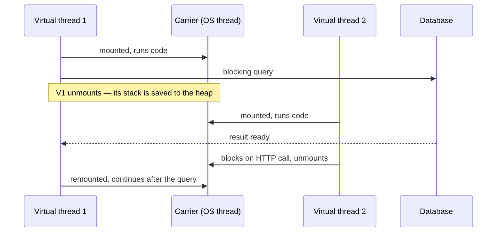

## The problem with platform threads

A classic Java thread (a **platform thread**) is a thin wrapper over an operating-system thread. OS threads are expensive: each reserves around **1 MB of stack**, and creating or context-switching them involves the kernel. A server can comfortably run a few thousand.

The traditional *thread-per-request* model therefore hits a wall: if each request spends 95% of its time waiting on a database or HTTP call, threads sit idle while holding scarce resources. The workaround was **reactive programming** (WebFlux, `CompletableFuture` chains) — scalable, but hard to write, debug and profile.

## Virtual threads (Java 21)

A **virtual thread** is a thread managed by the JVM, not the OS. Millions can exist at once. When a virtual thread performs a **blocking operation** (socket I/O, `Thread.sleep`, `BlockingQueue.take`, `Lock` waits), the JVM **unmounts** it from its carrier OS thread and parks it on the heap; the carrier is free to run another virtual thread. When the I/O completes, the virtual thread is **remounted** on some carrier and continues.



You keep writing simple, **blocking, sequential code** — and get the scalability of asynchronous I/O.

## Creating virtual threads

```java
Thread.ofVirtual().name("worker-", 0).start(() -> handle(request));   // builder
Thread.startVirtualThread(() -> handle(request));                     // shortcut

try (ExecutorService executor = Executors.newVirtualThreadPerTaskExecutor()) {
    futures = tasks.stream().map(executor::submit).toList();
}   // close() waits for all tasks
```

**Don't pool virtual threads.** They are cheap to create — one per task is the intended model. To limit concurrency against a scarce resource (e.g. a database allowing 50 connections), use a `Semaphore`, not a small pool.

## See it scale

<Playground title="VirtualThreads.java">

```java
import java.time.*;
import java.util.*;
import java.util.concurrent.*;
import java.util.stream.*;

class Main {
    // Simulates a blocking call such as a REST request or DB query
    static String fetchPrice(int productId) {
        try { Thread.sleep(Duration.ofMillis(200)); } catch (InterruptedException e) { Thread.currentThread().interrupt(); }
        return "p" + productId + "=" + (productId % 50 + 10);
    }

    static Duration run(ExecutorService executor, int tasks) throws Exception {
        Instant start = Instant.now();
        try (executor) {
            List<Future<String>> futures = IntStream.range(0, tasks)
                .mapToObj(i -> executor.submit(() -> fetchPrice(i)))
                .toList();
            for (Future<String> f : futures) f.get();
        }
        return Duration.between(start, Instant.now());
    }

    public static void main(String[] args) throws Exception {
        int tasks = 10_000;
        System.out.println(tasks + " tasks, each blocking for 200 ms");

        Duration virtual = run(Executors.newVirtualThreadPerTaskExecutor(), tasks);
        System.out.println("virtual threads:         " + virtual.toMillis() + " ms");

        Duration pooled = run(Executors.newFixedThreadPool(200), 2_000);
        System.out.println("200 platform threads (only 2,000 tasks): " + pooled.toMillis() + " ms");

        // Semaphore to protect a scarce downstream resource
        Semaphore dbConnections = new Semaphore(20);
        var inFlight = new java.util.concurrent.atomic.AtomicInteger();
        var maxSeen = new java.util.concurrent.atomic.AtomicInteger();
        try (var ex = Executors.newVirtualThreadPerTaskExecutor()) {
            for (int i = 0; i < 500; i++) {
                ex.submit(() -> {
                    dbConnections.acquireUninterruptibly();
                    try {
                        maxSeen.accumulateAndGet(inFlight.incrementAndGet(), Math::max);
                        Thread.sleep(10);
                    } catch (InterruptedException e) { Thread.currentThread().interrupt(); }
                    finally { inFlight.decrementAndGet(); dbConnections.release(); }
                });
            }
        }
        System.out.println("max concurrent 'DB calls' with Semaphore(20): " + maxSeen.get());
        System.out.println("isVirtual? " + Thread.ofVirtual().unstarted(() -> {}).isVirtual());
    }
}
```

</Playground>

Ten thousand blocking tasks finish in roughly the time of **one** (~200 ms plus overhead), because each sleeping virtual thread releases its carrier. The fixed pool of 200 needs ten "waves" for only 2,000 tasks.

## When virtual threads help — and when they don't

| ✓ Great fit | ✗ No benefit |
| --- | --- |
| I/O-bound request handling (REST, JDBC, messaging) | CPU-bound work — cores are the limit, use a pool sized to cores or parallel streams |
| Fan-out calls to several services | Very short tasks with no blocking |
| Replacing complex reactive/callback code | Code that already uses non-blocking I/O efficiently |

## Pinning

A virtual thread is **pinned** to its carrier — and can't unmount while blocked — when it:

- blocks **inside a `synchronized` block or method** (Java 21–23), or
- calls native code / foreign functions.

Pinning hurts throughput when it's frequent and long. In **Java 21**, prefer `ReentrantLock` over `synchronized` around blocking I/O. **Java 24** (JEP 491) removed the `synchronized` pinning limitation, so on 24+ this concern largely disappears. Diagnose with `-Djdk.tracePinnedThreads=full` (Java 21) or JFR's `jdk.VirtualThreadPinned` event.

<Callout type="warn" title="ThreadLocal at scale">
Each virtual thread has its own `ThreadLocal` values. Libraries that cache expensive objects in `ThreadLocal`s (assuming a small, pooled set of threads) can explode memory with a million virtual threads. **Scoped values** (final in Java 25) are the designed replacement for passing context.
</Callout>

## Virtual threads in Spring Boot 4

One property switches Tomcat request handling, `@Async`, `@Scheduled` task execution, and Spring's messaging listeners to virtual threads:

```properties
spring.threads.virtual.enabled=true
```

With it enabled, a plain blocking `@RestController` calling JDBC and `RestClient` scales like a reactive app — without changing a line of business code. Keep your **connection pool size** in mind: more concurrent requests now reach the database, and HikariCP's pool becomes the natural throttle.

<Callout type="interview">
Key points to land: virtual threads are **cheap, JVM-scheduled threads** that unmount on blocking calls; they improve **throughput**, not the latency of a single request; **don't pool them**; limit access to scarce resources with semaphores; watch for **pinning** (`synchronized` + blocking on Java 21) and heavy `ThreadLocal` use. Contrast with reactive: same scalability for I/O, but imperative code, normal stack traces and debuggers.
</Callout>
