## Observability = logs + metrics + traces

| Signal | Answers | Spring Boot tooling |
| --- | --- | --- |
| **Metrics** | *How much / how fast?* Request rate, latency percentiles, error rate, pool usage | Micrometer → Prometheus, OTLP, Datadog… |
| **Traces** | *Where did the time go* across services? | Micrometer Tracing / OpenTelemetry |
| **Logs** | *What exactly happened?* | Logback/Log4j2, structured JSON, trace ids |
| **Health** | *Can this instance serve traffic?* | Actuator health groups, Kubernetes probes |

## Actuator

```xml
<dependency>
    <groupId>org.springframework.boot</groupId>
    <artifactId>spring-boot-starter-actuator</artifactId>
</dependency>
```

```yaml
management:
  endpoints:
    web:
      exposure:
        include: health, info, metrics, prometheus
  endpoint:
    health:
      show-details: when-authorized
      probes:
        enabled: true                  # /actuator/health/liveness and /readiness
  server:
    port: 8081                         # separate port, not exposed publicly
```

| Endpoint | Purpose |
| --- | --- |
| `/actuator/health` | Aggregated health of DB, disk, brokers, custom indicators |
| `/actuator/health/liveness`, `/readiness` | Kubernetes probes |
| `/actuator/metrics`, `/actuator/prometheus` | Metrics |
| `/actuator/info` | Build, git and custom info |
| `/actuator/env`, `/configprops`, `/beans`, `/conditions`, `/mappings` | Diagnostics — secure them! |
| `/actuator/loggers` | View and change log levels at runtime |
| `/actuator/threaddump`, `/heapdump` | JVM diagnostics |

<Callout type="danger" title="Don't expose everything">
Endpoints like `env`, `heapdump` and `configprops` reveal sensitive information. Expose only what you need over the web, put management on a separate internal port, and protect it with Spring Security.
</Callout>

### Liveness vs readiness

- **Liveness** — is the process healthy, or should Kubernetes **restart** it? Don't include external dependencies here: a database outage shouldn't restart every pod.
- **Readiness** — can it **receive traffic** right now? Fails during startup, shutdown or when a critical dependency is unavailable; Kubernetes stops routing to it.

### Custom health indicator

```java
@Component
class PaymentGatewayHealth implements HealthIndicator {
    private final PaymentClient client;
    PaymentGatewayHealth(PaymentClient client) { this.client = client; }

    @Override
    public Health health() {
        return client.ping()
            ? Health.up().withDetail("latencyMs", client.lastLatency().toMillis()).build()
            : Health.down().withDetail("reason", "ping failed").build();
    }
}
```

## Metrics with Micrometer

Boot auto-instruments HTTP server and client requests, JVM memory and GC, thread pools, HikariCP, caches, Kafka, and more. Add business metrics yourself:

```java
@Service
class CheckoutService {
    private final Counter ordersPlaced;
    private final Timer paymentTimer;

    CheckoutService(MeterRegistry registry) {
        this.ordersPlaced = Counter.builder("shop.orders.placed").description("Orders placed").register(registry);
        this.paymentTimer = Timer.builder("shop.payment.duration").publishPercentileHistogram().register(registry);
    }

    void checkout(Cart cart) {
        paymentTimer.record(() -> payments.charge(cart));
        ordersPlaced.increment();
    }
}
```

Or declaratively with the **Observation API**, which produces a metric *and* a trace span from one annotation:

```java
@Observed(name = "shop.pricing.quote", contextualName = "price-quote")
public Quote quote(Cart cart) { ... }
```

<Callout type="warn" title="Cardinality">
Tags (labels) multiply time series. `uri=/api/orders/{id}` is fine; `orderId=12345` creates a new series per order and can take down your metrics backend. Never tag with unbounded values such as ids, emails or raw URLs.
</Callout>

## Distributed tracing with OpenTelemetry

A **trace** follows one request across services; each hop is a **span**. Context propagates via the W3C `traceparent` header, which Boot adds to outgoing `RestClient`, `WebClient` and Kafka calls automatically.

```mermaid
gantt
  dateFormat X
  axisFormat %Lms
  title Trace 4bf92f35… POST /api/orders
  section gateway
  POST /api/orders         :0, 420
  section order-service
  OrderController.create   :20, 400
  SELECT customer          :30, 45
  INSERT orders            :60, 80
  section inventory-service
  POST /reservations       :90, 290
  UPDATE stock             :110, 260
  section payment-service
  POST /charges            :300, 395
```



Spring Boot 4 provides a dedicated OpenTelemetry starter:

```xml
<dependency>
    <groupId>org.springframework.boot</groupId>
    <artifactId>spring-boot-starter-opentelemetry</artifactId>
</dependency>
```

```yaml
management:
  tracing:
    sampling:
      probability: 0.1            # sample 10% in production
  opentelemetry:
    tracing:
      export:
        otlp:
          endpoint: http://otel-collector:4318/v1/traces
```

Send traces to an OpenTelemetry Collector, then Grafana Tempo, Jaeger, Zipkin or a vendor.

## Structured logging

Spring Boot can write JSON logs without extra libraries:

```properties
logging.structured.format.console=ecs        # or logstash, gelf
```

Each line then includes the timestamp, level, logger, message, **traceId** and **spanId** — so you can jump from a trace to its logs. Add context with MDC or the fluent SLF4J API: `log.atInfo().addKeyValue("orderId", id).log("Order placed")`.

## Graceful shutdown

```properties
server.shutdown=graceful                          # default since Boot 3.4
spring.lifecycle.timeout-per-shutdown-phase=30s
```

On `SIGTERM` the server stops accepting new requests, readiness flips to `OUT_OF_SERVICE`, in-flight requests finish, then the context closes. Pair it with a Kubernetes `preStop` sleep of a few seconds so load balancers deregister the pod first.

<Callout type="interview">
*“How do you monitor a Spring Boot service in production?”* — Actuator health with liveness/readiness probes; Micrometer metrics exported to Prometheus/OTLP with RED metrics (Rate, Errors, Duration) and dashboards/alerts; distributed tracing via OpenTelemetry with trace ids in structured logs; graceful shutdown. Mention securing Actuator and keeping metric tag cardinality low.
</Callout>
