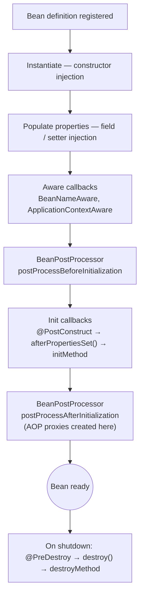

## Scopes

A bean's **scope** decides how many instances the container creates and how long they live.

| Scope | Instances | Lifetime | Typical use |
| --- | --- | --- | --- |
| `singleton` (default) | One per `ApplicationContext` | Whole application | Stateless services, repositories, clients |
| `prototype` | A new one on every lookup / injection | Managed by the caller (no destroy callback) | Stateful helpers, builders |
| `request` | One per HTTP request | Request | Request-scoped context |
| `session` | One per HTTP session | Session | User-session data (shopping cart) |
| `application` | One per `ServletContext` | Web application | Rare |

```java
@Component
@Scope(ConfigurableBeanFactory.SCOPE_PROTOTYPE)
class ReportBuilder { private final List<String> lines = new ArrayList<>(); }

@Component
@RequestScope                                  // = @Scope(value = "request", proxyMode = TARGET_CLASS)
class RequestContext { private String correlationId; }
```

<Callout type="danger" title="Singletons must be stateless (or thread-safe)">
A singleton bean is shared by **every** request thread. Mutable instance fields in a `@Service` — a counter, a "current user", a `SimpleDateFormat` — are race conditions waiting to happen. Keep state in method parameters, local variables, the database, or thread-safe types.
</Callout>

## Injecting a shorter-lived bean into a singleton

A singleton is created once, so a prototype or request-scoped dependency injected into its constructor would be resolved **only once**. Solutions:

```java
@Service
class InvoiceService {
    private final ObjectProvider<ReportBuilder> builders;     // lookup on demand
    InvoiceService(ObjectProvider<ReportBuilder> builders) { this.builders = builders; }

    Report render(Invoice i) {
        ReportBuilder b = builders.getObject();               // fresh prototype each call
        ...
    }
}
```

For request and session scopes, Spring injects a **scoped proxy** (that's what `@RequestScope` sets up): the singleton holds a proxy that delegates to the instance bound to the current request.

## The lifecycle



```java
@Component
class CacheWarmer {
    private final ProductRepository products;
    private final Map<Long, Product> cache = new ConcurrentHashMap<>();

    CacheWarmer(ProductRepository products) { this.products = products; }

    @PostConstruct                        // after injection, before use
    void warm() { products.findTop100ByOrderBySalesDesc().forEach(p -> cache.put(p.getId(), p)); }

    @PreDestroy                           // on graceful shutdown (singletons only)
    void flush() { cache.clear(); }
}
```

<Callout type="tip">
Prefer `@PostConstruct` / `@PreDestroy` (Jakarta annotations) or `@Bean(initMethod = ..., destroyMethod = ...)` over implementing `InitializingBean`/`DisposableBean`, which couples your class to Spring. For work that needs the **whole application** to be ready — e.g. sending a startup message or starting consumers — listen for `ApplicationReadyEvent` instead.
</Callout>

## BeanPostProcessor and BeanFactoryPostProcessor

These are Spring's main extension points:

| Hook | Operates on | Examples |
| --- | --- | --- |
| `BeanFactoryPostProcessor` | **Bean definitions**, before any bean is created | `PropertySourcesPlaceholderConfigurer` resolving `${...}` |
| `BeanPostProcessor` | **Bean instances**, around initialisation | `AutowiredAnnotationBeanPostProcessor`, AOP auto-proxy creator (wraps beans for `@Transactional`, `@Async`, `@Cacheable`) |

That's why the object you get from the context may not be the object your constructor created — it may be a **proxy** created in `postProcessAfterInitialization`.

## Lazy initialisation and startup

Singletons are created **eagerly** at startup, so wiring errors appear immediately. `@Lazy` defers creation until first use; `spring.main.lazy-initialization=true` makes all beans lazy (faster startup, but errors surface later — mostly useful in development).

## Circular dependencies

`A` needs `B` and `B` needs `A`. With constructor injection this is **impossible to satisfy** and Spring Boot fails at startup — by design, since Boot 2.6 circular references are prohibited by default. Fix the design: extract the shared logic into a third bean, use events, or invert one dependency.

<Callout type="interview">
*“Default scope of a Spring bean?”* (singleton — one per context, not per JVM), *“Are singleton beans thread-safe?”* (only if they have no mutable shared state), *“Prototype bean inside a singleton?”* (`ObjectProvider`, `@Lookup`, or scoped proxy), *“Order of lifecycle callbacks?”* (constructor → injection → aware → BPP before → `@PostConstruct` → BPP after → … → `@PreDestroy`), and *“Does Spring call destroy methods on prototypes?”* (no).
</Callout>
