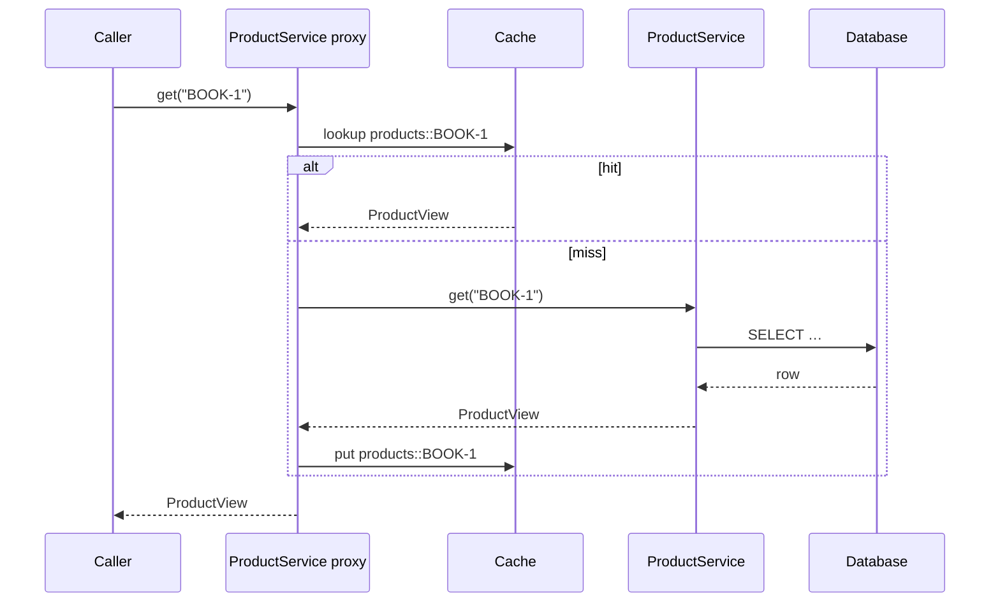

## The cache abstraction

Spring's cache abstraction adds caching to methods declaratively, independent of the storage technology. Like `@Transactional`, it's implemented with **AOP proxies**.

```java
@Configuration
@EnableCaching
class CacheConfig {}

@Service
class ProductService {

    @Cacheable(cacheNames = "products", key = "#sku")
    public ProductView get(String sku) {                          // runs only on a cache miss
        return repository.findBySku(sku).map(ProductView::from).orElseThrow();
    }

    @CachePut(cacheNames = "products", key = "#result.sku")      // always runs, refreshes the entry
    public ProductView update(String sku, UpdateProduct cmd) { ... }

    @CacheEvict(cacheNames = "products", key = "#sku")           // remove the entry
    public void delete(String sku) { ... }

    @CacheEvict(cacheNames = "products", allEntries = true)
    @Scheduled(cron = "0 0 3 * * *")
    public void nightlyFlush() {}
}
```



## Key options

```java
@Cacheable(cacheNames = "prices", key = "#sku + ':' + #currency")
@Cacheable(cacheNames = "quotes", key = "#cart.id", condition = "#cart.items.size() < 50", unless = "#result == null")
@Cacheable(cacheNames = "rates", sync = true)        // only one thread computes a missing entry (per JVM)
```

The default key is built from **all method parameters** — make sure they have sensible `equals`/`hashCode` (records are ideal).

## Choosing a provider

| Provider | Scope | Strengths | Watch out for |
| --- | --- | --- | --- |
| **Caffeine** | In-process (per instance) | Nanosecond reads, size/TTL eviction, no network | Each instance has its own copy; inconsistent across pods |
| **Redis** | Shared, out-of-process | Consistent across instances, survives restarts, large capacity | Network hop (~0.5–1 ms), serialization, another system to run |
| Two-level (Caffeine + Redis) | Both | Hot data local, shared invalidation | Complexity |

Boot picks a provider automatically from the classpath (`spring-boot-starter-cache` + Caffeine, or `spring-boot-starter-data-redis`).

### Caffeine

```yaml
spring:
  cache:
    cache-names: products, prices
    caffeine:
      spec: maximumSize=10000,expireAfterWrite=10m,recordStats
```

### Redis with per-cache TTLs

```yaml
spring:
  data:
    redis:
      host: redis
  cache:
    redis:
      time-to-live: 10m
      key-prefix: "shop:"
```

```java
@Bean
RedisCacheManagerBuilderCustomizer cacheTtls() {
    return builder -> builder
        .withCacheConfiguration("products", RedisCacheConfiguration.defaultCacheConfig().entryTtl(Duration.ofHours(1)))
        .withCacheConfiguration("prices", RedisCacheConfiguration.defaultCacheConfig().entryTtl(Duration.ofMinutes(1)));
}
```

<Callout type="warn" title="Serialization">
Redis stores bytes. Use a JSON serializer (Jackson) rather than JDK serialization, cache **DTOs/records**, not JPA entities (lazy proxies don't serialize well), and version your cached types — after a deploy, old entries may not deserialize into new classes. A cache name or key prefix per version solves it.
</Callout>

## Pitfalls

- **Self-invocation** — calling a `@Cacheable` method from the same bean bypasses the cache (proxy).
- **Stale data** — every write path must evict or update; prefer short TTLs over complex invalidation.
- **Cache stampede** — a hot key expires and hundreds of requests hit the database at once. Mitigate with `sync = true` (per instance), jittered TTLs, refresh-ahead (Caffeine `refreshAfterWrite`), or a distributed lock.
- **Caching nulls / errors** — use `unless = "#result == null"` if absence shouldn't be cached.
- **Unbounded caches** — always set a maximum size or TTL.

<Callout type="tip" title="Measure first">
Enable cache metrics (Caffeine `recordStats`, Micrometer's `cache.gets{result=hit|miss}`) and check the **hit ratio**. A cache with a 20% hit ratio adds complexity and memory for little gain; fix the query or add an index instead.
</Callout>

<Callout type="interview">
*“`@Cacheable` vs `@CachePut` vs `@CacheEvict`?”*, *“How do you keep a cache consistent with the database?”* (evict on write, TTLs, cache-aside), *“Local vs distributed cache?”*, *“What is a cache stampede and how do you prevent it?”*, *“Why doesn't `@Cacheable` work when called internally?”* (proxy self-invocation).
</Callout>
