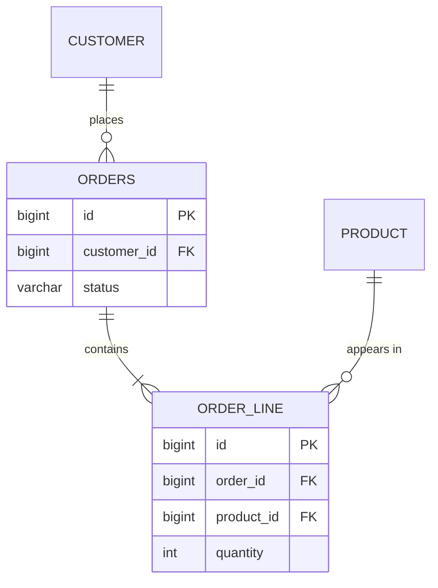

## Mapping associations



```java
@Entity
public class OrderLine {
    @Id @GeneratedValue private Long id;

    @ManyToOne(fetch = FetchType.LAZY, optional = false)   // owning side: has the FK column
    @JoinColumn(name = "order_id")
    private Order order;

    @ManyToOne(fetch = FetchType.LAZY, optional = false)
    private Product product;

    private int quantity;
}

@Entity
public class Order {
    @OneToMany(mappedBy = "order", cascade = CascadeType.ALL, orphanRemoval = true)   // inverse side
    private List<OrderLine> lines = new ArrayList<>();
}
```

Key rules:

- The side with the **foreign key** (`@ManyToOne`, `@JoinColumn`) is the **owning side**; `mappedBy` marks the inverse side. Only changes to the owning side are written to the database.
- Provide helper methods (`order.addLine(...)`) that update **both** sides.
- Use `cascade` and `orphanRemoval` only from a parent to children it truly owns (aggregate root → its lines), never towards shared entities like `Product` or `Customer`.
- Avoid `@ManyToMany` with extra data — model the join table as its own entity.

## Fetch types

| Association | JPA default | Recommended |
| --- | --- | --- |
| `@ManyToOne`, `@OneToOne` | **EAGER** | Set `fetch = LAZY` explicitly |
| `@OneToMany`, `@ManyToMany` | LAZY | Keep LAZY |

**EAGER is a trap**: it loads the association every time the entity is loaded — even when you don't need it — and often via extra queries. Make everything LAZY and decide **per use case** what to fetch.

## The N+1 problem

Load N orders, then touch each order's lazy association: Hibernate runs **1** query for the orders plus **N** more — one per order.

```java
List<Order> orders = orderRepository.findByStatus(PAID);     // 1 query
for (Order o : orders) {
    total += o.getLines().size();                             // +1 query PER order
}
```

Simulate it — and the fix — with a fake database that counts queries:

<Playground title="NPlusOne.java">

```java
import java.util.*;
import java.util.stream.*;

record Line(long orderId, String sku) {}
record Order(long id, String customer) {}

class FakeDb {
    int queries = 0;
    final List<Order> orders = LongStream.rangeClosed(1, 50).mapToObj(i -> new Order(i, "c" + i % 7)).toList();
    final List<Line> lines = LongStream.rangeClosed(1, 50).boxed()
        .flatMap(id -> Stream.of(new Line(id, "A"), new Line(id, "B"))).toList();

    List<Order> selectOrders() { queries++; return orders; }
    List<Line> selectLinesFor(long orderId) {                       // "lazy loading" one order at a time
        queries++; return lines.stream().filter(l -> l.orderId() == orderId).toList();
    }
    List<Line> selectLinesFor(Collection<Long> orderIds) {          // batch / IN clause
        queries++; return lines.stream().filter(l -> orderIds.contains(l.orderId())).toList();
    }
    Map<Order, List<Line>> selectOrdersJoinLines() {                // fetch join
        queries++;
        Map<Long, List<Line>> byOrder = lines.stream().collect(Collectors.groupingBy(Line::orderId));
        Map<Order, List<Line>> result = new LinkedHashMap<>();
        orders.forEach(o -> result.put(o, byOrder.getOrDefault(o.id(), List.of())));
        return result;
    }
}

class Main {
    public static void main(String[] args) {
        var db = new FakeDb();
        int count = 0;
        for (Order o : db.selectOrders()) count += db.selectLinesFor(o.id()).size();
        System.out.println("N+1 lazy loading:  " + count + " lines, " + db.queries + " queries");

        db.queries = 0;
        List<Order> orders = db.selectOrders();
        List<Line> all = new ArrayList<>();
        List<Long> ids = orders.stream().map(Order::id).toList();
        for (int i = 0; i < ids.size(); i += 25) all.addAll(db.selectLinesFor(ids.subList(i, Math.min(i + 25, ids.size()))));
        System.out.println("batch size 25:     " + all.size() + " lines, " + db.queries + " queries");

        db.queries = 0;
        int joined = db.selectOrdersJoinLines().values().stream().mapToInt(List::size).sum();
        System.out.println("join fetch:        " + joined + " lines, " + db.queries + " query");
    }
}
```

</Playground>

With 50 orders that's **51 queries** instead of 1. In production with network latency, this turns a 10 ms endpoint into a 2-second one.

## Fixing N+1

### 1. Fetch join (JPQL)

```java
@Query("select distinct o from Order o join fetch o.lines l join fetch l.product where o.status = :status")
List<Order> findWithLines(OrderStatus status);
```

### 2. Entity graph (declarative)

```java
@EntityGraph(attributePaths = {"lines", "lines.product"})
List<Order> findByStatus(OrderStatus status);
```

### 3. Batch fetching

```properties
spring.jpa.properties.hibernate.default_batch_fetch_size=50
```

Hibernate then loads lazy collections for up to 50 parents in one `IN (...)` query — N+1 becomes N/50+1 without changing any query.

### 4. DTO projections

For read-only views, select exactly the columns you need into records — no entities, no lazy loading at all.

<Callout type="warn" title="Fetch joins and pagination">
`join fetch` on a **collection** combined with `Pageable` makes Hibernate paginate **in memory** (warning `HHH90003004: firstResult/maxResults specified with collection fetch`). Paginate the parent ids first, then fetch their collections — or use batch fetching. Also, fetching **two** collections in one query produces a Cartesian product (`MultipleBagFetchException` for `List`s).
</Callout>

## Detecting N+1

- Log SQL in development: `logging.level.org.hibernate.SQL=debug` (and `org.hibernate.orm.jdbc.bind=trace` for parameters)
- `spring.jpa.properties.hibernate.generate_statistics=true` reports query counts per session
- Assert query counts in tests (e.g. with the `datasource-proxy` library)
- Tracing (Micrometer + OpenTelemetry) shows dozens of identical spans under one request

## LazyInitializationException

Accessing a lazy association **after** the persistence context is closed (outside a transaction, with open-in-view disabled) throws `LazyInitializationException`. The fix is **not** EAGER or open-in-view — it's fetching what the use case needs inside the transactional service method (fetch join, entity graph or DTO projection).

<Callout type="interview">
*“What is the N+1 problem and how do you solve it?”* is one of the most common Spring/JPA interview questions. Define it (1 query for parents + N for children), explain why it happens (lazy loading in a loop, or EAGER associations), list fixes (fetch join, `@EntityGraph`, batch fetching, DTO projections) and how you'd detect it (SQL logs, Hibernate statistics, tests asserting query counts).
</Callout>
