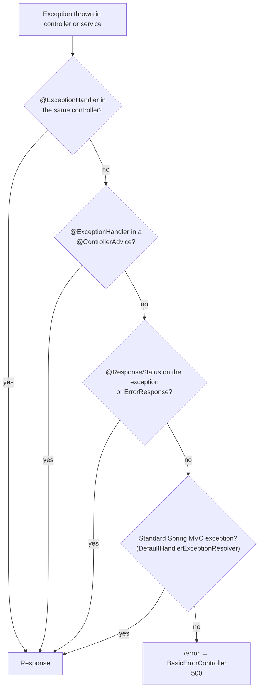

## Goals of good API errors

1. **Correct status code** — clients and gateways act on it.
2. **Consistent, machine-readable body** — clients shouldn't parse prose.
3. **No leaks** — no stack traces, SQL or internal class names.
4. **Traceability** — a correlation/trace id to find the logs.

## RFC 9457 Problem Details

Spring supports the standard **`application/problem+json`** format (RFC 9457, which obsoletes RFC 7807) with the `ProblemDetail` class:

```json
{
  "type": "https://api.shop.example/problems/insufficient-stock",
  "title": "Insufficient stock",
  "status": 409,
  "detail": "Only 2 units of SKU BOOK-1 are available",
  "instance": "/api/orders",
  "sku": "BOOK-1",
  "available": 2,
  "traceId": "4bf92f3577b34da6a3ce929d0e0e4736"
}
```

Enable problem details for Spring MVC's own exceptions (400 for malformed JSON, 405, 415, …):

```properties
spring.mvc.problemdetails.enabled=true
```

## Centralised handling with @RestControllerAdvice

```java
@RestControllerAdvice
class ApiExceptionHandler extends ResponseEntityExceptionHandler {   // handles standard MVC exceptions

    private static final Logger log = LoggerFactory.getLogger(ApiExceptionHandler.class);

    @ExceptionHandler(NotFoundException.class)
    ProblemDetail handleNotFound(NotFoundException ex) {
        ProblemDetail pd = ProblemDetail.forStatusAndDetail(HttpStatus.NOT_FOUND, ex.getMessage());
        pd.setTitle("Resource not found");
        pd.setType(URI.create("https://api.shop.example/problems/not-found"));
        return pd;
    }

    @ExceptionHandler(InsufficientStockException.class)
    ProblemDetail handleStock(InsufficientStockException ex) {
        ProblemDetail pd = ProblemDetail.forStatusAndDetail(HttpStatus.CONFLICT, ex.getMessage());
        pd.setTitle("Insufficient stock");
        pd.setProperty("sku", ex.sku());
        pd.setProperty("available", ex.available());
        return pd;
    }

    @ExceptionHandler(OptimisticLockingFailureException.class)
    ProblemDetail handleConflict(OptimisticLockingFailureException ex) {
        return ProblemDetail.forStatusAndDetail(HttpStatus.CONFLICT,
            "The resource was modified by someone else. Reload and try again.");
    }

    // Shape validation errors as a list of field errors
    @Override
    protected ResponseEntity<Object> handleMethodArgumentNotValid(MethodArgumentNotValidException ex,
            HttpHeaders headers, HttpStatusCode status, WebRequest request) {
        ProblemDetail pd = ex.getBody();
        pd.setTitle("Validation failed");
        pd.setProperty("errors", ex.getBindingResult().getFieldErrors().stream()
            .map(fe -> Map.of("field", fe.getField(), "message", String.valueOf(fe.getDefaultMessage())))
            .toList());
        return ResponseEntity.badRequest().body(pd);
    }

    // Last resort: never leak internals
    @ExceptionHandler(Exception.class)
    ProblemDetail handleUnexpected(Exception ex, HttpServletRequest request) {
        log.error("Unhandled error on {} {}", request.getMethod(), request.getRequestURI(), ex);
        return ProblemDetail.forStatusAndDetail(HttpStatus.INTERNAL_SERVER_ERROR, "An unexpected error occurred");
    }
}
```

## Domain exceptions that carry their status

For simple cases, let the exception describe its own response by extending `ErrorResponseException`:

```java
public class OrderNotFoundException extends ErrorResponseException {
    public OrderNotFoundException(long id) {
        super(HttpStatus.NOT_FOUND,
              ProblemDetail.forStatusAndDetail(HttpStatus.NOT_FOUND, "Order " + id + " not found"),
              null);
    }
}
```

Or keep the domain free of HTTP concerns (recommended for larger codebases): throw plain domain exceptions from services and translate them **only** in the `@RestControllerAdvice`.

## How Spring resolves an exception



Handlers are matched by the **closest exception type** in the hierarchy. Scope an advice to part of the app with `@RestControllerAdvice(basePackages = "com.shop.api")` or `assignableTypes`.

## Testing error responses

```java
@WebMvcTest(OrderController.class)
class OrderControllerTest {
    @Autowired MockMvcTester mvc;
    @MockitoBean OrderService orders;

    @Test
    void returns404AsProblemDetail() {
        given(orders.get(99)).willThrow(new OrderNotFoundException(99));

        assertThat(mvc.get().uri("/api/orders/99"))
            .hasStatus(HttpStatus.NOT_FOUND)
            .hasContentType(MediaType.APPLICATION_PROBLEM_JSON)
            .bodyJson().extractingPath("$.detail").isEqualTo("Order 99 not found");
    }
}
```

<Callout type="tip" title="Add the trace id">
With Micrometer Tracing on the classpath, include the current trace id in every problem detail (inject `Tracer` and call `pd.setProperty("traceId", tracer.currentSpan().context().traceId())`). Support teams can then jump straight from a customer's error to the logs and traces.
</Callout>

<Callout type="interview">
*“How do you handle exceptions globally in Spring?”* — `@RestControllerAdvice` with `@ExceptionHandler` methods, often extending `ResponseEntityExceptionHandler`. *“What is `ProblemDetail`?”* — Spring's implementation of RFC 9457 problem details. *“`@ControllerAdvice` vs `@RestControllerAdvice`?”* — the latter adds `@ResponseBody`. *“Which status for an optimistic locking failure?”* — 409 Conflict.
</Callout>
