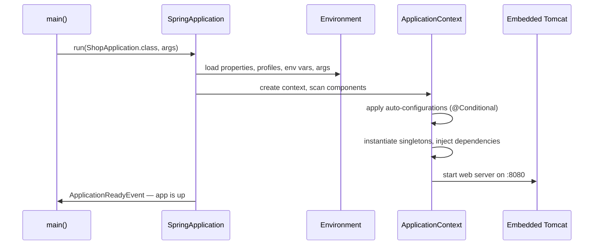

## Spring vs Spring Boot

**Spring Framework** is a large toolkit for building Java applications: dependency injection, transactions, web MVC, data access, messaging. It's powerful, but historically a new project needed a lot of setup — XML or Java config, a servlet container to deploy into, and hand-picked library versions that worked together.

**Spring Boot** is an opinionated layer on top of Spring that removes that setup:

| Without Boot | With Boot |
| --- | --- |
| Pick compatible versions of dozens of libraries | **Starters** + a managed dependency BOM |
| Configure `DataSource`, `DispatcherServlet`, Jackson, … by hand | **Auto-configuration** based on what's on the classpath |
| Build a WAR and deploy it to Tomcat | **Embedded server** — `java -jar app.jar` |
| Roll your own health checks and metrics | **Actuator** endpoints |
| Scattered config formats | Unified `application.properties` / `.yml`, profiles, env vars |

## Spring Boot 4 at a glance

This track targets **Spring Boot 4.x**, built on **Spring Framework 7**. The main changes from Boot 3:

| Area | Spring Boot 4 / Framework 7 |
| --- | --- |
| Java | Baseline Java 17; first-class support for **Java 21 and 25** (virtual threads, records everywhere) |
| Jakarta EE | **Jakarta EE 11** — Servlet 6.1, JPA 3.2 (Hibernate 7), Bean Validation 3.1 |
| Modularisation | Auto-configuration split into focused modules; starters like **`spring-boot-starter-webmvc`** (the classic `spring-boot-starter-web` is kept as a deprecated alias) |
| JSON | **Jackson 3** by default (`tools.jackson` packages, `JsonMapper`) |
| Null safety | Framework APIs annotated with **JSpecify** (`@NullMarked`, `@Nullable`) |
| REST | Built-in **API versioning** (`@GetMapping(version = "1.1")`) and declarative **HTTP service clients** |
| Resilience | `@Retryable` and `@ConcurrencyLimit` in Spring Framework core |
| Testing | `@MockBean` removed — use `@MockitoBean`; new `RestTestClient` |
| Servers | Tomcat 11 and Jetty 12.1; Undertow support dropped |

<Callout type="info" title="Coming from Boot 3?">
Most application code carries over unchanged. Typical migration work: rename starters, replace `@MockBean`/`@SpyBean` with `@MockitoBean`/`@MockitoSpyBean`, update Jackson imports if you used `com.fasterxml.jackson.databind` directly, and fix anything removed after being deprecated in 3.x. The `spring-boot-properties-migrator` module reports renamed configuration properties at startup.
</Callout>

## Your first application

```java
package com.example.shop;

import org.springframework.boot.SpringApplication;
import org.springframework.boot.autoconfigure.SpringBootApplication;
import org.springframework.web.bind.annotation.*;

@SpringBootApplication
public class ShopApplication {
    public static void main(String[] args) {
        SpringApplication.run(ShopApplication.class, args);
    }
}

@RestController
class HelloController {
    @GetMapping("/hello")
    String hello(@RequestParam(defaultValue = "world") String name) {
        return "Hello, " + name + "!";
    }
}
```

```xml
<parent>
    <groupId>org.springframework.boot</groupId>
    <artifactId>spring-boot-starter-parent</artifactId>
    <version>4.0.0</version>
</parent>

<dependencies>
    <dependency>
        <groupId>org.springframework.boot</groupId>
        <artifactId>spring-boot-starter-webmvc</artifactId>
    </dependency>
    <dependency>
        <groupId>org.springframework.boot</groupId>
        <artifactId>spring-boot-starter-webmvc-test</artifactId>
        <scope>test</scope>
    </dependency>
</dependencies>
```

Run `./mvnw spring-boot:run` and open `http://localhost:8080/hello?name=Ada`. No server installation, no XML.

## What @SpringBootApplication does

It's a shortcut for three annotations:

```java
@SpringBootConfiguration      // this class is a source of bean definitions (@Configuration)
@EnableAutoConfiguration      // apply auto-configuration based on the classpath
@ComponentScan                // scan this package and sub-packages for @Component, @Service, ...
public class ShopApplication { }
```

<Callout type="warn" title="Package placement">
Component scanning starts at the package of the `@SpringBootApplication` class. Put it in the **root package** (`com.example.shop`) with feature packages below it, or beans in sibling packages won't be found.
</Callout>

## What happens at startup



## Starters

A **starter** is a dependency descriptor that pulls in a coherent set of libraries plus their auto-configuration. Versions are managed by Boot's BOM, so you never write a version number for them.

| Starter | Brings |
| --- | --- |
| `spring-boot-starter-webmvc` | Spring MVC, embedded Tomcat, Jackson |
| `spring-boot-starter-webflux` | Reactive web stack on Netty |
| `spring-boot-starter-data-jpa` | Spring Data JPA, Hibernate, HikariCP |
| `spring-boot-starter-validation` | Hibernate Validator (Jakarta Bean Validation) |
| `spring-boot-starter-security` | Spring Security |
| `spring-boot-starter-actuator` | Health, metrics, info endpoints |
| `spring-boot-starter-kafka` | Spring for Apache Kafka |
| `spring-boot-starter-test` | JUnit Jupiter, AssertJ, Mockito, Spring Test |

## Executable jars

`./mvnw package` produces a **fat jar** containing your classes, every dependency and a launcher. `java -jar target/shop-0.0.1.jar` runs it anywhere a JVM exists — ideal for containers. Boot also builds OCI images directly with `./mvnw spring-boot:build-image` (Cloud Native Buildpacks).

<Callout type="interview">
*“What is the difference between Spring and Spring Boot?”* — Spring is the framework (DI, MVC, transactions…); Boot is convention-over-configuration on top of it: starters, auto-configuration, embedded servers, externalised config and production features. *“What does `@SpringBootApplication` contain?”* — `@SpringBootConfiguration`, `@EnableAutoConfiguration` and `@ComponentScan`. For Boot 4 specifically, be ready to mention Framework 7, Jakarta EE 11, Jackson 3, API versioning and JSpecify null safety.
</Callout>
