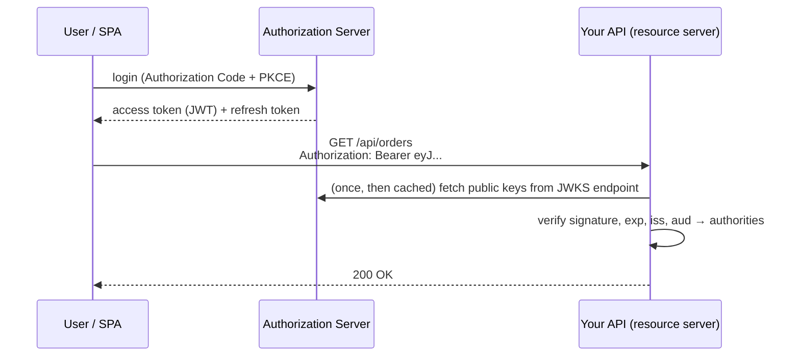

## OAuth2 and OIDC in one picture

Modern apps don't usually check passwords themselves. An **authorization server** (Keycloak, Okta, Auth0, Microsoft Entra ID, AWS Cognito, or Spring Authorization Server) authenticates the user and issues **access tokens**. Your API is a **resource server**: it validates the token on each request and authorizes based on its claims.



**OpenID Connect (OIDC)** adds identity on top of OAuth2: an **ID token** describing the user, and a standard user-info endpoint.

## Anatomy of a JWT

A JSON Web Token is three base64url parts separated by dots: `header.payload.signature`.

```json
// header
{ "alg": "RS256", "kid": "2026-key-1", "typ": "JWT" }
// payload (claims)
{
  "iss": "https://auth.shop.example",
  "sub": "user-123",
  "aud": "shop-api",
  "exp": 1793347200,
  "iat": 1793346300,
  "scope": "orders:read orders:write",
  "roles": ["customer"]
}
```

The **signature** proves the token was issued by the authorization server and hasn't been modified. With asymmetric algorithms (RS256, ES256), the API verifies using the server's **public key** — fetched from its JWKS endpoint — and never needs a shared secret.

<Callout type="danger" title="JWTs are signed, not encrypted">
Anyone holding a JWT can base64-decode and read its claims. Never put secrets or sensitive personal data in a token.
</Callout>

## Spring Boot as a resource server

```xml
<dependency>
    <groupId>org.springframework.boot</groupId>
    <artifactId>spring-boot-starter-oauth2-resource-server</artifactId>
</dependency>
```

```yaml
spring:
  security:
    oauth2:
      resourceserver:
        jwt:
          issuer-uri: https://auth.shop.example        # discovers the JWKS URL via OIDC metadata
          audiences: shop-api                           # reject tokens meant for other APIs
```

```java
@Bean
SecurityFilterChain api(HttpSecurity http) throws Exception {
    return http
        .authorizeHttpRequests(auth -> auth
            .requestMatchers(HttpMethod.GET, "/api/orders/**").hasAuthority("SCOPE_orders:read")
            .requestMatchers("/api/orders/**").hasAuthority("SCOPE_orders:write")
            .anyRequest().authenticated())
        .oauth2ResourceServer(oauth -> oauth.jwt(jwt -> jwt.jwtAuthenticationConverter(rolesConverter())))
        .sessionManagement(s -> s.sessionCreationPolicy(SessionCreationPolicy.STATELESS))
        .csrf(csrf -> csrf.disable())
        .build();
}
```

With that, Spring Security validates the **signature**, **expiry** (`exp`, `nbf`), **issuer** (`iss`) and **audience** (`aud`) on every request, and turns the `scope` claim into `SCOPE_…` authorities.

### Mapping custom claims to roles

```java
private JwtAuthenticationConverter rolesConverter() {
    var scopes = new JwtGrantedAuthoritiesConverter();                 // scope -> SCOPE_*
    var converter = new JwtAuthenticationConverter();
    converter.setJwtGrantedAuthoritiesConverter(jwt -> {
        Collection<GrantedAuthority> authorities = new ArrayList<>(scopes.convert(jwt));
        List<String> roles = jwt.getClaimAsStringList("roles");
        if (roles != null) roles.forEach(r -> authorities.add(new SimpleGrantedAuthority("ROLE_" + r.toUpperCase())));
        return authorities;
    });
    return converter;
}
```

## Testing secured endpoints

```java
@WebMvcTest(OrderController.class)
@Import(SecurityConfig.class)
class OrderControllerSecurityTest {
    @Autowired MockMvc mvc;
    @MockitoBean OrderService orders;

    @Test
    void rejectsAnonymous() throws Exception {
        mvc.perform(get("/api/orders/1")).andExpect(status().isUnauthorized());
    }

    @Test
    void allowsReadScope() throws Exception {
        mvc.perform(get("/api/orders/1").with(jwt().authorities(new SimpleGrantedAuthority("SCOPE_orders:read"))))
           .andExpect(status().isOk());
    }

    @Test
    void forbidsWriteWithoutScope() throws Exception {
        mvc.perform(post("/api/orders").with(jwt()).contentType(APPLICATION_JSON).content("{}"))
           .andExpect(status().isForbidden());
    }
}
```

## Token lifetime and revocation

JWT validation is **stateless**: the API doesn't call the authorization server per request, which is fast but means a token stays valid until it expires. Mitigations:

- **Short-lived access tokens** (5–15 minutes) + **refresh tokens** (rotated, revocable)
- **Opaque tokens + introspection** (`opaqueToken(...)`) when instant revocation matters, at the cost of a call per request (cacheable)
- A deny-list of token ids (`jti`) for emergencies

<Callout type="warn" title="Don't roll your own auth server">
Hand-written JWT issuing — HS256 with a hard-coded secret, no key rotation, no refresh token rotation, tokens in `localStorage` — is a classic source of vulnerabilities. Use a proven identity provider, or **Spring Authorization Server** if you must host one, and keep your services as resource servers.
</Callout>

## Service-to-service calls

For machine-to-machine calls use the **client credentials** grant. Spring Security's OAuth2 client support fetches and caches tokens and attaches them to `RestClient` requests:

```java
@Bean
RestClient inventoryClient(RestClient.Builder builder, OAuth2AuthorizedClientManager manager) {
    var interceptor = new OAuth2ClientHttpRequestInterceptor(manager);
    interceptor.setClientRegistrationIdResolver(request -> "inventory");
    return builder.baseUrl("https://inventory.internal").requestInterceptor(interceptor).build();
}
```

<Callout type="interview">
*“How does JWT authentication work in Spring?”* — the `BearerTokenAuthenticationFilter` extracts the token; a `JwtDecoder` verifies the signature with keys from the issuer's JWKS and checks `exp`/`iss`/`aud`; claims become authorities; no session is kept. Follow-ups: *“How do you revoke a JWT?”*, *“Where should a SPA store tokens?”* (prefer a backend-for-frontend with HTTP-only cookies), *“Symmetric vs asymmetric signing?”*.
</Callout>
