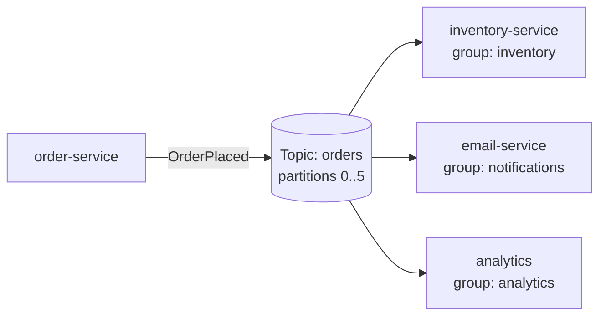
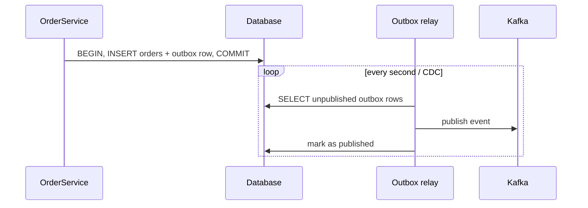

## Why messaging?

Synchronous HTTP between services couples them in **time**: if inventory is down, checkout fails. With events, `order-service` publishes `OrderPlaced` and moves on; inventory, email and analytics consume it at their own pace.



## Kafka concepts

| Concept | Meaning |
| --- | --- |
| **Topic** | Named, append-only log of records (`orders`) |
| **Partition** | A topic is split into ordered partitions — the unit of parallelism |
| **Key** | Records with the same key go to the same partition → **ordered per key** |
| **Offset** | Position of a record in a partition; consumers commit offsets they've processed |
| **Consumer group** | Consumers sharing a group id split the partitions — each record goes to **one** consumer per group |
| **Retention** | Records stay for a configured time/size, regardless of consumption — consumers can replay |

Ordering is guaranteed **only within a partition**. Use the aggregate id (`orderId`) as the key so all events for one order are processed in order.

## Producing

```java
public record OrderPlaced(String orderId, String customerId, BigDecimal total, Instant at) {}

@Service
class OrderEvents {
    private final KafkaTemplate<String, OrderPlaced> kafka;
    OrderEvents(KafkaTemplate<String, OrderPlaced> kafka) { this.kafka = kafka; }

    CompletableFuture<SendResult<String, OrderPlaced>> publish(OrderPlaced event) {
        return kafka.send("orders", event.orderId(), event);       // key = orderId
    }
}
```

```yaml
spring:
  kafka:
    bootstrap-servers: kafka:9092
    producer:
      acks: all                       # wait for all in-sync replicas
      properties:
        enable.idempotence: true      # no duplicates from producer retries
```

## Consuming

```java
@Component
class InventoryListener {

    @KafkaListener(topics = "orders", groupId = "inventory", concurrency = "3")
    void on(OrderPlaced event, @Header(KafkaHeaders.RECEIVED_PARTITION) int partition) {
        inventory.reserveFor(event.orderId());     // must be idempotent — see below
    }
}
```

`concurrency = "3"` starts three consumers in the group; more consumers than partitions leaves the extras idle.

## Delivery guarantees

| Guarantee | How | Consequence |
| --- | --- | --- |
| At most once | Commit offset **before** processing | May lose messages |
| **At least once** (default) | Commit offset **after** processing | May process **duplicates** after a crash/rebalance |
| Exactly once | Kafka transactions, read-process-write within Kafka | Only end-to-end within Kafka; external side effects still need idempotency |

In practice: **at-least-once delivery + idempotent consumers**. Make handlers safe to run twice — check a processed-event table, use upserts, or rely on natural idempotency ("set status to PAID").

```java
@Transactional
void on(OrderPlaced event) {
    if (processedEvents.existsById(event.orderId())) return;    // already handled
    inventory.reserveFor(event.orderId());
    processedEvents.save(new ProcessedEvent(event.orderId()));
}
```

## Retries and dead-letter topics

A poison message that always fails would block its partition forever. Retry a few times with back-off, then park it on a **dead-letter topic (DLT)**:

```java
@RetryableTopic(attempts = "4", backoff = @Backoff(delay = 1_000, multiplier = 2),
                exclude = { ValidationException.class })               // don't retry what can't succeed
@KafkaListener(topics = "orders", groupId = "inventory")
void on(OrderPlaced event) { ... }

@DltHandler
void dead(OrderPlaced event, @Header(KafkaHeaders.EXCEPTION_MESSAGE) String error) {
    log.error("Giving up on {}: {}", event.orderId(), error);          // alert, store for manual replay
}
```

Non-blocking retries use separate retry topics (`orders-retry-0`, …), so the main partition keeps flowing.

## The dual-write problem and the outbox

```java
@Transactional
public void placeOrder(...) {
    orders.save(order);                         // 1. DB commit
    kafka.send("orders", event);                // 2. what if this fails, or the DB commit fails after it?
}
```

Writing to the database **and** Kafka can't be atomic: you'll eventually publish events for rolled-back orders, or lose events for committed ones. The **transactional outbox** fixes it:



The event is written in the **same transaction** as the business data. A relay — a scheduled poller, **Debezium** change data capture, or **Spring Modulith**'s event publication registry — publishes it afterwards (at least once). Consumers stay idempotent.

## Testing

Use Testcontainers' `KafkaContainer` with `@ServiceConnection`, publish through the real `KafkaTemplate`, and assert with Awaitility that the listener's side effect happened.

<Callout type="tip" title="Schemas and compatibility">
Events are a public contract. Use a schema format (Avro, Protobuf or JSON Schema) with a schema registry, or at least versioned JSON records, and evolve them **backwards-compatibly** (add optional fields; never rename or remove).
</Callout>

<Callout type="interview">
Frequent questions: *“How does Kafka guarantee ordering?”* (per partition; choose keys accordingly), *“What happens if a consumer crashes mid-processing?”* (redelivery from the last committed offset → duplicates → idempotent consumers), *“How do you handle poison messages?”* (bounded retries + DLT), *“How do you publish events reliably when you also write to a database?”* (transactional outbox / CDC). Also be ready for Kafka vs RabbitMQ: log with replay and partitioned ordering vs a broker with flexible routing and per-message acks.
</Callout>
