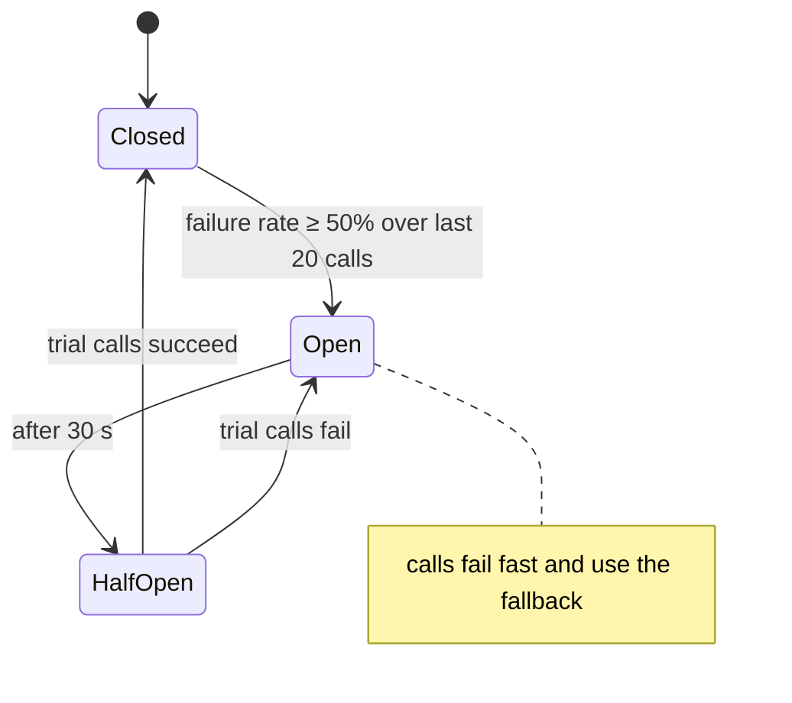

## Failure is normal

In a distributed system, something is always slow or broken: a pod restarting, a database failover, a network blip, a dependency under load. Without protection, one slow service makes callers wait, their threads fill up, and the failure **cascades** through the system.

| Pattern | Protects against | Tool |
| --- | --- | --- |
| **Timeout** | Waiting forever | HTTP client settings |
| **Retry with back-off** | Transient failures | Spring Framework 7 `@Retryable`, Resilience4j |
| **Circuit breaker** | Hammering a failing dependency | Resilience4j |
| **Bulkhead / concurrency limit** | One dependency exhausting all threads | `@ConcurrencyLimit`, Resilience4j |
| **Rate limiter** | Overloading yourself or a partner API | Resilience4j, API gateway |
| **Fallback** | Total failure of a non-critical feature | Default values, cached data |

## Timeouts first

Every remote call needs a **connect** and **read** timeout (see [HTTP Clients](/spring-boot/http-clients/)). A circuit breaker can't help if calls never fail — they just hang.

## Retries with exponential back-off

Spring Framework 7 includes retry in core:

```java
@Configuration
@EnableResilientMethods
class ResilienceConfig {}

@Component
class ExchangeRateClient {
    @Retryable(includes = { ResourceAccessException.class, HttpServerErrorException.class },
               maxAttempts = 4, delay = 200, multiplier = 2, maxDelay = 2_000, jitter = 100)
    public Rate rate(String from, String to) { ... }
}
```

Rules:

- Retry only **transient** errors (timeouts, 502/503/504) — never 400/404/409
- Retry only **idempotent** operations (or protect POSTs with an idempotency key)
- Use **exponential back-off + jitter** so retries from many clients don't arrive in synchronized waves
- Keep the **total** budget below the caller's own timeout

## Circuit breaker

A circuit breaker watches calls to a dependency. When failures exceed a threshold, it **opens** and fails fast (or uses a fallback) without calling the dependency, giving it time to recover. After a wait it lets a few trial calls through (**half-open**).



See the state machine in action:

<Playground title="CircuitBreaker.java">

```java
import java.time.*;
import java.util.*;
import java.util.function.*;

class CircuitBreaker {
    enum State { CLOSED, OPEN, HALF_OPEN }

    private final int windowSize;
    private final double failureThreshold;
    private final Duration openFor;
    private final Deque<Boolean> window = new ArrayDeque<>();   // true = failure
    private State state = State.CLOSED;
    private Instant openedAt;
    private Instant now = Instant.EPOCH;                         // simulated clock

    CircuitBreaker(int windowSize, double failureThreshold, Duration openFor) {
        this.windowSize = windowSize; this.failureThreshold = failureThreshold; this.openFor = openFor;
    }

    void advance(Duration d) { now = now.plus(d); }

    <T> T call(Supplier<T> remote, Supplier<T> fallback) {
        if (state == State.OPEN) {
            if (Duration.between(openedAt, now).compareTo(openFor) >= 0) state = State.HALF_OPEN;
            else return fallback.get();                          // fail fast, don't touch the dependency
        }
        try {
            T result = remote.get();
            record(false);
            if (state == State.HALF_OPEN) { state = State.CLOSED; window.clear(); }
            return result;
        } catch (RuntimeException e) {
            record(true);
            if (state == State.HALF_OPEN || failureRate() >= failureThreshold) { state = State.OPEN; openedAt = now; }
            return fallback.get();
        }
    }

    private void record(boolean failure) { window.addLast(failure); if (window.size() > windowSize) window.removeFirst(); }
    private double failureRate() {
        if (window.size() < windowSize) return 0;                // minimum number of calls
        return window.stream().filter(f -> f).count() / (double) window.size();
    }
    State state() { return state; }
}

class Main {
    public static void main(String[] args) {
        var breaker = new CircuitBreaker(5, 0.5, Duration.ofSeconds(30));
        var downstreamCalls = new int[1];
        boolean[] healthy = {true};
        Supplier<String> inventory = () -> {
            downstreamCalls[0]++;
            if (!healthy[0]) throw new RuntimeException("503 Service Unavailable");
            return "in stock";
        };
        Supplier<String> fallback = () -> "unknown (cached)";

        for (int i = 1; i <= 16; i++) {
            if (i == 4) healthy[0] = false;                     // inventory goes down
            if (i == 13) { healthy[0] = true; breaker.advance(Duration.ofSeconds(31)); }   // recovers, wait elapses
            String result = breaker.call(inventory, fallback);
            System.out.printf("call %2d  %-9s -> %-17s (downstream calls so far: %d)%n", i, breaker.state(), result, downstreamCalls[0]);
            breaker.advance(Duration.ofSeconds(1));
        }
    }
}
```

</Playground>

While the breaker is open, the failing service receives **no** traffic — and callers get an instant fallback instead of waiting for timeouts.

### Resilience4j in Spring Boot

```xml
<dependency>
    <groupId>io.github.resilience4j</groupId>
    <artifactId>resilience4j-spring-boot3</artifactId>   <!-- check for the Boot 4-compatible module version -->
</dependency>
```

```yaml
resilience4j:
  circuitbreaker:
    instances:
      inventory:
        sliding-window-size: 20
        minimum-number-of-calls: 10
        failure-rate-threshold: 50
        slow-call-duration-threshold: 2s
        slow-call-rate-threshold: 80
        wait-duration-in-open-state: 30s
        permitted-number-of-calls-in-half-open-state: 3
```

```java
@CircuitBreaker(name = "inventory", fallbackMethod = "stockFallback")
public StockLevel stock(String sku) { return inventoryApi.stock(sku); }

private StockLevel stockFallback(String sku, Throwable cause) {
    return StockLevel.unknown(sku);           // degrade gracefully: show "check availability"
}
```

Spring Cloud Circuit Breaker offers a vendor-neutral `CircuitBreakerFactory` API over Resilience4j if you prefer programmatic use.

## Bulkheads and concurrency limits

A **bulkhead** isolates resources so one slow dependency can't consume every thread. With virtual threads, threads are no longer scarce — but the dependency still is:

```java
@ConcurrencyLimit(20)                          // Spring Framework 7
public Report generate(ReportRequest r) { ... }
```

Resilience4j also provides semaphore and thread-pool bulkheads and a `RateLimiter` for outbound partner APIs.

## Putting it together

Order matters. A common stack, outermost first: **Retry → Circuit breaker → Rate limiter / Bulkhead → Timeout → call**. That way retries count as separate attempts in the breaker's statistics, and the breaker can stop retries quickly when it opens.

<Callout type="warn" title="Retry storms">
Retries multiply load: 3 retries at each of 4 service layers can turn one user request into 4⁴ = 256 calls on the deepest service. Retry at **one** layer (usually the edge closest to the failure), use back-off with jitter, and let circuit breakers stop retries when a dependency is clearly down.
</Callout>

<Callout type="interview">
*“Explain the circuit breaker pattern and its states”* (closed → open → half-open), *“Retry vs circuit breaker?”* (retry handles transient blips; the breaker stops calling a dependency that is persistently failing), *“What is a bulkhead?”*, *“How do you avoid cascading failures?”* (timeouts, breakers, bulkheads, fallbacks, load shedding, async messaging).
</Callout>
