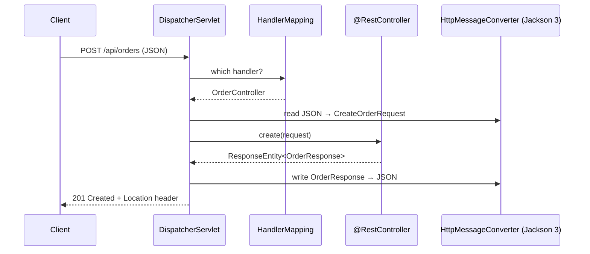

## The request pipeline



The `DispatcherServlet` is the **front controller**: every request goes through it; it finds the handler, converts the body, calls your method and serialises the result.

## A complete resource controller

```java
@RestController
@RequestMapping("/api/orders")
class OrderController {
    private final OrderService orders;

    OrderController(OrderService orders) { this.orders = orders; }

    @GetMapping
    Page<OrderSummary> list(@RequestParam(required = false) OrderStatus status,
                            @PageableDefault(size = 20, sort = "createdAt", direction = DESC) Pageable pageable) {
        return orders.search(status, pageable);
    }

    @GetMapping("/{id}")
    OrderResponse get(@PathVariable long id) {
        return orders.get(id);                                   // throws OrderNotFoundException → 404
    }

    @PostMapping
    ResponseEntity<OrderResponse> create(@Valid @RequestBody CreateOrderRequest request) {
        OrderResponse created = orders.create(request);
        URI location = ServletUriComponentsBuilder.fromCurrentRequest()
            .path("/{id}").buildAndExpand(created.id()).toUri();
        return ResponseEntity.created(location).body(created);  // 201 + Location
    }

    @PatchMapping("/{id}/status")
    OrderResponse updateStatus(@PathVariable long id, @Valid @RequestBody StatusChange change) {
        return orders.changeStatus(id, change.status());
    }

    @DeleteMapping("/{id}")
    @ResponseStatus(HttpStatus.NO_CONTENT)                      // 204
    void cancel(@PathVariable long id) {
        orders.cancel(id);
    }
}
```

## DTOs as records — never expose entities

```java
public record CreateOrderRequest(
        @NotBlank String customerId,
        @NotEmpty List<@Valid LineItemRequest> items,
        @Size(max = 500) String note) {}

public record LineItemRequest(@NotBlank String sku, @Positive int quantity) {}

public record OrderResponse(long id, String customerId, OrderStatus status,
                            BigDecimal total, Instant createdAt) {
    static OrderResponse from(Order o) {
        return new OrderResponse(o.getId(), o.getCustomerId(), o.getStatus(), o.total(), o.getCreatedAt());
    }
}
```

<Callout type="danger" title="Why not return JPA entities?">
Returning entities couples your API to your schema, can leak fields (password hashes, internal flags), triggers lazy-loading during serialisation (`LazyInitializationException` or N+1 queries), and can recurse infinitely through bidirectional relationships. Map to **response records** in the service layer.
</Callout>

## Binding annotations

| Annotation | Binds from | Example |
| --- | --- | --- |
| `@PathVariable` | URI template | `/orders/{id}` |
| `@RequestParam` | Query string / form | `?status=PAID&page=2` |
| `@RequestBody` | Body via message converter | JSON → record |
| `@RequestHeader` | HTTP header | `@RequestHeader("Idempotency-Key") String key` |
| `@CookieValue` | Cookie | |
| `@ModelAttribute` | Query/form params into an object | search filters |
| `@AuthenticationPrincipal` | Spring Security principal | `Jwt jwt` |

## Status codes that mean something

| Situation | Status |
| --- | --- |
| Read OK | `200 OK` |
| Created | `201 Created` + `Location` header |
| Accepted for async processing | `202 Accepted` |
| Success, no body | `204 No Content` |
| Validation failure / malformed JSON | `400 Bad Request` |
| Not authenticated / not allowed | `401` / `403` |
| Missing resource | `404 Not Found` |
| State conflict, optimistic lock failure, duplicate | `409 Conflict` |
| Semantically invalid business rule | `422 Unprocessable Content` |
| Rate limited | `429 Too Many Requests` |

## API versioning (Spring Framework 7)

Spring Framework 7 adds **first-class API versioning**. Configure *how* the version is read once, then declare versions on mappings:

```properties
# Resolve the version from a request header, e.g. "API-Version: 1.1"
spring.mvc.apiversion.use.header=API-Version
spring.mvc.apiversion.default=1.0
spring.mvc.apiversion.supported=1.0,1.1,2.0
```

```java
@RestController
@RequestMapping("/api/customers")
class CustomerController {

    @GetMapping(path = "/{id}", version = "1.0")
    CustomerV1 getV1(@PathVariable long id) { ... }

    @GetMapping(path = "/{id}", version = "1.1+")       // 1.1 and anything newer, until overridden
    CustomerV2 getV2(@PathVariable long id) { ... }
}
```

Versions can come from a header, a query parameter, a path segment (`/api/v2/...`) or the media type. A request for an unsupported version gets a `400` automatically, and the same `version` attribute is supported on the client side by `RestClient` and HTTP service clients.

<Callout type="tip" title="Versioning strategy">
Version only for **breaking** changes. Additive changes (new optional fields, new endpoints) don't need a new version if clients ignore unknown fields — which Jackson does by default in Spring Boot.
</Callout>

## Jackson 3 in Spring Boot 4

Boot 4 uses **Jackson 3** by default. The databind classes moved to the `tools.jackson` package (`tools.jackson.databind.json.JsonMapper`), while the familiar annotations (`@JsonProperty`, `@JsonIgnore`, `@JsonFormat`) still live in `com.fasterxml.jackson.annotation`. Customise through properties (`spring.jackson.*`) or a customizer bean rather than defining your own mapper:

```java
@Bean
JsonMapperBuilderCustomizer jsonCustomizer() {
    return builder -> builder.changeDefaultPropertyInclusion(incl -> incl.withValueInclusion(JsonInclude.Include.NON_NULL));
}
```

## Content negotiation and other formats

`produces` / `consumes` restrict media types; returning `ResponseEntity<byte[]>` or a `Resource` streams files; `ResponseEntity.ok().eTag(...)` enables conditional requests; `@CrossOrigin` or a `WebMvcConfigurer#addCorsMappings` configure CORS.

<Callout type="interview">
*“`@Controller` vs `@RestController`?”* (`@RestController` = `@Controller` + `@ResponseBody` on every method), *“`@PathVariable` vs `@RequestParam`?”*, *“PUT vs PATCH?”* (full replacement vs partial update; PUT should be idempotent), *“How do you version a REST API?”* — URI, header, query param or media type; with Spring Framework 7 you configure the strategy once and use the `version` attribute on mappings. *“Which status code for a created resource?”* — 201 with a `Location` header.
</Callout>
