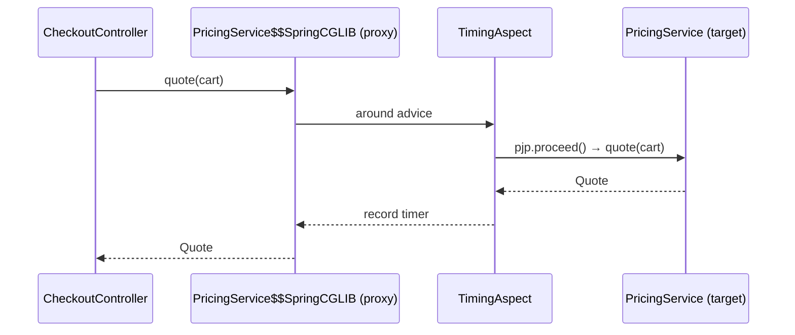

## Cross-cutting concerns

Logging, metrics, security checks, transactions, retries and caching apply to *many* methods across *many* classes. Writing them inline tangles business logic with plumbing. **Aspect-Oriented Programming (AOP)** lets you define that behaviour once and apply it declaratively.

| Term | Meaning |
| --- | --- |
| **Aspect** | A module of cross-cutting behaviour (`@Aspect` class) |
| **Join point** | A point in execution — in Spring AOP, always a **method call** on a bean |
| **Pointcut** | An expression selecting join points (`execution(* com.shop..*Service.*(..))`) |
| **Advice** | Code to run: `@Before`, `@AfterReturning`, `@AfterThrowing`, `@After`, `@Around` |
| **Proxy** | The object Spring injects in place of your bean, which runs advice around calls |

## Writing an aspect

```java
@Target(ElementType.METHOD)
@Retention(RetentionPolicy.RUNTIME)
public @interface Timed { String value() default ""; }

@Aspect
@Component
class TimingAspect {
    private final MeterRegistry registry;
    TimingAspect(MeterRegistry registry) { this.registry = registry; }

    @Around("@annotation(timed)")
    Object time(ProceedingJoinPoint pjp, Timed timed) throws Throwable {
        String name = timed.value().isEmpty() ? pjp.getSignature().toShortString() : timed.value();
        Timer.Sample sample = Timer.start(registry);
        try {
            return pjp.proceed();                          // call the real method
        } finally {
            sample.stop(registry.timer("method.duration", "method", name));
        }
    }
}

@Service
class PricingService {
    @Timed("pricing.quote")
    public Quote quote(Cart cart) { ... }
}
```

Requires `spring-boot-starter-aspectj` (Boot 4's name for the AOP starter) or AspectJ on the classpath.

## How it works: proxies

When the context creates `PricingService`, a `BeanPostProcessor` notices matching advice and wraps the bean in a **proxy** — a CGLIB-generated subclass by default in Spring Boot, or a JDK dynamic proxy for interfaces. Every other bean receives the proxy.



The same mechanism powers `@Transactional`, `@Async`, `@Cacheable`, `@PreAuthorize`, `@Retryable`, `@ConcurrencyLimit` and `@Validated` method validation.

## The self-invocation trap

Because advice lives in the **proxy**, a call from one method of a bean to another method **of the same bean** goes through `this` — the raw target — and skips the advice entirely. Run this simulation of how Spring wires a proxy:

<Playground title="SelfInvocation.java">

```java
import java.lang.annotation.*;
import java.lang.reflect.*;

@Retention(RetentionPolicy.RUNTIME) @interface Transactional {}

interface OrderService {
    void importAll(int count);
    @Transactional void save(int id);
}

class OrderServiceImpl implements OrderService {
    public void importAll(int count) {
        for (int i = 1; i <= count; i++) save(i);     // this.save(...) — bypasses the proxy!
    }
    public void save(int id) { System.out.println("    saving order " + id); }
}

class Main {
    // What Spring does for @Transactional: wrap the bean in a proxy that opens/commits a transaction
    static OrderService proxy(OrderService target) {
        return (OrderService) Proxy.newProxyInstance(OrderService.class.getClassLoader(), new Class<?>[]{OrderService.class},
            (p, method, args) -> {
                boolean tx = method.isAnnotationPresent(Transactional.class);
                if (tx) System.out.println("  BEGIN transaction for " + method.getName());
                Object result = method.invoke(target, args);
                if (tx) System.out.println("  COMMIT");
                return result;
            });
    }

    public static void main(String[] args) {
        OrderService service = proxy(new OrderServiceImpl());

        System.out.println("External call to save() — goes through the proxy:");
        service.save(42);

        System.out.println("External call to importAll(), which calls save() internally:");
        service.importAll(2);                         // no BEGIN/COMMIT for the inner saves!
    }
}
```

</Playground>

Fixes, from most to least preferred:

1. **Move the advised method to another bean** (`OrderImporter` calls `OrderService.save`) — usually also a better design.
2. Put the annotation on the **outer** method if the whole operation should be one transaction.
3. Use programmatic APIs: `TransactionTemplate`, `RetryTemplate`.
4. Inject the bean's own proxy (`@Lazy` self-reference) or use `AopContext.currentProxy()` — works, but is a smell.

<Callout type="warn" title="What proxies can't intercept">
- `private` methods — never proxied
- `final` methods and `final` classes — CGLIB can't override them (Kotlin classes need the `allopen`/Spring compiler plugin)
- `static` methods
- Calls made inside the constructor or `@PostConstruct` of the same bean

Use AspectJ **load-time or compile-time weaving** if you truly need to advise these — rarely worth it.
</Callout>

## Advice types

```java
@Before("execution(* com.shop.orders..*(..)) && args(order,..)")
void validate(Order order) { ... }

@AfterReturning(pointcut = "@annotation(Audited)", returning = "result")
void audit(JoinPoint jp, Object result) { ... }

@AfterThrowing(pointcut = "within(com.shop..*)", throwing = "ex")
void alert(DataAccessException ex) { ... }
```

`@Around` is the most powerful (it can skip or retry the call and change the result) — prefer the narrower advice types when they suffice. Multiple aspects on one join point are ordered with `@Order`.

<Callout type="interview">
*“How does `@Transactional` work?”* — a proxy intercepts the call, opens a transaction via the `PlatformTransactionManager`, invokes the target and commits or rolls back. *“Why doesn't `@Transactional` work when I call the method from the same class?”* — self-invocation bypasses the proxy. *“JDK proxy vs CGLIB?”* — interface-based vs subclass-based; Boot defaults to CGLIB. *“Spring AOP vs AspectJ?”* — runtime proxies on bean method calls only vs full bytecode weaving at any join point.
</Callout>
