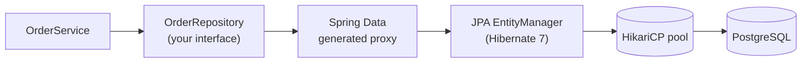

## The layers



- **JPA** (Jakarta Persistence 3.2) is the specification for object-relational mapping.
- **Hibernate** is the implementation Spring Boot uses.
- **Spring Data JPA** generates repository implementations from interfaces, removing DAO boilerplate.

## An entity

```java
@Entity
@Table(name = "orders")
public class Order {

    @Id
    @GeneratedValue(strategy = GenerationType.SEQUENCE)
    private Long id;

    @Column(nullable = false, length = 40)
    private String customerId;

    @Enumerated(EnumType.STRING)                   // never ORDINAL — reordering the enum corrupts data
    @Column(nullable = false)
    private OrderStatus status = OrderStatus.NEW;

    @Column(nullable = false, precision = 12, scale = 2)
    private BigDecimal total = BigDecimal.ZERO;

    @OneToMany(mappedBy = "order", cascade = CascadeType.ALL, orphanRemoval = true)
    private List<OrderLine> lines = new ArrayList<>();

    @Version                                       // optimistic locking
    private long version;

    @CreatedDate private Instant createdAt;
    @LastModifiedDate private Instant updatedAt;

    protected Order() {}                           // required by JPA
    public Order(String customerId) { this.customerId = customerId; }

    public void addLine(String sku, int qty, BigDecimal price) {   // keep both sides in sync
        var line = new OrderLine(this, sku, qty, price);
        lines.add(line);
        total = total.add(price.multiply(BigDecimal.valueOf(qty)));
    }
    // getters…
}
```

## A repository

```java
public interface OrderRepository extends JpaRepository<Order, Long> {

    // Derived queries — parsed from the method name
    List<Order> findByCustomerIdAndStatus(String customerId, OrderStatus status);
    Optional<Order> findFirstByCustomerIdOrderByCreatedAtDesc(String customerId);
    boolean existsByCustomerIdAndStatus(String customerId, OrderStatus status);
    long countByStatus(OrderStatus status);
    Page<Order> findByStatus(OrderStatus status, Pageable pageable);

    // JPQL for anything non-trivial
    @Query("""
           select o from Order o
           where o.status = :status and o.total >= :min
           order by o.total desc
           """)
    List<Order> findLargeOrders(OrderStatus status, BigDecimal min, Limit limit);

    // Native SQL when you need database features
    @Query(value = "select * from orders where created_at > now() - interval '1 day'", nativeQuery = true)
    List<Order> placedInLastDay();

    // Bulk update — bypasses the persistence context
    @Modifying(clearAutomatically = true)
    @Query("update Order o set o.status = 'EXPIRED' where o.status = 'NEW' and o.createdAt < :cutoff")
    int expireOlderThan(Instant cutoff);
}
```

`JpaRepository` already provides `save`, `saveAll`, `findById`, `findAll(Sort/Pageable)`, `deleteById`, `count` and more.

## Projections — fetch only what you need

```java
// Interface-based or record-based projections select only those columns
public record OrderSummary(Long id, OrderStatus status, BigDecimal total) {}

public interface OrderRepository extends JpaRepository<Order, Long> {
    List<OrderSummary> findByCustomerId(String customerId);

    @Query("select new com.shop.orders.OrderSummary(o.id, o.status, o.total) from Order o where o.status = :s")
    Page<OrderSummary> summaries(OrderStatus s, Pageable pageable);
}
```

Projections avoid loading full entities (and their associations) for read-only screens — often the single biggest JPA performance win.

## Pagination and sorting

```java
Pageable page = PageRequest.of(0, 20, Sort.by(Sort.Direction.DESC, "createdAt"));
Page<Order> result = repository.findByStatus(OrderStatus.PAID, page);
result.getContent(); result.getTotalElements(); result.getTotalPages();
```

`Page` runs an extra `count` query; return `Slice<T>` when you only need "is there a next page?". For deep pagination over large tables, prefer **keyset (seek) pagination** with `ScrollPosition` / `Window<T>`.

## Auditing

```java
@Configuration
@EnableJpaAuditing
class JpaConfig {
    @Bean AuditorAware<String> auditor() {
        return () -> Optional.ofNullable(SecurityContextHolder.getContext().getAuthentication()).map(Authentication::getName);
    }
}
```

Add `@EntityListeners(AuditingEntityListener.class)` to entities (or a mapped superclass) and `@CreatedDate`, `@LastModifiedDate`, `@CreatedBy`, `@LastModifiedBy` are filled in automatically.

## Optimistic locking

With a `@Version` column, every `UPDATE` includes `where id = ? and version = ?`. If another transaction changed the row first, zero rows match and Spring throws `ObjectOptimisticLockingFailureException` — map it to **409 Conflict** or retry. This prevents lost updates without holding database locks.

## Essential configuration

```yaml
spring:
  datasource:
    url: jdbc:postgresql://localhost:5432/shop
    hikari:
      maximum-pool-size: 20
  jpa:
    open-in-view: false            # see the callout
    hibernate:
      ddl-auto: validate           # schema is owned by Flyway/Liquibase, never 'update' in prod
    properties:
      hibernate.jdbc.batch_size: 50
      hibernate.order_inserts: true
```

<Callout type="warn" title="Turn off open-in-view">
Spring Boot enables **Open Session in View** by default (and logs a warning). It keeps the persistence context open for the whole web request, so lazy loading "works" in controllers and serializers — silently firing queries outside your service layer and holding DB connections longer. Set `spring.jpa.open-in-view=false` and fetch what you need inside `@Transactional` service methods.
</Callout>

<Callout type="interview">
*“`CrudRepository` vs `JpaRepository`?”* (JpaRepository adds JPA-specific methods like `flush`, `saveAllAndFlush`, batch deletes, and `List` return types), *“How do derived queries work?”*, *“`save()` — insert or update?”* (it calls `persist` for new entities and `merge` for detached ones, based on the id/version), *“What does `@Version` do?”*, and *“Why use projections?”*.
</Callout>
